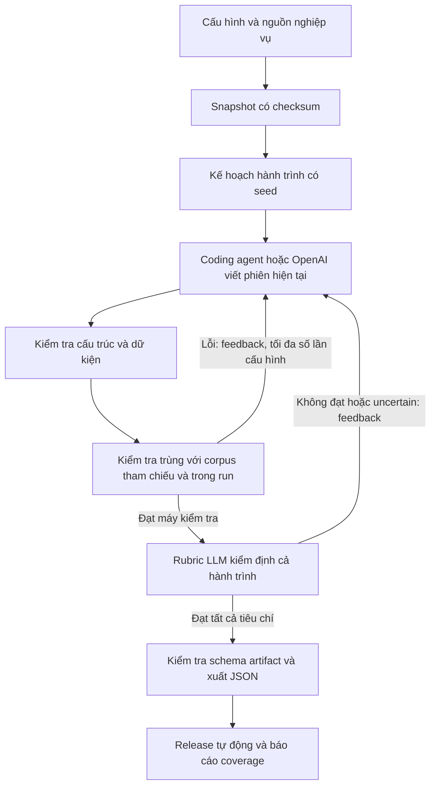

# Pipeline sinh transcript tổng hợp

**Luồng coding agent:** Run lightweight mới sinh toàn bộ hành trình trong một task, rồi review riêng; hỗ trợ `--generation-unit session` cho luồng từng phiên. Cache đặc trưng chống trùng trong checkpoint và chỉ dựng lại planner đầy đủ khi finalize.  [HANDS_OFF.md](HANDS_OFF.md) hướng dẫn agent đã đăng nhập dùng model đang chọn để xử lý task qua file, không cần API key, model argument hay SDK. Chạy `python3 -B -m dataset.pipeline.agent init --profile M1 --output outputs/benchmark/agent_m1_v1` để kiểm tra môi trường, đóng băng M1 và khởi tạo checkpoint; agent tiếp tục qua `next`/`submit`, không phải Python tự gọi model. Profile bắt buộc là M1 hoặc M2. Có checkpoint token/quota, resume và verify. Run agent mới mặc định dùng provenance gọn: không sao chép source, không bắt buộc replay; thêm `--archive` khi init để lưu đầy đủ và replay khi finalize. Manifest export nhận metadata provenance từ run. Giữ working inputs/journal để recovery và kiểm tra trùng; không tự xóa run cũ. Các mục OpenAI bên dưới mô tả runner API tùy chọn vẫn được giữ lại.

Pipeline độc lập với `main/scenarios_prefilled/`, `main/scenarios_complete/` và corpus M2 cũ. Đầu vào là **cấu hình yêu cầu + dữ liệu nghiệp vụ đáng tin cậy**, không phải hội thoại đã hoàn chỉnh. Mỗi phiên được xuất thành **một tệp JSON** có lời khách và agent.



## Yêu cầu và giới hạn phạm vi

- Python 3.11+. Plan, verify, replay và test offline chỉ cần standard library. Gọi live cần [OpenAI Python SDK](https://developers.openai.com/api/docs/quickstart).
- Chỉ tạo **transcript tham chiếu tổng hợp**. Không chạy sales agent, không tạo audio hoặc giả kết quả ASR, diarization, simulator, TSR/RQR/CCR/HR.
- M1: profile đặt ít nhất 120 transcript, 30 khách có hai hotline, 10 khách gọi + chat, ba persona bắt buộc, một ngành, 30 SKU, 20 hành trình và năm ca khó.
- M2: profile đặt ít nhất 250 transcript, 60 khách có hai hotline, 30 khách gọi + chat, có hành trình ba phiên, năm persona, ba ngành, 100 SKU và 40 hành trình.
- Ngưỡng lấy từ [PDF C.1/C.4](<../organizer/SUDO CODE 2026 - Đề Bài Dự Án Cuối Kì.pdf>) và [điều chỉnh BTC](../organizer/DIEU-CHINH-DE.md). M2 còn yêu cầu simulator; cả hai mức còn yêu cầu audio/ASR riêng. Đạt số đếm văn bản không chứng minh hoàn tất M1/M2.

## Cấu hình và nguồn độc lập

Hai cấu hình mẫu: [hackathon_m1.json](configs/hackathon_m1.json), [hackathon_m2.json](configs/hackathon_m2.json). Đường dẫn `domain.root` tính từ vị trí tệp config, không phải working directory. Seed chỉ điều khiển **planner**, không phải seed của model.

| Thành phần | Trách nhiệm |
| --- | --- |
| [agent.py](agent.py) | CLI file task: init M1/M2, next/submit, checkpoint token/quota, resume, finalize và verify |
| [agent_engine.py](agent_engine.py) | Trạng thái sinh/judge/review/repair có thể lưu, dựng lại duplicate index từ snapshot và các phiên đã đạt |
| [agent_response.schema.json](agent_response.schema.json) | Envelope nộp response gắn run/task/checksum; body tuân theo schema của task |
| [domain.py](domain.py) | Adapter nguồn: `btc` dùng mock BTC và catalog/policy; `json` dùng catalog tĩnh do người dùng cung cấp |
| [planner.py](planner.py) | Tạo khách tổng hợp, persona, 2–3 phiên liên kết, kênh, ngày, mục tiêu và ca khó; kiểm chứng dữ kiện trước khi model viết |
| [prompts/generate.md](prompts/generate.md) | Hướng dẫn tiếng Việt về tính tự nhiên, dữ kiện, vai nói và phản hồi lỗi |
| [providers.py](providers.py) | OpenAI Responses API với Structured Outputs; recorder và replay provider |
| [checks.py](checks.py) | Kiểm tra ID/schema, số và số tiền, sản phẩm, kết quả tham chiếu, giới hạn lượt và một số claim không có chứng cứ |
| [duplicates.py](duplicates.py) | Hash và similarity xác định; không dùng model để tính số đếm corpus |
| [prompts/duplicate.md](prompts/duplicate.md) | Model phán xét các cặp gần trùng nhưng chưa vượt ngưỡng từ chối |
| [runner.py](runner.py) | Snapshot, retry/budget, commit hành trình, xuất tự động và verify đầy đủ |
| [review.py](review.py), [prompts/review.md](prompts/review.md) | Kiểm định tự động bảy tiêu chí, có trích dẫn đối chiếu từ thoại |
| [response.schema.json](response.schema.json) / [transcript.schema.json](transcript.schema.json) | Schema JSON model trả về / artifact đầy đủ được xuất |

Adapter BTC chỉ đọc catalog, mock tham chiếu, policy và tài liệu yêu cầu. Nó không đọc M1/M2 scenario có sẵn. Mỗi khách dùng ID thử nghiệm riêng như `SYN-C0001`, không sinh số điện thoại để liên hệ người thật. Mock order/exchange chạy trên state nội bộ riêng để dựng sự kiện **tham chiếu**, không chạm database hay tạo đơn thật.

Adapter `json` giúp dùng nguồn khác. Catalog có dạng:

```json
{
  "reference_date": "2026-10-15",
  "products": [
    {"sku": "TEST-A", "name": "Sản phẩm thử nghiệm", "category": "gia-dung",
     "price_vnd": 123000, "stock": 10}
  ]
}
```

Config tương ứng dùng `domain: {"kind": "json", "root": "./domain", "catalog": "catalog.json", "policies": []}` cùng các khối planning/generation/duplicates/validation/requirements như mẫu. Adapter này chỉ xác nhận giá/tồn kho tĩnh, **không** giả tạo khả năng thực thi order/exchange hoặc khuyến mãi. Muốn nguồn có nghiệp vụ khác, bổ sung adapter theo giao diện `Domain` và test dữ kiện. Hiện persona và bốn loại ca khó là thiết kế telesales được cấu hình; không phải generator tự hiểu mọi domain.

## Sử dụng

Để coding agent dùng phiên/model đang chọn và xử lý task qua file, bắt đầu tại [HANDS_OFF.md](HANDS_OFF.md); entrypoint là `python3 -B -m dataset.pipeline.agent`. Runner API riêng dùng `python3 -B -m dataset.pipeline.setup_env`: mặc định không gọi API LLM; `--mode pilot`/`full` yêu cầu model, credential và ngân sách API rõ ràng. Setup API dùng dependency cố định trong [requirements.lock](requirements.lock); các lệnh bên dưới là giao diện từng bước của runner API.

Chạy từ gốc repository. Mỗi `--output` phải là thư mục **chưa tồn tại**, nằm ngoài mã pipeline. Chọn đường dẫn khác cho mỗi run. Không sửa artifact đã seal; sửa config/nguồn/prompt và tạo plan mới.

### 1. Đóng băng input và tạo plan, không dùng API

```bash
python3 -B -m dataset.pipeline plan \
  --config dataset/pipeline/configs/hackathon_m1.json \
  --output outputs/benchmark/synthetic_m1_plan_v1
```

Thay config bằng `hackathon_m2.json` để dùng mục tiêu M2. Trên nguồn BTC hiện tại, M1 lên kế hoạch **120 phiên/50 khách**, M2 **260 phiên/100 khách** (một số persona thêm cuộc hotline thứ ba). Đây là **số kế hoạch**, chưa phải transcript đã sinh.

Có thể thêm `--reference-dir <thu_muc_transcript_json>` nhiều lần để tránh trùng với corpus đã có. Mỗi thư mục chỉ chứa transcript JSON có `transcript_id` và `utterances` (`speaker`, `text`). Pipeline snapshot các bản tham chiếu để lần replay không phụ thuộc tệp ngoài đã thay đổi. Thư mục tham chiếu là tùy chọn, không có hardcoded dependency vào M1/M2.

### 2. Gọi OpenAI cho một hành trình thử

```bash
python -m pip install -r dataset/pipeline/requirements.txt
# Thiết lập OPENAI_API_KEY trong môi trường local; không ghi vào config/Git.
# OPENAI_MODEL là model ID có quyền truy cập và hỗ trợ Structured Outputs.
python3 -B -m dataset.pipeline generate \
  --plan outputs/benchmark/synthetic_m1_plan_v1 \
  --output outputs/benchmark/synthetic_m1_pilot_v1 \
  --model "$OPENAI_MODEL" --limit 1
```

Model được chọn theo `--model` → `OPENAI_MODEL` → config. Giá trị mẫu `SET_OPENAI_MODEL` bị từ chối khi gọi live. SDK đọc `OPENAI_API_KEY` từ môi trường; công cụ không tự load `.env`. Không có model mặc định hoặc chuyển provider ngầm. Script không gửi temperature/seed khi chưa biết model hỗ trợ; metadata ghi `null`, không hứa generation giống nhau. Client dùng timeout 60 giây, tắt SDK retry, `store=false` (không phải cam kết về mọi chính sách lưu trữ của provider).

Mặc định chỉ chạy **một hành trình**. Dùng `--all` sau khi xem pilot để chạy toàn bộ. `generation.max_api_calls` bao gồm lượt sinh, duplicate judge và review toàn hành trình; cạn budget hoặc lỗi provider làm dừng có báo cáo, không bịa response. Thiếu credential/dependency thì không gọi API. Xử lý response bị từ chối, thiếu, sai JSON hoặc sai nội dung như lỗi, lưu raw artifact để kiểm tra.

### 3. Kiểm tra trùng và vòng lặp sửa

1. So sánh cả hội thoại sau NFC/casefold, chuẩn hóa entity và số **chỉ trong bản so sánh local**. Thay tên/SKU/giá mà giữ nguyên đoạn thoại vẫn bị nhận là bản sao. Không thay model input hoặc transcript gốc bằng token.
2. Hash bằng nhau → từ chối. Jaccard trên word-trigram ≥ `reject_threshold` → từ chối. Trong khoảng review → judge so sánh tối đa ba bản gần nhất, giải thích bằng tiếng Việt.
3. Judge trả sai schema/không đủ dữ liệu → không tự chấp nhận. Tắt `judge_ambiguous` thì cặp không rõ phải được rewrite hoặc quarantine, không chuyển sang bước duyệt tay.
4. Feedback nêu ID phiên và lỗi; thử lại **cả hành trình** trong giới hạn `max_attempts`. Facts/ngày/kết quả nghiệp vụ không đổi. Failed attempt không đi vào duplicate index chính. Chỉ commit khi mọi phiên của hành trình đạt máy kiểm tra.
5. Hết lượt → quarantine, báo phần thiếu. Pipeline không hạ ngưỡng similarity hoặc đổi đáp án để đủ số lượng.

Ngưỡng mẫu `0.65`/`0.90` là **heuristic ban đầu**, không phải tiêu chuẩn BTC. Cần gán nhãn cặp trùng/khác trong pilot để hiệu chỉnh. Cùng persona, sản phẩm, câu chào hoặc sự thật bắt buộc không tự có nghĩa trùng; judge cần phân biệt. Lexical search có thể bỏ sót paraphrase xa và judge có thể sai; không cam kết tìm hết trùng ngữ nghĩa.

### 4. Replay không API và xác minh artifact

```bash
python3 -B -m dataset.pipeline replay \
  --run outputs/benchmark/synthetic_m1_pilot_v1 \
  --output outputs/benchmark/synthetic_m1_replay_v1

python3 -B -m dataset.pipeline verify \
  --run outputs/benchmark/synthetic_m1_pilot_v1
```

Replay dùng lại request/response đã lưu, kiểm tra request hash và thứ tự gọi (gồm review); không import SDK hoặc dùng credential. Kế hoạch được dựng lại từ snapshot để phát hiện khác biệt. Code/prompt/schema hoặc artifact thay đổi thì từ chối. `verify` kiểm tra cả checksum, schema artifact, provenance, response gốc, bằng chứng review, liên kết phiên và số đếm manifest/coverage. Tệp transcript/manifest có thể được tái tạo giống từng byte khi input và code giữ nguyên; thời điểm và metadata của run mới không được coi là giống. Đây không phải lời hứa gọi API lần nữa sẽ cho cùng kết quả.

Run lưu snapshot, seed, nguồn/code/prompt/schema hashes, phiên bản Python và SDK thực tế khi live. `requirements.txt` chặn major SDK; để tái tạo môi trường live, pin đúng phiên bản SDK ghi trong `run.json`. Hash phát hiện thay đổi, không phải chữ ký chứng thực nguồn. Run bị gián đoạn chỉ có các call đã lưu; replay không tự tạo response còn thiếu. Hiện không có resume live trong cùng thư mục; tạo run mới thay vì ghi đè bằng chứng.

### 5. Review và xuất tự động, không cần người duyệt

Sau khi mọi phiên của một hành trình qua kiểm tra cứng và dedup, model reviewer nhận toàn bộ hành trình, kế hoạch và nguồn. Reviewer dùng một lượt gọi riêng. Mặc định `review.model: SAME_AS_GENERATOR`; cấu hình model khác hoặc dùng `--review-model` nếu muốn tách model sinh và kiểm định. Metadata lưu cả hai cấu hình; dùng cùng model không được mô tả là hai hệ thống độc lập về sai số.

Bảy tiêu chí bắt buộc: **factuality, continuity, persona, naturalness, diversity, outcome_alignment, privacy**. Mỗi tiêu chí phải có đúng một verdict `pass|fail|uncertain`, lý do không rỗng và trích dẫn nguyên văn có `transcript_id`, `turn_index` từ 0. Continuity phải dẫn ít nhất hai phiên. Checker đối chiếu trích dẫn với lời thoại thật, không tin citation bịa hoặc kết quả thiếu tiêu chí.

Chỉ tất cả `pass` mới được tự động xuất. `fail`, `uncertain`, schema/citation lỗi đều tạo feedback để sinh lại cả hành trình trong số lượt còn lại. Hết lượt thì quarantine; provider/budget dừng thì không tự phê duyệt. Model review không được ghi đè kết quả kiểm tra cứng.

Trước khi ghi mỗi artifact, checker kiểm tra toàn bộ [transcript.schema.json](transcript.schema.json): trường bắt buộc, kiểu dữ liệu lồng nhau, enum, ISO date, provenance hash và trường thừa. Export chỉ commit cả hành trình, giữ liên kết phiên. Không có `review_template.json`, file quyết định người duyệt hoặc lệnh `review` thủ công nữa.

```bash
python3 -B -m dataset.pipeline generate \
  --plan outputs/benchmark/synthetic_m1_plan_v1 \
  --output outputs/benchmark/synthetic_m1_auto_v1 \
  --model "$OPENAI_MODEL" --review-model "$OPENAI_REVIEW_MODEL" --limit 1
```

`OPENAI_REVIEW_MODEL` trong ví dụ là biến do người dùng chọn; bỏ `--review-model` để dùng cấu hình. Mẫu config có `review.max_output_tokens: 4000`. Review tiêu thụ API budget như các lần gọi khác. Kết quả ghi là **automated_approved**, không phải human-approved hoặc chứng minh mọi ngữ nghĩa đều đúng. Không còn bước người duyệt bắt buộc trong pipeline.

## Đầu ra

```text
plan_run/
  config.json · plans.json · catalog.json
  snapshot/domain/ · snapshot/references/
  coverage_report.json · run.json · seal.json

generation_run/
  plan/                         # bản chụp plan để replay độc lập
  calls/000001.json             # request chính xác, raw response, metadata
  attempts/J0001/01/*.json      # lỗi và bằng chứng similarity từng lần thử
  transcripts/J0001-S01.json    # JSON riêng, chỉ khi cả hành trình auto-review đạt
  schemas/                      # schema response, artifact và review đã đóng băng
  reviews/J0001/attempt_01.json # verdict + citation + request/response hashes
  manifest.json · quarantine.json
  coverage_report.json · validation_report.json · duplicate_report.json
  automated_review_report.json · DATASET_CARD.md · run.json · seal.json
```

Artifact transcript có `transcript_id`, `customer_id`, `journey_id`, `session_index`, `previous_transcript_id`, ngày, kênh, persona, ca khó, `utterances`, outcome và provenance. `origin: synthetic_llm_reference`, `is_actual_agent_trace: false`, `review_status: automated_approved`. Provenance có hash của bản review được lưu; manifest liên kết review tương ứng. Không đưa metadata chấm riêng vào đoạn thoại làm đầu vào cho sales agent được đánh giá.

`DATASET_CARD.md` được viết tự động bằng tiếng Việt với phương pháp, phân bố thực tế, hạn chế và xử lý thông tin cá nhân. Số đếm xuất lấy từ **hành trình thực sự đã qua máy kiểm tra và rubric tự động**, không lấy tổng plan để báo đã sinh đủ.

Exit code: `0` khi đạt ngưỡng số đếm tương ứng; `3` khi thiếu coverage (bao gồm pilot); `2` khi lỗi/quarantine/provider dừng. Status generation: `automated_release` hoặc `automated_partial_coverage`; chỉ xuất hành trình đã qua review tự động. Exit `0` của plan không có nghĩa đã sinh transcript. Mọi báo cáo văn bản vẫn ghi audio chưa hoàn tất.

## Quyền riêng tư và tính đúng

Theo yêu cầu cấu hình hiện tại, **không có masker**. Dữ kiện cần thiết và lời thoại đi nguyên văn vào request; thư mục run có quyền riêng tư và `.gitignore`, không tự xuất bản ra dịch vụ ngoài ngoài lời gọi API được chọn. Adapter BTC không gửi toàn bộ CRM cho model, nhưng nguồn tùy chỉnh có thể chứa PII. Rà soát nguồn, prompt, response và quyền dùng dữ liệu trước khi chia sẻ. Điều này không thay yêu cầu che PII trước external model của PDF hoặc chứng minh đã xử lý đủ quyền riêng tư.

Validators chỉ kiểm tra một phần: schema/ID, số, giá dạng literal, entity chính, một số claim, provenance và nguồn mock. Chúng không chứng minh mọi phát ngôn đúng ngữ nghĩa, mọi kế hoạch hợp lý hoặc mọi ca khó đã được diễn đạt thành công. Không dùng số lượng candidate như bằng chứng agent đạt TSR/CCR/RQR/HR. Rubric LLM kiểm tra chất lượng ngôn ngữ và nghĩa tự động nhưng vẫn có thể sai; pipeline không yêu cầu người duyệt và không coi model review là chứng nhận hoàn hảo. Simulator/đánh giá agent là workflow khác.

## Kiểm thử offline

```bash
python3 -B -W ignore::ResourceWarning -m unittest discover \
  -s dataset/pipeline/tests -v
```

Test dùng fake provider được ghi rõ, không sinh dữ liệu production hoặc chứng minh naturalness thực tế. Bao phủ planner không phụ thuộc M1, snapshot/code drift, giá/ID giả, dedup đổi tên/số, iterative feedback, bounded retry/budget, commit theo hành trình, model judge lỗi, replay giống byte, OpenAI strict-schema payload/refusal, rubric pass/fail/uncertain, citation bịa/thiếu, schema JSON xuất và gate review tự động. Các mock BTC có thể phát ResourceWarning do cách mở file trong mã BTC; test có thể bỏ lọc warning để xem.

Tham khảo API: [OpenAI Structured Outputs](https://developers.openai.com/api/docs/guides/structured-outputs). API key không được lưu vào cấu hình hoặc artifact.
