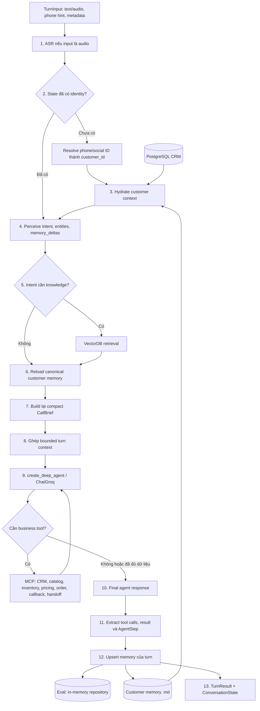

# Kiến trúc Telesale Deep Agent

Tài liệu này mô tả pipeline hiện tại của `DeepAgentHarness`, trách nhiệm của
từng giai đoạn và ranh giới dữ liệu giữa PostgreSQL CRM, customer memory dạng
file `.md`, RAG và DeepAgent.

Pipeline là kiến trúc hybrid:

- Phần application chạy tuần tự và có tính quyết định để nhận diện khách hàng,
  lấy đúng dữ liệu, giới hạn context và persist memory.
- `create_deep_agent()` đảm nhiệm reasoning, chọn MCP business tool và tạo câu
  trả lời.
- DeepAgent không sở hữu CRM và không tự ghi customer memory. Hai tác vụ này do
  application pipeline kiểm soát.

## 1. Tổng quan pipeline



Luồng dữ liệu quan trọng nhất giữa hai turn là:

```text
Turn N
  -> Perceiver tạo memory_deltas
  -> DeepAgent có thể tạo thêm fact qua pricing/order tool results
  -> Persister upsert các fact theo key
  -> repository trở thành canonical memory mới

Turn N+1
  -> reload canonical memory
  -> build CallBrief mới
  -> DeepAgent nhận brief đã phản ánh kết quả Turn N
```

Context vì vậy không tăng tuyến tính theo toàn bộ transcript. Mỗi turn dùng một
projection có giới hạn của memory và một đoạn hội thoại gần nhất.

## 2. Ba scope trạng thái

| Scope | Thành phần | Tuổi thọ | Vai trò |
|---|---|---:|---|
| Turn | `TurnContext` | Một lần `run_turn()` | Workspace tạm cho perception, retrieval, brief, tool results và persistence |
| Call | `ConversationState` | Nhiều turn trong cùng cuộc gọi | Identity, vài message gần nhất, working state và turn number |
| Customer | `CustomerMemoryRepository` | Qua nhiều call/session | Fact, preference, episode và foresight lâu dài theo `customer_id` |

`ConversationState` là nguồn continuity chính trong một cuộc gọi. Checkpointer
của DeepAgent không được dùng làm customer memory lâu dài.

## 3. Phân tích từng giai đoạn

### Giai đoạn 0 — Bootstrap và khởi tạo DeepAgent

Điểm vào production/evaluation là `build_deepagent_harness_async()`.

Chức năng:

1. Load environment và chọn model từ `GROQ_MODEL`, sau đó `MODEL_NAME`; mặc định
   là `openai/gpt-oss-20b`.
2. Chọn memory adapter theo chế độ:
   - `durable`: file `.md` + deterministic `TurnMemoryPersister` mặc định;
     chỉ dùng `LLMPersister` khi `MEMORY_PERSISTER_MODE=llm_episode`;
   - `evaluation`: repository trong RAM, có thể seed từ file, +
     `TurnMemoryPersister`;
   - `disabled`: repository rỗng và không persist.
3. Khởi tạo ASR, perceiver, identity resolver, PostgreSQL CRM retriever,
   VectorDB retriever và CallBrief builder.
4. Mở hai MCP server qua stdio:
   - DB server: CRM, catalog, inventory, pricing và order;
   - Workflow server: callback và human handoff.
5. Đọc `soul.md`, `agent.md`, `tools.md` một lần và truyền trực tiếp làm system
   prompt. Đây là cấu hình/persona của agent, không phải customer memory.
6. Tạo graph bằng `create_deep_agent()`.

DeepAgent mặc định có filesystem, shell và general-purpose subagent. Telesale
pipeline không cần các capability này, nên filesystem middleware được thay bằng
bản có system prompt rỗng và các built-in tool không dùng bị ẩn. Việc này giữ
nguyên DeepAgent runtime nhưng giảm system prompt và tool schema gửi lên Groq.

Kết quả của giai đoạn bootstrap là một `DeepAgentHarness` đã mở MCP sessions và
sẵn sàng nhận turn. Harness phải được đóng bằng `__aexit__()` để giải phóng các
subprocess/session.

### Giai đoạn 1 — Nhận input và ASR

Input là `TurnInput`, gồm:

- `conversation_id`;
- `text` hoặc `audio`;
- channel;
- `customer_hint`, thường là số điện thoại;
- metadata như `call_date`, `call_key`, `scenario_id`.

Nếu đã có text thì pipeline dùng trực tiếp. Nếu chỉ có audio, `ASREngine` chuyển
audio thành transcript và ghi lại vào `TurnInput.text`.

Giai đoạn này không truy cập CRM hoặc memory. Output duy nhất cần thiết cho các
bước sau là customer utterance dạng text.

### Giai đoạn 2 — Resolve identity

Identity chỉ resolve khi `ConversationState.identity` chưa tồn tại.

`HintIdentityResolver` dùng phone/social hint để truy vấn PostgreSQL và chuyển
định danh bên ngoài thành canonical `customer_id`, ví dụ:

```text
0984726714 -> C031
```

Output là `CustomerIdentity` với các field tách biệt:

- `customer_id`: khóa nội bộ dùng để đọc CRM và memory;
- `phone`, `zalo_id`, `fb_id`: external identifiers;
- `profile` và confidence.

Từ bước này trở đi, filesystem memory luôn được address bằng `customer_id`,
không dùng phone làm tên thư mục. Điều này tránh việc đổi phone làm mất liên kết
memory hoặc hai channel tạo hai bộ nhớ khác nhau cho cùng khách hàng.

### Giai đoạn 3 — Hydrate CRM và customer memory

Ở lần đầu của cuộc gọi, `CustomerContextService.hydrate()` ghép hai nguồn nhưng
không trộn ownership:

```text
PostgreSQL CRM
  -> verified customer profile
  -> past orders / business history

CustomerMemoryRepository
  -> facts
  -> profile/behaviors
  -> episodes/foresights
```

Kết quả được giữ riêng trong state:

- `state.customer_profile`: dữ liệu CRM đã xác minh;
- `state.past_history`: order history và compatibility view;
- `state.customer_memory`: memory do agent học được.

PostgreSQL không chứa conversation memory và table `customer_sessions` không
còn được dùng. File memory không trở thành nguồn sự thật cho trạng thái order,
inventory hoặc giá.

### Giai đoạn 4 — Perception

`LLMPerceiver` phân tích utterance hiện tại thành `Perception`:

- `intent`: intent chính;
- `intents`: tất cả intent phát hiện được;
- `entities`: product, quantity, budget hoặc entity liên quan;
- `memory_deltas`: fact lâu dài mới được khách hàng xác nhận;
- confidence và transcript gốc.

Ví dụ:

```json
{
  "intent": "product_inquiry",
  "entities": {"category": "air_purifier"},
  "memory_deltas": {
    "room_area_m2": 25,
    "budget_vnd": 5000000,
    "has_children": true
  }
}
```

Transcript customer được append vào `state.messages`. `memory_deltas` được đưa
vào working state nhưng chưa ghi ngay xuống repository; việc ghi diễn ra sau
khi DeepAgent hoàn thành để persister có thể kết hợp thêm kết quả tool.

PII được mask trước khi utterance được gửi tới external perception LLM.

### Giai đoạn 5 — Retrieval/RAG

Pipeline dùng intent taxonomy để quyết định có cần knowledge retrieval hay
không. Những intent thuần hội thoại hoặc không cần kiến thức có thể bỏ qua
VectorDB.

Khi cần, `VectorDBRetriever` trả `RetrievedContext`:

- product/catalog knowledge;
- policy chunks;
- active promotions;
- customer/history references nếu adapter cung cấp.

Retrieval chỉ cung cấp knowledge, không được phép thay thế authoritative tool:

- giá hiện tại phải lấy từ pricing tool;
- tồn kho phải lấy từ inventory tool;
- order phải tạo/tra cứu qua order tool.

Hiện tại compact catalog/policy hints chỉ được inject trực tiếp ở turn đầu của
call để hạn chế context. Ở các turn sau, agent phải dùng business MCP tool khi
cần dữ liệu vận hành mới nhất.

### Giai đoạn 6 — Reload canonical memory

Sau perception/retrieval và trước khi build brief,
`CustomerContextService.refresh_memory()` đọc lại repository bằng
`customer_id`.

Mục đích của reload là bảo đảm Turn N+1 nhìn thấy chính xác các write đã hoàn
thành ở cuối Turn N, kể cả khi repository được thay thế bằng adapter khác.

Giai đoạn này chỉ reload customer memory; CRM không bị query lại mỗi turn. CRM
profile/order history đã hydrate ở đầu call vẫn nằm trong state.

### Giai đoạn 7 — Build CallBrief mới cho mỗi turn

`LLMCallBriefBuilder` tạo lại `CallBrief` sau mỗi lần reload. Brief gồm:

- canonical customer ID và customer name;
- summary của episode/history gần nhất;
- needs/facts hiện có;
- objections và unresolved issues nếu có;
- active promotions;
- `verified_customer_data` từ CRM;
- `remembered_preferences` từ file/RAM memory;
- relevant episodes.

CallBrief là read model dành cho agent, không phải một storage layer. Nó có thể
được build lại bất kỳ lúc nào từ CRM + memory + current turn context.

Khi inject vào DeepAgent, pipeline chỉ lấy projection cô đọng:

- tên, saved address và phone cần cho business action;
- summary;
- tối đa một số needs;
- tối đa 8 canonical facts, mỗi value bị giới hạn độ dài;
- fallback sang một số legacy atomic fact nếu chưa có `facts.md`.

Nhờ vậy việc build lại brief mỗi turn không đồng nghĩa với việc append toàn bộ
memory vào prompt.

### Giai đoạn 8 — Ghép bounded turn context

User message gửi tới DeepAgent gồm utterance hiện tại và các system note nhỏ:

- canonical customer ID;
- current call date;
- current intent/entities;
- compact CallBrief;
- tối đa 4 message gần nhất của cuộc gọi;
- compact RAG hints ở turn đầu nếu có.

Các giới hạn mặc định:

```dotenv
DEEPAGENT_RECENT_MESSAGE_COUNT=4
DEEPAGENT_RECENT_MESSAGE_CHARS=450
DEEPAGENT_RECENT_CONTEXT_CHARS=1600
GROQ_MAX_OUTPUT_TOKENS=768
```

Raw transcript của toàn bộ cuộc gọi, toàn bộ episode files và raw tool outputs
không được copy vào mọi turn.

### Giai đoạn 9 — DeepAgent reasoning và MCP tools

`create_deep_agent()` nhận bounded context và tự quyết định:

1. Có đủ dữ liệu để trả lời chưa.
2. Có cần gọi business tool không.
3. Dựa trên tool result, cần gọi thêm tool hay tạo final response.

Các nhóm tool chính:

| Nhóm | Tool DeepAgent | Mục đích |
|---|---|---|
| CRM | `retrieve_customer_profile` | Lấy lại hồ sơ khi thật sự cần |
| Catalog | `search_catalog` | Tìm sản phẩm phù hợp |
| Inventory | `check_inventory` | Xác minh tồn kho |
| Pricing | `get_pricing_quote` | Xác minh giá/promotion theo ngày gọi |
| Order | `create_new_order`, `check_order_status` | Tạo hoặc tra cứu đơn |
| Workflow | `mcp_schedule_callback` | Hẹn callback |
| Handoff | `mcp_escalate_to_human` | Chuyển nhân viên thật |

DeepAgent không được expose memory-write tool trong flow chính. Nếu cho cả agent
và application persister cùng ghi memory, một fact có thể bị ghi hai lần hoặc
ghi trước khi business tool hoàn thành.

### Giai đoạn 10 — Checkpoint và continuity

`MemorySaver` vẫn được dùng làm checkpointer nội bộ của graph, nhưng thread ID
mặc định có scope theo turn:

```text
<conversation_id>__turn_1
<conversation_id>__turn_2
...
```

Mỗi invocation vẫn giữ được toàn bộ reasoning/tool loop bên trong chính turn
đó. Sang turn kế tiếp, DeepAgent không replay raw graph history của turn trước;
continuity được truyền bằng compact recent messages + rebuilt CallBrief.

Có thể đặt `DEEPAGENT_CHECKPOINT_SCOPE=conversation`, nhưng không nên dùng cho
BTC eval hoặc Groq account có TPM thấp vì input sẽ tăng theo mỗi lượt.

### Giai đoạn 11 — Chuẩn hóa tool trace và response

Sau khi graph kết thúc, harness:

1. Tìm final assistant message của turn hiện tại.
2. Ghép từng AI tool call với `ToolMessage` result theo tool call ID.
3. Chuẩn hóa tên MCP sang tên BTC canonical, ví dụ:
   `get_pricing_quote -> pricing.get_quote`.
4. Chuẩn hóa một số arguments như `payment_method -> payment`.
5. Chuyển mỗi tool execution thành `AgentStep` gồm plan, policy, result và
   observation.
6. Append final response vào `state.messages`.

Output này cho phép eval runner ghi chính xác `tool_calls`, `claims`, latency và
facts được sử dụng, thay vì chỉ lưu text response.

### Giai đoạn 12 — Persist memory sau turn

Persister chạy sau khi final response và tool results đã có.

Nguồn fact được ghi:

- `memory_deltas` từ Perceiver;
- `product_advised` từ pricing/order tool;
- `price_quoted_vnd` từ authoritative pricing/order result;
- `promo_code` từ pricing result;
- các field mới khác nếu perception schema sinh ra.

Canonical facts được lưu trong:

```text
data/memory-root/users/<customer_id>/facts.md
```

Ví dụ:

```markdown
# Customer Facts

- budget_vnd: 6000000
- room_area_m2: 25
- product_advised: "SKU-AP-Y"
```

Persistence dùng upsert theo key:

- key chưa tồn tại: `set/create`;
- key đã tồn tại và value thay đổi: `supersede/update`;
- file chỉ giữ một canonical value cho mỗi key.

Các thư mục `episodes/`, `atomic_facts/`, `foresights/` vẫn được đọc để tương
thích memory cũ. Durable mode còn có thể tạo episode summary cho turn bằng
`LLMPersister`; evaluation mode dùng deterministic `TurnMemoryPersister` và
không ghi xuống memory-root thật.

Sau persistence, `state.customer_memory` được cập nhật. Turn kế tiếp vẫn reload
từ repository trước khi build brief, tránh phụ thuộc vào object cache trong
state.

### Giai đoạn 13 — Trả TurnResult

`TurnResult` chứa:

- response text;
- perception và resolved identity;
- retrieved context và CallBrief đã dùng;
- normalized `tool_calls`;
- `memory_writes` của turn;
- `AgentStep`/observation;
- `ConversationState` mới với `turn_number` đã tăng.

API/UI dùng response text. Eval runner dùng phần còn lại để tạo JSONL trace và
chấm tool correctness, memory carry-over, grounded claims và latency.

## 4. Phân quyền dữ liệu

| Dữ liệu | Nguồn sự thật | Có được memory ghi đè không? |
|---|---|---:|
| `customer_id`, phone, name, region | PostgreSQL CRM | Không |
| Order và order status | PostgreSQL/business tool | Không |
| Inventory | Inventory tool | Không |
| Giá/promotion hiện tại | Pricing tool | Không |
| Budget, room size, preference, blocker | Customer memory `.md` | Có, bằng upsert fact mới |
| Tóm tắt tương tác trước | Episode `.md` | Có thể bổ sung episode mới |
| Persona và tool rules của agent | `data/memory-root/agents/telesales_agent/*.md` | Không phải customer memory |

Quy tắc xử lý xung đột:

1. Dữ liệu nghiệp vụ đã xác minh luôn ưu tiên CRM/tool result.
2. Customer memory chỉ lưu điều khách đã nói, preference và historical context.
3. CallBrief trình bày hai nguồn cho agent nhưng không hợp nhất chúng thành một
   bảng dữ liệu không rõ provenance.

## 5. Evaluation flow

Mỗi scenario được cô lập:

- reset in-memory customer repository;
- seed lịch sử được load vào repository evaluation;
- mỗi call có `ConversationState` và conversation ID riêng;
- carry-over giữa các call chỉ đi qua customer memory;
- `baseline_no_memory` dùng repository rỗng và không có persister;
- `full` dùng in-memory upsert và rebuild CallBrief như production.

Runner phân biệt hai lỗi Groq:

- HTTP 413/request too large: prompt vượt giới hạn, không retry cùng payload;
- HTTP 429/rolling TPM: mặc định dừng turn ngay để không replay toàn bộ NLU và
  DeepAgent. Chỉ backoff/retry khi người chạy chủ động đặt `--max-retries > 1`.

Runner mặc định nghỉ 20 giây giữa các turn. `--sleep` chỉ giúp 429. Nó không thể
sửa 413; 413 phải được xử lý bằng bounded context, checkpoint theo turn và giảm
system/tool schema.

## 6. Invariants cần giữ khi mở rộng

1. Mọi CRM và memory lookup sau identity resolution phải dùng `customer_id`.
2. DeepAgent không được ghi customer memory trực tiếp.
3. Fact từ giá/order phải lấy từ tool result, không trích từ câu model tự nói.
4. Persist chỉ chạy sau khi tool loop và final response hoàn thành.
5. Turn sau phải reload repository trước khi build brief.
6. CallBrief là projection có giới hạn, không phải full memory dump.
7. Không đổi checkpoint sang conversation scope nếu chưa có token-budget test.
8. Evaluation không được ghi vào durable customer files.
9. PostgreSQL không lưu lại transcript/session memory đã chuyển sang `.md`.

## 7. File implementation chính

- `src/telesale_agent/bootstrap.py`: wiring và chọn memory mode.
- `src/telesale_agent/core/deepagent_pipeline.py`: orchestration của toàn turn.
- `src/telesale_agent/application/customer_context.py`: hydrate CRM + memory và
  refresh memory theo turn.
- `src/telesale_agent/adapters/llm/llm_perceive.py`: perception và memory delta.
- `src/telesale_agent/adapters/llm/llm_call_brief.py`: build CallBrief.
- `src/telesale_agent/adapters/memory/file_memory.py`: durable `.md` repository.
- `src/telesale_agent/adapters/memory/in_memory.py`: isolated eval repository.
- `src/telesale_agent/adapters/memory/turn_persist.py`: deterministic turn
  upsert.
- `src/telesale_agent/adapters/llm/llm_persist.py`: durable episode persistence.
- `src/eval/generate_traces.py`: BTC scenario runner và trace serialization.

Phần giải thích riêng về memory/upsert/context limit nằm tại
`docs/agent/deepagent_context_memory_flow.md`.

Báo cáo trạng thái hoàn thiện, kết quả SAMPLE-03 và backlog ưu tiên nằm tại
`docs/agent/deep_agent_implementation_status.md`.

## 8. Giới hạn hiện tại

- File memory chưa có lock cho nhiều process cùng ghi một customer. Production
  nhiều worker cần single-writer service hoặc file lock.
- Nếu bật `MEMORY_PERSISTER_MODE=llm_episode`, `LLMPersister` tạo episode bằng
  một LLM call bổ sung; mặc định deterministic không có request này.
- In-process `MemorySaver` vẫn giữ checkpoint của các turn cho tới khi harness
  bị đóng. Nó không làm prompt turn sau lớn lên khi dùng turn scope, nhưng eval
  cực lớn có thể cần cleanup để giảm RAM.
- Compact RAG hints hiện chỉ inject trực tiếp ở turn đầu. Nếu muốn dùng RAG ở
  mọi turn, phải giữ cap theo item/character hoặc route qua một retrieval tool,
  không inject toàn bộ kết quả.

## 9. Orchestration chống 429/413

Biểu đồ Groq cho thấy uncached input lớn hơn output rất nhiều. Vì vậy pipeline
không giải quyết bằng cách giảm độ dài câu trả lời đơn thuần mà giảm cả kích
thước request lẫn số vòng model.

### 9.1 Instruction memory không dùng `MemoryMiddleware`

Ba file sau vẫn là nguồn cấu hình duy nhất của agent:

```text
data/memory-root/agents/telesales_agent/soul.md
data/memory-root/agents/telesales_agent/agent.md
data/memory-root/agents/telesales_agent/tools.md
```

Harness đọc chúng một lần khi startup và truyền thẳng qua `system_prompt` của
`create_deep_agent`. Không dùng `MemoryMiddleware`, vì middleware này tự thêm
hơn 5.100 ký tự hướng dẫn self-edit vào mọi model request. Agent telesale không
cần phần đó: customer memory được application persister ghi sau turn.

Điều này không đổi format `.md`, không chuyển instruction vào code và không
cho model quyền sửa instruction files.

### 9.2 Tool allowlist theo intent

`select_tools_for_turn()` chỉ expose schema cần cho intent hiện tại. Ví dụ:

| Intent | Tool có thể nhìn thấy |
|---|---|
| hỏi sản phẩm | catalog, inventory |
| hỏi giá/giảm giá | pricing |
| tạo đơn | inventory, pricing, order.create |
| đổi size | order.status, inventory, order.update |
| hỏi policy | không có business tool; dùng context đã retrieve |

Các filesystem/execute/subagent tool của DeepAgent bị ẩn. Model call tối đa 4
và business tool call tối đa 3 cho một turn.

### 9.3 Deterministic read prefetch

Read chain có dependency rõ ràng được thực thi bởi orchestrator trước model:

```text
catalog.search
    -> đúng một variant SKU
    -> inventory.check
    -> compact verified results
    -> một DeepAgent response call
```

Ở turn hỏi giá hoặc chốt đơn, SKU đã được persist từ turn trước nên pricing và
inventory cũng có thể được prefetch mà không cần model chọn lại SKU. Mutation
như `order.create` và `order.update` vẫn do DeepAgent gọi.

Prefetch không làm mất trace. Mỗi call vẫn được normalize thành `tool_calls`,
đổi thành `AgentStep`, đi qua memory persistence và được ghi vào JSONL eval.

### 9.4 Chống retry storm

- `GROQ_MAX_RETRIES=0`: SDK không tự gửi lại request ngầm.
- `GROQ_REQUEST_TIMEOUT_SECONDS=30`: request treo không giữ turn vô hạn.
- eval `--max-retries 1`: mặc định không replay cả turn sau 429.
- eval `--sleep 20`: dãn turn theo quota thấp; có thể tăng nếu Groq account có
  TPM thấp hơn workload thực tế.
- mỗi model request log ước lượng input token từ system/messages/tool schema để
  tìm turn phình context trước khi xem dashboard.

Ước lượng cục bộ là cảnh báo, không phải số billing chính xác. Dashboard Groq
vẫn là nguồn xác nhận cuối cùng.
