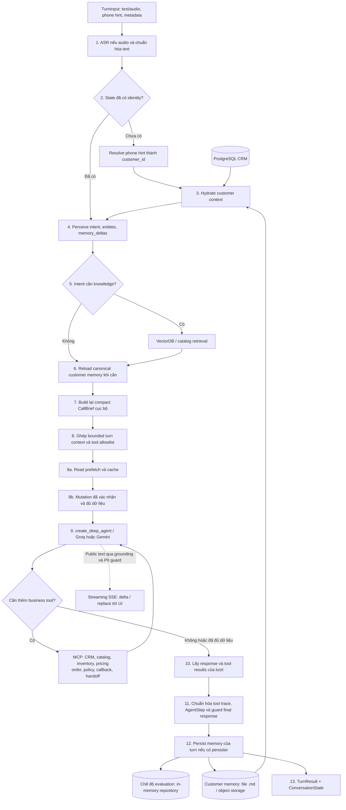

# Kiến trúc Telesale Deep Agent

Đối chiếu mã nguồn ngày 20/10/2026, tại commit `d85a428` (`feat: Add streaming`).
Các giá trị mặc định dưới đây lấy từ code; environment và CLI có thể thay đổi
cấu hình từng process. Tài liệu mô tả phần đã triển khai, không bao gồm các đề
xuất tối ưu latency chưa được áp dụng.

Hệ thống dùng kiến trúc hybrid:

- Application kiểm soát identity, CRM, customer memory, retrieval, routing,
  read prefetch, mutation đã được khách xác nhận và persistence.
- `create_deep_agent()` chạy model/tool loop với tập tool giới hạn theo lượt,
  rồi sinh câu trả lời.
- Backend hỗ trợ JSON hoàn chỉnh và streaming SSE; frontend hiện yêu cầu
  streaming cho text lẫn file audio.
- CRM, memory học được và knowledge base có nguồn sự thật riêng. DeepAgent
  không tự sửa instruction hoặc ghi customer memory qua tool.

## 1. Tổng quan pipeline



Các bước 8a và 8b là phần application thực hiện trước DeepAgent. Agent tiếp
tục gọi các tool còn được phép nếu chưa đủ dữ liệu. CallBrief ở bước 7 được
dựng cục bộ, không gọi LLM.

Nhánh streaming phát public text đã guard trong lúc bước 9 đang chạy; khi còn
write tool cần xác minh, phần trả lời có thể được giữ lại. Sau bước 11, harness
phát final response và `response_complete`; sau bước 12–13 mới có `complete`.
Luồng JSON đợi toàn bộ lượt hoàn tất. Các bước trước model vẫn chạy tuần tự.

Memory repository phụ thuộc `memory_mode`: bootstrap `evaluation` dùng RAM;
nhánh `full` của `run_suite.py` dùng `durable` với vùng memory đánh giá riêng
khi chọn backend file. Bước 3 cũng chạy nếu đã có identity nhưng chưa nạp
memory; bước 6 bỏ qua reload nếu lượt đó vừa hydrate.

Luồng dữ liệu quan trọng nhất giữa hai turn là:

```text
Turn N
  -> Perceiver tạo memory_deltas
  -> Verified pricing/order tool results cung cấp thêm fact
  -> Persister upsert các fact theo key
  -> LLMPersister bổ sung atomic facts / episode / foresight nếu được chọn
  -> repository trở thành canonical memory mới trước khi complete

Turn N+1
  -> reload canonical memory
  -> build CallBrief mới
  -> DeepAgent nhận brief đã phản ánh kết quả Turn N
```

Context gửi sang turn tiếp theo dùng projection có giới hạn của memory và một
đoạn hội thoại gần nhất, thay vì toàn bộ transcript. Giới hạn prompt không có
nghĩa toàn bộ `ConversationState.messages` và checkpoint trong RAM bị cắt bỏ.

## 2. Scope trạng thái và nguồn sự thật

| Scope | Thành phần | Tuổi thọ và vai trò |
|---|---|---|
| Turn | `TurnInput`, `TurnContext`, `TurnResult`, usage scope | Một lượt; perception, retrieval, tool trace, latency và memory writes |
| Call | `ConversationState` | Nhiều lượt cùng `conversation_id`; identity, hồ sơ, message history, pending order, read cache và turn number |
| Customer | Memory repository / snapshot store | Qua nhiều cuộc gọi, theo canonical `customer_id` |
| Runtime | `DeepAgentHarness`, model, MCP sessions, `MemorySaver` | Theo vòng đời harness; API dùng chung harness trong process |

| Dữ liệu | Nguồn sự thật |
|---|---|
| Customer ID, phone, tên và hồ sơ đã xác minh | PostgreSQL CRM |
| Đơn hàng, trạng thái đơn | PostgreSQL qua business tool |
| Giá, khuyến mãi và tồn kho hiện tại | Pricing/inventory tool theo thời điểm truy vấn |
| Budget, nhu cầu, blocker, xác nhận của khách | Customer memory, có provenance |
| Sản phẩm/giá/đơn đã tư vấn trong lịch sử | Fact từ verified tool result; cần kiểm tra lại cho giao dịch mới |
| Policy, vận chuyển, bảo hành, quy tắc cửa hàng | Knowledge retrieval / `search_policy`, có nguồn tài liệu |
| Persona và instruction | `soul.md`, `agent.md`, `tools.md` của agent |

Memory lưu ngữ cảnh lịch sử, không ghi đè trạng thái nghiệp vụ hiện tại.
`past_history.sessions` chỉ là compatibility view của episodes từ memory;
CRM adapter hiện không đọc conversation memory từ `customer_sessions`.

## 3. Bootstrap, model và MCP runtime

`build_deepagent_harness()` tạo harness chưa mở runtime để dùng với
`async with`. `build_deepagent_harness_async()` tạo và gọi `__aenter__()`;
caller phải đóng bằng `__aexit__()`.

Bootstrap nối các thành phần:

- `ZipformerASREngine`, `LLMPerceiver`, `HintIdentityResolver`;
- `PostgresCRMRetriever`, `CustomerContextService`, `VectorDBRetriever`;
- `CallBriefProjector`, `PIIGuardrail`, memory adapter và persister.

### 3.1 Chọn provider/model

`adapters/llm/model_factory.py` là factory chung cho NLU, main agent và LLM
memory persister. Runtime hỗ trợ Groq và Gemini qua LangChain.

| Cấu hình | Quy tắc trong code |
|---|---|
| Provider application | Tham số trực tiếp, rồi `LLM_PROVIDER`; fallback `groq` |
| Model application | Tham số trực tiếp, `LLM_MODEL`, `GROQ_MODEL` hoặc `GEMINI_MODEL`, rồi `MODEL_NAME` |
| Model fallback theo provider | Groq: `openai/gpt-oss-20b`; Gemini: `gemini-2.5-flash` |
| API key | Groq: `GROQ_API_KEY`; Gemini: `GOOGLE_API_KEY` rồi `GEMINI_API_KEY` |
| Timeout / retries / output cap | `LLM_REQUEST_TIMEOUT_SECONDS`, `LLM_MAX_RETRIES`, `LLM_MAX_OUTPUT_TOKENS`, rồi biến tương ứng của provider; fallback `30`, `0`, `1024` |
| Gemini thinking | `LLM_THINKING_LEVEL` nếu đặt; bỏ trống dùng mặc định provider |
| Model eval | CLI / `EVAL_LLM_*`; mặc định riêng `gemini/gemini-3.6-flash` |

Eval export lựa chọn vào environment của process benchmark và các MCP child,
không sửa `.env`. Model của một lần benchmark không chứng minh model của API
đang chạy ở process khác. Các model Gemini được factory nhận diện fixed
sampling, gồm `gemini-3.6-flash`, không được gửi custom temperature.

### 3.2 Khởi tạo DeepAgent

Runtime đọc một lần `soul.md`, `agent.md`, `tools.md` từ
`data/memory-root/agents/telesales_agent/`, hoặc `AGENT_INSTRUCTIONS_ROOT`.
Nội dung được truyền vào `system_prompt`, không dùng `MemoryMiddleware` để
cho agent tự sửa instruction/customer memory.

Ba MCP server được mở qua stdio, nếu script tương ứng tồn tại:

| Server | Trách nhiệm |
|---|---|
| `src/mcp_servers/mcp_db.py` | CRM, catalog, inventory, pricing, order |
| `src/mcp_servers/mcp_knowledge.py` | `search_policy`, knowledge có provenance |
| `src/mcp_servers/mcp_workflow.py` | Callback và human handoff |

Adapter có `search_archive()` còn được gắn tool đọc memory archive, ràng buộc
`customer_id` từ runtime context, không cho model chọn khách hàng khác.

Harness profile ẩn filesystem/shell tool không dùng và tắt general-purpose
subagent. `IntentToolRoutingMiddleware` lọc tool theo allowlist, loại tên tool
đã được model gọi ở vòng trước và phát internal streaming gate. Đây là giới
hạn trong graph, không phải bảo đảm idempotency của giao dịch ở database.

Mặc định code:

```dotenv
DEEPAGENT_MAX_MODEL_CALLS=3
DEEPAGENT_MAX_TOOL_CALLS=3
DEEPAGENT_RECURSION_LIMIT=30
DEEPAGENT_CHECKPOINT_SCOPE=turn
DEEPAGENT_RECENT_MESSAGE_COUNT=2
DEEPAGENT_RECENT_MESSAGE_CHARS=300
DEEPAGENT_RECENT_CONTEXT_CHARS=800
```

Giới hạn model/tool call áp dụng cho loop DeepAgent; NLU, LLM memory persister
và tool do application prefetch/mutation executor gọi nằm ngoài các bộ đếm đó.
Runtime có prewarm Knowledge MCP; mặc định bật với Chroma, tắt với Pinecone,
có thể đổi bằng `KNOWLEDGE_MCP_PREWARM`.

## 4. Xử lý một lượt hội thoại

### 4.1 Chuẩn hóa đầu vào và ASR

`TurnInput` chứa `conversation_id`, text hoặc audio, channel, customer hint và
metadata. Nếu đã có text thì không chạy ASR.

File audio được `ZipformerASREngine` nhận dạng offline bằng sherpa-onnx trên
CPU. Model được nạp lười và tái sử dụng; xử lý audio chạy qua
`asyncio.to_thread`. Không tải model trong lúc xử lý lượt. API kiểm tra dung
lượng file; ASR kiểm tra định dạng và thời lượng theo `ASRConfig`.

Audio transcript đi qua `normalize_asr_transcript`; text chat đi qua
`normalize_chat_text`. Raw input được giữ trong metadata để debug; các bước
sau dùng text đã chuẩn hóa. Đây là xử lý file ghi âm theo lượt, chưa phải
luồng microphone/VAD/TTS thời gian thực.

### 4.2 Identity và hydrate

Khi state chưa có identity, `HintIdentityResolver` dùng `customer_hint` là
phone để tra PostgreSQL. Khách mới có thể được tạo trong CRM; phone trùng được
đối chiếu thêm thông tin tự giới thiệu trong utterance. Thiếu hint hoặc chưa
phân giải được khách thì `customer_id` có thể rỗng và không load/persist memory
cá nhân. Resolver hiện không lookup Zalo/Facebook dù model dữ liệu có các field đó.

`CustomerContextService.hydrate()` nạp riêng:

- `state.customer_profile`: hồ sơ CRM;
- `state.past_history`: lịch sử order và compatibility view;
- `state.customer_memory`: snapshot memory học được.

Hydrate chủ yếu chạy đầu cuộc gọi; cũng chạy nếu state có identity nhưng chưa
có customer memory. Lookup memory từ đây dùng canonical `customer_id`.

### 4.3 Perception và retrieval

`LLMPerceiver` gọi LLM structured output để lấy `intent`, `intents`, `entities`
và `memory_deltas`, rồi chuẩn hóa các key memory. Transcript được mask PII
trước khi gửi perception LLM. Customer message được append vào state; memory
deltas được giữ đến cuối lượt để kết hợp với verified tool results.

Tên intent đi theo taxonomy, ví dụ `ask_product`, `ask_policy`, `create_order`.
Lỗi perception thông thường có thể fallback sang intent `unknown`; rate limit
được truyền lên caller.

Có hai đường knowledge khác nhau:

| Đường | Cách dùng hiện tại |
|---|---|
| `VectorDBRetriever` trước main agent | Gate theo intent; policy bằng Chroma/local embedding, catalog bằng PostgreSQL. Compact hints được inject trực tiếp ở lượt đầu |
| Knowledge MCP `search_policy` | Route/prefetch theo câu hỏi; `KNOWLEDGE_BACKEND=chroma` hoặc `pinecone`, lọc nguồn và trả chunk provenance |

Gate có thể bỏ qua retrieval cho intent không cần knowledge. Knowledge cũ
trong state không thay cho xác minh giá/tồn kho hoặc thao tác order.

### 4.4 Refresh memory và CallBrief

Nếu chưa hydrate trong lượt, `refresh_memory()` reload canonical memory sau
perception/retrieval. CRM profile/order history không được reload mỗi lượt.

`CallBriefProjector` dựng brief cục bộ từ CRM, memory và current turn context,
không gọi LLM. `LLMCallBriefBuilder` trong module cũ chỉ là compatibility alias.
Brief có identity, summary, needs, canonical facts, unresolved issues, episodes
và các vùng riêng cho verified CRM data / remembered preferences.

Projection đưa vào prompt chọn tập fact liên quan, giới hạn độ dài value,
recent messages và catalog/policy hints. Toàn bộ memory không được dump vào
mỗi turn; raw tool messages trong chính model/tool loop vẫn có thể lớn.

### 4.5 Routing, read prefetch và mutation

`select_tools_for_turn()` kết hợp intent, utterance, remembered facts và working
state để chọn tool. `pending_order` có thể bổ sung quyền inventory/pricing/order
cho lượt tiếp theo trong cùng cuộc gọi.

`ReadToolExecutor.prefetch()` thực hiện read chain có đủ arguments, ví dụ
catalog → xác định một SKU → inventory, hoặc pricing theo SKU đã nhớ. Kết quả
được cache trong working state theo tool/args/call date, compact vào context và
loại tool đã xử lý khỏi allowlist khi phù hợp.

`MutationToolExecutor.execute()` thực hiện hành động đã được khách xác nhận,
đủ identity/arguments và có dữ liệu nghiệp vụ cần thiết, gồm các nhánh tạo/đổi
đơn, callback và handoff. Nó có kiểm tra từ chối tạo đơn, pending checkout và
ngăn tạo trùng trong các nhánh đã hỗ trợ. Callback thiếu phone/thời gian hợp lệ
không được giao lại cho model tự đoán arguments.

Mutation vì vậy không còn hoàn toàn do DeepAgent tự quyết định. Các tool còn
được phép tiếp tục đi qua model/tool loop. Prefetch và mutation application
vẫn được ghi trace và đưa vào memory persistence.

| Tool runtime | Tên canonical trong trace |
|---|---|
| `retrieve_customer_profile` | `crm.get_customer` |
| `search_catalog` | `catalog.search` |
| `check_inventory` | `inventory.check` |
| `get_pricing_quote` | `pricing.get_quote` |
| `create_new_order`, `check_order_status`, `update_order` | `order.create`, `order.status`, `order.update` |
| `search_policy` | `policy.search` |
| `search_customer_memory_archive` khi adapter hỗ trợ | `memory.archive_search` |
| `mcp_schedule_callback` | `schedule.callback` |
| `mcp_escalate_to_human` | `handoff.transfer` |

### 4.6 DeepAgent, checkpoint và response

Graph nhận bounded user context và `runtime_context` chứa allowlist cùng
customer ID. `MemorySaver` giữ checkpoint nội bộ. Mặc định thread ID là
`<conversation_id>__turn_<n>`; continuity giữa lượt đi qua application state và
rebuilt brief. Có thể đổi scope thành `conversation`, khi đó raw graph history
có thể tăng theo cuộc gọi.

Sau graph, harness lấy assistant message của lượt hiện tại, ghép tool call với
result theo ID và tạo `AgentStep`. Đây là projection của tool execution để
trace/eval, không phải planner pipeline độc lập chạy thêm sau DeepAgent.
Cached prefetch không bị ghi thành execution mới trong final tool trace.

`prepare_response()` áp dụng grounding cho câu hỏi về từng sản phẩm cụ thể,
tồn kho, recap giỏ hàng, xác nhận nhiều đơn, callback adjustment và PII guard.
Cùng cơ chế được dùng cho streamed prefix và final response. Khi model không
có text phù hợp, harness có fallback response.

## 5. Streaming từ model đến giao diện

API có hai entrypoint:

| Endpoint | Input | Chế độ trả lời |
|---|---|---|
| `POST /api/chat` | JSON text, phone hint, conversation ID | `stream=true`: SSE; mặc định `false`: JSON sau khi lượt hoàn tất |
| `POST /api/chat/audio` | Multipart file audio và các field tương ứng | Cùng lựa chọn `stream`; trả transcript sau ASR |

API còn có `GET /health` và `DELETE /api/sessions/{conversation_id}`; thao tác
clear chỉ xóa active session trong RAM, không xóa customer memory. Nếu đặt
`API_KEY`, các endpoint chat/session kiểm tra header `X-API-Key`.
`ENABLE_DEBUG_RESPONSE=true` bổ sung CRM/memory/tool/usage vào payload debug;
mặc định không bật.

Trong chế độ streaming, harness dùng `agent.astream()` với
`stream_mode=["messages", "values", "custom"]`, `version="v1"`:

- `messages`: public text từ model node; loại reasoning/content block riêng tư
  và message chứa tool arguments;
- `values`: cập nhật graph result và bằng chứng tool;
- `custom`: internal `answer_stream_gate` cho từng model invocation, không gửi
  control event này ra frontend.

Read tool còn khả dụng không chặn public text. Khi còn write tool liên quan
order/callback/handoff, phần trả lời được giữ để kiểm tra kết quả. Prefix chỉ
phát ở biên từ hoàn chỉnh; phần đuôi số dang dở được giữ lại để guard kiểm tra.
Final response vẫn được kiểm tra sau khi graph kết thúc. Runtime không có
`astream` thì fallback `ainvoke` và phát câu trả lời hoàn chỉnh.

`AnswerStream` có queue một phần tử và acknowledgement để kiểm soát backpressure.
Timestamp answer được ghi ngay trước khi yield `delta`/`replace` cho consumer.
API đóng gói SSE dạng `data: <JSON>`, có header `Cache-Control: no-cache` và
`X-Accel-Buffering: no`.

| Event SSE | Ý nghĩa |
|---|---|
| `input` | Text/transcript chuẩn hóa; không phải token trả lời |
| `delta` | Append public answer text |
| `replace` | Thay public answer khi grounding/final khác prefix đã phát |
| `response_complete` | Đã phát xong câu trả lời; persistence còn có thể đang chạy |
| `complete` | Persistence và cập nhật state xong; mang final response, latency và payload API |
| `error` | Lượt không hoàn tất; API gửi lỗi đã chuẩn hóa |

Frontend `createChatClient()` dùng `fetch`/`ReadableStream`, ghép frame SSE và
UTF-8 bị chia qua network chunks, rồi chờ callback render giữa các event.
`page.tsx` dùng một agent bubble theo turn ID, `flushSync` và animation frame
để commit text mới; `upsertChatTurn()` cập nhật cùng message thay vì tạo hai
response bubble. UI giữ trạng thái bận đến `complete`, kể cả sau
`response_complete`. Client có fallback cho backend trả JSON.

API giữ `sessions` và `session_locks` trong RAM theo conversation. Producer
stream giữ lock đến khi cập nhật state/persist xong. Khi client ngắt kết nối,
consumer detach nhưng producer tiếp tục hoàn tất lượt khi process còn sống;
frontend không tự replay POST có thể đã thực hiện mutation. Cơ chế này không
phải durable background job hoặc bảo đảm exactly-once qua restart.

## 6. Customer memory và persistence

### 6.1 Memory mode

| `memory_mode` | Repository | Persister |
|---|---|---|
| `durable` | File mặc định; object storage khi `CUSTOMER_MEMORY_BACKEND=object_storage` hoặc `s3` | Mặc định `LLMPersister` với `MEMORY_PERSISTER_MODE=llm_learning`; `llm_episode` cũng chọn cùng adapter |
| `durable` với mode persister khác, ví dụ `turn` / `deterministic` | Backend durable đã chọn | `TurnMemoryPersister`, không gọi LLM học memory |
| `evaluation` | `InMemoryCustomerMemoryRepository(seed=local_memory)` | `TurnMemoryPersister` |
| `disabled` | In-memory rỗng | Không có persister |

Mode `evaluation` của bootstrap khác với nhánh `full` của `run_suite.py`;
nhánh đó dùng `durable` để đo cả hành vi persist thực tế.

### 6.2 Fact và memory học được

Persistence chạy sau final response/tool trace. `persist_turn_memory()` kết
hợp memory deltas của khách với fact từ verified tool results, giữ provenance
`customer` / `verified_tool`, upsert theo key và lưu previous value khi cần.
Phone giữ ở CRM; địa chỉ giao hàng khách xác nhận có thể lưu dưới
`delivery_address`. Order ID và lịch callback đã xác nhận phải có tool result
phù hợp, không lấy từ câu model tự nói.

`TurnMemoryPersister` chỉ ghi canonical facts. `LLMPersister` ghi canonical
facts trước, bổ sung atomic fact audit rồi gọi structured LLM để học episode
và foresight. Prompt học memory dùng customer text đã mask và verified fact
updates, không dùng agent statement như bằng chứng của khách. Nếu bước tóm
tắt LLM lỗi, canonical facts vẫn được giữ; lỗi commit remote được truyền lên.

Pipeline hiện vẫn `await` persistence. Sau đó tăng `turn_number` và trả
`TurnResult`, gồm response, perception, identity, retrieval, brief, tool trace,
memory writes, latency, usage và state mới.

### 6.3 File backend

Root mặc định là `data/memory-root/users`, đổi bằng `CUSTOMER_MEMORY_ROOT`:

```text
<root>/<customer_id>/
    facts.md
    user.md
    behaviors.md
    atomic_facts/fact-YYYY-MM-DD.md
    episodes/episode-YYYY-MM-DD.md
    foresights/foresight-YYYY-MM-DD.md
```

Adapter đọc `.mmd` cũ để tương thích, ghi mới `.md`. Fact được upsert theo key;
episode có source marker để hạn chế ghi lặp. Có customer `threading.RLock`
trong process và atomic file replacement; chưa có transaction/lock liên
process cho toàn bộ lượt ghi memory.

### 6.4 Object storage backend

Adapter S3-compatible dùng `CUSTOMER_MEMORY_BUCKET`, `CUSTOMER_MEMORY_PREFIX`
(mặc định `users`) và tùy chọn endpoint S3. Object canonical là
`<prefix>/<customer_id>/current.md`; có fallback đọc legacy key.

`CustomerContextService` đọc snapshot qua thread. `TurnMemoryWriteSession`
tạo workspace RAM từ snapshot đã nạp, chạy upsert/học memory tại đây, rồi
commit snapshot thay đổi. Trong lượt thông thường adapter chủ yếu PUT
`current.md`; khi cần, nó export static files và daily archives trước khi
publish snapshot mới. Current snapshot giữ các daily collection của hai ngày
hoạt động gần nhất; archive cũ được đọc theo nhu cầu bằng tool archive.

Đây là snapshot commit ở tầng application; code chưa có distributed customer
lock hoặc compare-and-swap để giải quyết hai writer đồng thời.

## 7. Đo latency và usage

API middleware ghi `perf_counter` lúc request đến backend, trước xử lý body
và chờ session lock. Khi gọi trực tiếp harness trong eval, mốc bắt đầu là lúc
tạo answer stream/nhận lượt tại harness. Không dùng thời gian render UI làm
latency backend.

| Field | Mốc đo hiện tại |
|---|---|
| `latency.ttft_ms` khi streaming | Từ mốc bắt đầu đến public answer `delta`/`replace` không rỗng đầu tiên được emit |
| `latency.total_ms` khi streaming | Từ cùng mốc đến answer emission cuối, gồm final replacement nếu có |
| TTFT/Total khi non-streaming | Hai giá trị bằng nhau; implementation hiện đợi cả persistence trước khi trả kết quả |
| `call_brief_latency_ms` trong trace / `latency.call_brief_ms` | Lượt đầu: từ mốc bắt đầu đã trừ ASR đến khi brief sẵn sàng; gồm identity, hydrate, NLU, retrieval và các bước trước brief |
| `response_ready_ms` | Mốc final response đã chuẩn bị/guard; số chẩn đoán, không thay cho first answer emission |
| `persistence_ms` | Thời gian chờ persister sau câu trả lời |
| `request_complete_ms` | Toàn bộ lượt đến persist xong, loại thời gian ASR offline |
| `backend_total_ms` | Toàn bộ lượt tại backend/harness, gồm ASR |
| `asr_ms` | Transcribe file audio; tách khỏi TTFT/Total M1 và tổng hợp thêm ms/phút audio |
| `ttfa_ms` | `None`; chưa có VAD end-of-speech và audio output/TTS |

CallBrief latency không phải thời gian riêng của hàm projector. `input`,
status, reasoning và tool arguments không được tính là answer token. TTFT
không được suy ra bằng cách chia Total cho 3. `precomputed_parts` ghi các lớp
memory đã có trước persistence của lượt hiện tại.

Usage được gom theo `perception`, `main_agent`, `memory_persister`, gồm số
request, token, failed request và finish reason. Trace chưa có duration riêng
cho mọi NLU/DB/tool request, nên chưa thể tách chính xác toàn bộ thời gian
thành phần chỉ từ token counters.

Ngưỡng hướng dẫn là TTFT p95 ≤3 giây, Total p95 ≤8 giây cho M1; dùng cùng
model/API/phần cứng, bỏ 3 lượt warm-up, tối thiểu 100 lượt đo mỗi nhóm so sánh
và tính p95 bằng `reference_eval.py`. Smoke test 5 scenario chỉ có tối đa
27 lượt đo/nhóm với dataset hiện tại, chưa đủ xác nhận SLA.

## 8. Evaluation flow

Runner một lệnh hiện tại là `src/eval/run_suite.py`. Mặc định chọn 40 scenario
đầu từ `dataset/iterative-refinement/scenarios_complete dataset`, kiểm tra
manifest/text/checksum audio tương ứng trong
`dataset/iterative-refinement/audio`, rồi chạy tuần tự bốn nhóm:

```text
text/baseline_no_memory -> text/full
    -> audio/baseline_no_memory -> audio/full
```

- `baseline_no_memory`: bootstrap `disabled`; vẫn có CRM và business tools,
  không học customer memory.
- `full`: bootstrap `durable`, mặc định persister `llm_learning`.
- Với backend file, mỗi nhóm có `CUSTOMER_MEMORY_ROOT` riêng trong output;
  mỗi scenario chọn namespace riêng. Seed history chỉ được thêm cho `full`;
  các call cùng scenario dùng chung customer memory nhưng state riêng.
- Runner không tự override `CUSTOMER_MEMORY_BACKEND`. Cô lập bằng file root và
  namespace không áp dụng tự động cho object storage; backend remote cần cấu
  hình bucket/prefix đánh giá riêng nếu sử dụng.
- Order tạo trong scenario được theo dõi và cleanup khi kết thúc bình thường;
  benchmark vẫn gọi CRM/business tools thật, không phải toàn bộ là mock.

`FreshCallBrief` là wrapper riêng của suite: đầu call bổ sung kiểm tra tồn
kho/khuyến mãi theo SKU đã nhớ và ngày gọi. CRM/order history được hydrate
lại khi bắt đầu call. Nguồn tương tác đa kênh chưa có trong CRM adapter và được
ghi rõ trong metadata; không mặc định coi freshness đã đầy đủ.

Suite bật streaming mặc định, gọi harness trực tiếp và ghi JSONL trace. Mỗi
nhóm có report riêng; report tổng có baseline/full comparison, coverage,
trace health, latency, hardware/model/parameters, dataset và source fingerprints.

Metric gồm RQR, context carryover, TSR, hallucination (cả phần price-only),
tool accuracy, calls-to-close, số lượt/call, guardrail, memory checks và ASR
WER/CER cho audio. MWQ LLM judge chỉ chạy khi `--judge-memory`; chi phí USD
chỉ được tính khi có cấu hình đơn giá. Ngưỡng chất lượng: RQR giảm tương đối
≥40%, TSR ≥70%, HR giá ≤5%.

Retry có hai tầng khác nhau:

- Suite không replay toàn bộ turn (`run_scenario(max_retries=1)`). Request
  provider có `--model-retries`, mặc định `2`, và timeout mặc định 30 giây.
- `--sleep` mặc định `0`. Shared request interval mặc định `0` với Gemini,
  `30` giây với Groq GPT-OSS; có thể override.
- Lỗi provider vĩnh viễn như auth/billing/model access dừng các nhóm còn lại;
  lỗi từng lượt được giữ trong trace. Thiếu lượt, lỗi request hoặc cleanup làm
  trace không hợp lệ, không được báo thành một lần đo chất lượng đạt.
- `MAX_TOKENS` hoặc thông báo chạm tool limit có thể là response đã hoàn tất
  ở tầng API, nên cần đọc finish reason/chất lượng bên cạnh `trace_health`.

Ví dụ từ repository root, dùng tên output mới cho mỗi lần chạy:

```powershell
.\.venv\Scripts\python.exe -u -B -X utf8 src/eval/run_suite.py --limit 5 --version benchmark_check_5
```

Các CLI `generate_traces.py`, `run_benchmark.py` và `run_parallel_benchmark.py`
vẫn tồn tại cho workflow khác; cấu hình riêng của chúng không thay thế
suite defaults ở trên. Chi tiết metric/CLI ở [README eval](../../src/eval/README.md).

## 9. Ranh giới và giới hạn hiện tại

1. API sessions, locks và graph checkpoints ở RAM, chưa có shared session store
   hoặc tự động dọn toàn bộ state theo TTL. Restart mất active call state;
   prompt có giới hạn không đồng nghĩa RAM được giới hạn.
2. Lock API theo conversation không serialize hai conversation khác nhau của
   cùng customer. File lock chỉ trong process; snapshot remote chưa có CAS.
3. Disconnect không tự replay lượt, nhưng producer vẫn phụ thuộc process đang
   sống. Chưa có bảo đảm exactly-once qua nhiều worker/restart/repost thủ công.
4. Streaming phát theo public text đã guard, có thể buffer/replacement;
   không bảo đảm mỗi lượt đều thấy từng token. Proxy/deployment vẫn phải chuyển
   tiếp SSE không buffer. Client JSON cũ nhận một câu trả lời hoàn chỉnh.
5. NLU, retrieval, read prefetch và chuẩn bị context còn tuần tự. CallBrief là
   local projector; LLM summarization bổ sung nằm ở memory persister.
6. Output cap có thể cắt JSON hoặc câu trả lời (`MAX_TOKENS`); thiếu tool action,
   ASR sai entity và tool-call limit vẫn có thể làm TSR/HR không đạt. Có
   streaming không đồng nghĩa đạt TTFT/Total SLA hay chất lượng tác vụ.
7. Freshness đa kênh chưa đầy đủ. Giảm thinking, thêm xử lý song song hoặc
   chuyển học memory sang nền chỉ là tùy chọn/đề xuất cho đến khi code hoặc
   cấu hình runtime thực sự được thay đổi và đo lại.

## 10. File implementation chính

| File / module | Vai trò |
|---|---|
| `src/telesale_agent/bootstrap.py` | Wiring, memory mode/backend/persister |
| `src/telesale_agent/application/deepagent/harness.py` | Public facade, lifecycle và run/stream turn |
| `src/telesale_agent/application/deepagent/runtime.py` | Instruction, MCP clients, DeepAgent graph/middleware |
| `src/telesale_agent/application/deepagent/turn.py` | Orchestration chính, grounding, persistence và latency |
| `src/telesale_agent/application/deepagent/streaming.py` | Answer events, backpressure, gate và emission timing |
| `src/telesale_agent/application/deepagent/tools/` | Routing, read prefetch, confirmed mutation, archive tool, canonical trace |
| `src/telesale_agent/application/deepagent/context/` | Projection prompt, fact, order và callback helpers |
| `src/telesale_agent/application/customer_context.py` | Hydrate/refresh CRM và customer memory |
| `src/telesale_agent/application/memory/` | CallBriefProjector, canonical fact persistence, snapshot format |
| `src/telesale_agent/adapters/llm/model_factory.py` | Provider/model và tham số chung |
| `src/telesale_agent/adapters/llm/llm_perceive.py` | NLU structured output, canonical memory deltas |
| `src/telesale_agent/adapters/llm/llm_persist.py` | Canonical facts, atomic audit, học episode/foresight |
| `src/telesale_agent/adapters/memory/` | File, in-memory, object storage, turn-local write session |
| `src/telesale_agent/adapters/asr/` | ASR file audio offline trên CPU |
| `src/telesale_agent/entrypoints/api/chat.py` | API text/audio, sessions, SSE, arrival timestamp |
| `src/web/utils/chat-api.ts`, `src/web/utils/chat-messages.ts`, `src/web/app/page.tsx` | Client SSE và render một bubble cho mỗi lượt |
| `src/eval/run_suite.py`, `src/eval/generate_traces.py`, `src/eval/benchmark_support.py`, `src/eval/team_eval.py` | Scenario, trace, latency, quality comparison |

`core/deepagent_pipeline.py` và `adapters/llm/llm_call_brief.py` giữ compatibility
imports; chúng không còn là nơi triển khai orchestration hoặc LLM brief.
Tham khảo thêm [memory/context flow](deepagent_context_memory_flow.md) và
[text normalization](text_input_normalization.md); khi có khác biệt, đối chiếu
implementation được liệt kê ở trên.
