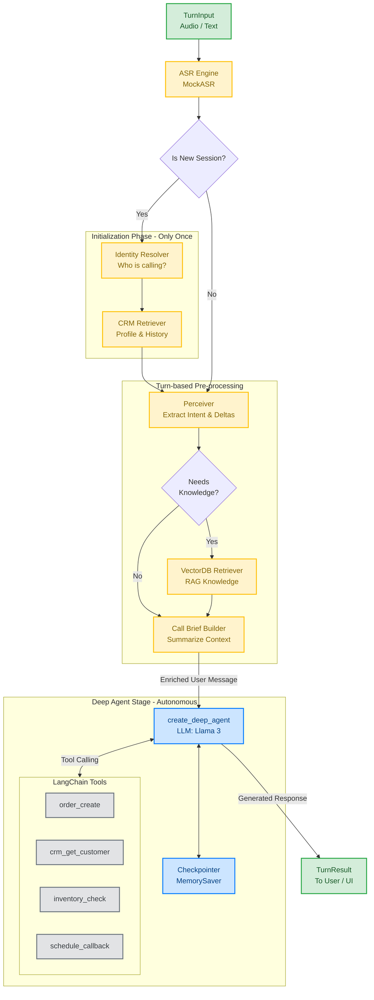

# 🧠 Telesale Agent Architecture (Deep Agents)

This document visualizes the architecture of the `DeepAgentHarness`, showcasing how we've integrated the `deepagents` library into the existing telesales flow.

## High-Level Workflow

The agent now follows a **Hybrid Pipeline**: A deterministic pre-processing stage (to preserve existing complex business logic like CRM and RAG) followed by an autonomous Deep Agent stage (for reasoning and tool execution).

## 🔍 Component Breakdown

### 1. ⚙️ Pre-Processing Nodes (The Observers)
These nodes gather context *before* the agent starts reasoning. They are explicitly defined to guarantee that the LLM has all the data it needs to personalize the call:
- **ASR Engine**: Transcribes voice to text.
- **Perceiver**: Extracts customer intents and detects new facts (`memory_deltas`) from the utterance.
- **Identity Resolver**: Finds the customer's phone number or ID.
- **CRM Retriever**: Fetches the `customer_profile` and `past_history` (M1 Memory).
- **VectorDB Retriever**: Fetches product knowledge, policies, and promotions.
- **Call Brief Builder**: Condenses all the gathered info into a short `CallBrief`.

### 2. 🧩 Data Injection
Instead of forcing the Deep Agent to retrieve this context itself, the harness injects the `CallBrief` and `RAG Knowledge` into the user's message as a hidden `[System Note]`. This guarantees the Deep Agent always has up-to-date context per turn without needing extra tokens for system prompt updates.

### 3. 🤖 Deep Agent Engine (The Brain)
We use `create_deep_agent` to build the core reasoning loop. 
- **LLM Reasoning**: It uses `ChatGroq` (Llama 3).
- **Tool Calling**: We converted all the custom `TOOL_REGISTRY` functions (`order.create`, `schedule.callback`) into `StructuredTool`s. The Deep Agent autonomously decides if and when to call these.
- **Memory**: The agent maintains conversation history implicitly via LangGraph's `MemorySaver` (thread-level state).

### 4. 📦 Output Generation
The harness extracts the final text generated by the Deep Agent and wraps it back into a `TurnResult`, retaining the `ctx.perception`, `ctx.identity`, `ctx.call_brief` for logging, evaluation traces, and the UI.
