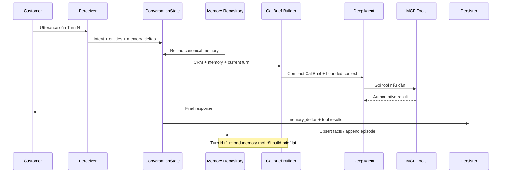

# Customer Memory trong Telesale DeepAgent

Tài liệu này giải thích chi tiết memory hiện tại hoạt động như thế nào, dữ liệu
nào được lưu, lưu ở đâu, khi nào được đọc/ghi và tại sao thiết kế này giúp giảm
context của DeepAgent.

## 1. Hiểu nhanh trong một phút

Ý tưởng chính là: DeepAgent không cần nhớ toàn bộ transcript.

Sau mỗi turn, application chỉ giữ lại những thông tin có giá trị lâu dài dưới
dạng các field ngắn như:

```text
budget_vnd = 5000000
room_area_m2 = 25
has_children = true
product_advised = SKU-AP-Y
price_quoted_vnd = 5200000
blocker = cần hỏi chồng
```

Các field này được lưu vào `facts.md`. Nếu khách hàng thay đổi thông tin, field
cũ được cập nhật thay vì append thêm một bản sao mới.

```text
Turn 1 kết thúc
  -> ghi budget_vnd = 5,000,000 vào memory

Turn 2 bắt đầu
  -> reload memory
  -> build CallBrief có budget 5,000,000

Turn 2 khách sửa lại ngân sách thành 6,000,000
  -> cập nhật budget_vnd = 6,000,000

Turn 3 bắt đầu
  -> CallBrief chỉ nhìn thấy budget mới là 6,000,000
```

Đây là self-learning memory theo vòng lặp:

```text
Observe -> Extract -> Use -> Persist -> Reload -> Use again
```

## 2. Bốn loại “memory” không được nhầm với nhau

Trong project có bốn khái niệm dễ bị gọi chung là memory nhưng chúng có mục
đích hoàn toàn khác nhau.

| Loại | Vị trí | Chứa gì | Tuổi thọ |
|---|---|---|---|
| Customer memory | `data/memory-root/users/<customer_id>/` | Fact, preference, behavior, episode của từng khách | Qua nhiều turn và nhiều cuộc gọi |
| Agent instruction memory | `data/memory-root/agents/telesales_agent/` | `soul.md`, `agent.md`, `tools.md` | Cấu hình cố định của agent |
| Conversation state | `ConversationState` trong RAM | Identity, recent messages, call brief, turn number | Trong một cuộc gọi |
| DeepAgent checkpoint | `MemorySaver` | Message/tool loop nội bộ của graph | Mặc định chỉ trong một turn |

### Customer memory

Đây là thứ agent “học” về một khách hàng cụ thể. Nó được address bằng
`customer_id`, không phải bằng phone.

### Agent instruction memory

Đây không phải thông tin khách hàng. Ba file này mô tả agent phải nói chuyện và
dùng tool như thế nào:

```text
data/memory-root/agents/telesales_agent/
├── soul.md
├── agent.md
└── tools.md
```

Chúng được `MemoryMiddleware` đưa vào system context khi khởi tạo DeepAgent.
Không được ghi fact khách hàng vào đây.

### Conversation state

`ConversationState` giữ working state của cuộc gọi đang diễn ra. Nó giúp
application biết đây là turn thứ mấy, customer nào đang gọi và vài message gần
nhất là gì.

State này không phải durable storage. Restart process có thể làm mất state,
nhưng customer memory `.md` vẫn còn.

### DeepAgent checkpoint

Checkpoint phục vụ reasoning/tool loop của `create_deep_agent()`. Ví dụ trong
một turn agent có thể:

```text
LLM -> pricing tool -> tool result -> LLM -> final response
```

Pipeline mặc định tạo thread ID riêng cho mỗi turn, nên checkpoint không replay
toàn bộ raw history ở turn tiếp theo. Continuity giữa các turn được truyền bằng
CallBrief và recent conversation đã giới hạn.

## 3. PostgreSQL không phải customer memory

PostgreSQL CRM là nguồn dữ liệu đã xác minh và dữ liệu nghiệp vụ:

- `customer_id`, phone, name, honorific, region;
- order và order status;
- catalog, inventory, price/promotion qua business tools.

Customer memory `.md` lưu thông tin mềm hoặc thông tin agent học được:

- ngân sách;
- diện tích phòng;
- nhu cầu, sở thích;
- có trẻ nhỏ hay không;
- sản phẩm từng được tư vấn;
- mức giá từng quote;
- blocker và tóm tắt cuộc gọi.

Memory không được ghi đè dữ liệu nghiệp vụ. Ví dụ:

- `price_quoted_vnd` trong memory giúp agent nhớ lần trước đã báo giá bao nhiêu;
- giá hiện tại vẫn phải gọi `get_pricing_quote` để xác minh;
- memory nói sản phẩm còn hàng không thay thế được `check_inventory`.

## 4. Cấu trúc thư mục customer memory

Mỗi customer có một thư mục riêng:

```text
data/memory-root/users/<customer_id>/
├── facts.md
├── user.md
├── behaviors.md
├── atomic_facts/
│   └── fact-YYYY-MM-DD.md
├── episodes/
│   └── episode-YYYY-MM-DD.md
└── foresights/
    └── foresight-YYYY-MM-DD.md
```

Không bắt buộc mọi file phải tồn tại ngay từ đầu. Repository tạo thư mục/file
khi có dữ liệu cần ghi.

### `facts.md` — trạng thái fact hiện tại

Đây là file quan trọng nhất cho vòng memory theo turn.

Ví dụ:

```markdown
# Customer Facts

- room_area_m2: 25
- budget_vnd: 6000000
- has_children: true
- product_advised: "SKU-AP-Y"
- price_quoted_vnd: 5200000
- blocker: "cần hỏi chồng"
```

Mỗi key chỉ có một canonical value. `upsert_fact()` đọc map hiện tại, thay hoặc
thêm key, rồi ghi lại `facts.md`.

Các value được serialize bằng JSON nên giữ được type:

- `6000000` là integer;
- `true` là boolean;
- `"SKU-AP-Y"` là string;
- list/dictionary cũng có thể lưu nếu perception trả về type đó.

### `user.md` — mô tả profile dạng văn bản

File này dành cho các ghi chú profile dạng narrative hoặc human-readable.
`update_profile()` append một bullet mới.

Nó khác `facts.md` ở chỗ không có upsert theo key. Vì vậy dữ liệu thường xuyên
thay đổi như budget nên đặt trong `facts.md`, không nên append vào `user.md`.

### `behaviors.md` — pattern hành vi

Chứa các pattern quan sát qua thời gian, ví dụ:

```markdown
- Thường muốn được gọi vào buổi sáng
- Muốn so sánh kỹ trước khi quyết định
```

`update_behaviors()` hiện append text; nó không tự deduplicate hoặc supersede.

### `episodes/` — chuyện gì đã xảy ra

Episode là bản tóm tắt một tương tác, không phải trạng thái hiện tại.

Ví dụ:

```markdown
### Session at 10:30:12
Facts: phòng 25m2 | Product: AirPure Y | Blocker: cần hỏi chồng
```

Khi bật tùy chọn `MEMORY_PERSISTER_MODE=llm_episode`, `LLMPersister` dùng hai
message gần nhất — customer và agent — để tạo episode summary. Nhiều episode
trong cùng ngày được append vào `episode-YYYY-MM-DD.md`. Mặc định durable mode
dùng deterministic persister để tránh thêm một Groq request sau mỗi turn.

Episode trả lời câu hỏi “đã xảy ra chuyện gì?”, còn `facts.md` trả lời câu hỏi
“thông tin hiện tại của khách là gì?”.

### `atomic_facts/` — compatibility với memory cũ

Trước đây fact được append vào các file theo ngày. Cách này tạo lịch sử nhưng
có thể làm một key xuất hiện nhiều lần với value khác nhau.

Turn persister mới không dùng `record_atomic_fact()` cho canonical turn facts;
nó dùng `upsert_fact()` và `facts.md`. Thư mục `atomic_facts/` vẫn được đọc để
tương thích dữ liệu cũ.

Nếu chưa có `facts.md`, repository scan các atomic-fact file theo thứ tự và fold
các dòng `key: value` thành một map. Value đọc sau sẽ thay value đọc trước. Lần
upsert tiếp theo sẽ tạo `facts.md` từ map này.

### `foresights/` — dự đoán/gợi ý tương lai

Chứa gợi ý có thể hữu ích cho tương tác sau. Đây vẫn là collection append-only
và hiện không được turn persister tự động tạo.

## 5. Vòng đời memory của một turn



### Bước 1 — Perceiver tìm fact mới

`LLMPerceiver` trả `memory_deltas` từ điều customer vừa nói.

Ví dụ customer nói:

```text
Phòng chị khoảng 25m2, nhà có em bé, ngân sách tầm 5 triệu.
```

Perceiver có thể tạo:

```json
{
  "room_area_m2": 25,
  "has_children": true,
  "budget_vnd": 5000000
}
```

Các delta được đưa vào `state.memory_deltas`. Chúng chưa được ghi xuống file ở
thời điểm này.

### Bước 2 — Reload memory trước khi build brief

Pipeline gọi `CustomerContextService.refresh_memory()` để lấy snapshot mới
nhất từ repository.

Ở Turn N, snapshot này chứa dữ liệu đã persist tới hết Turn N-1. Fact vừa được
phát hiện ở Turn N chưa nằm trong durable memory, nhưng utterance, intent và
entities hiện tại vẫn được gửi trực tiếp cho agent.

### Bước 3 — Build CallBrief

CallBrief được tạo lại mỗi turn từ:

- verified CRM profile;
- order history;
- canonical `facts`;
- profile/behavior memory;
- episodes và foresights;
- current perception/retrieval context.

Agent không nhận toàn bộ file memory. Harness chỉ inject một projection nhỏ,
gồm summary, needs và một số fact trong map hiện tại.

### Bước 4 — DeepAgent gọi business tool

Trong lúc reasoning, tool result có thể cung cấp thêm fact đáng tin cậy.

Hiện turn persister tự lấy memory candidate từ:

| Tool | Fact tạo ra |
|---|---|
| `pricing.get_quote` | `product_advised`, `price_quoted_vnd`, `promo_code` |
| `order.create` | `product_advised`, `price_quoted_vnd` |

Giá và promotion được lấy từ tool output, không lấy từ câu trả lời tự sinh của
LLM.

### Bước 5 — Merge memory candidates

Persister bắt đầu bằng `state.memory_deltas`, sau đó merge tool-derived facts.

```python
candidates = memory_deltas
candidates.update(tool_memory_candidates)
```

Nếu trùng key, tool-derived value thắng. Đây là chủ ý vì tool result là nguồn
đã xác minh hơn inference từ utterance.

### Bước 6 — Upsert từng fact

Với mỗi candidate:

1. Đọc `previous = latest_fact(customer_id, key)`.
2. Nếu key đã có và value khác, trace operation là `supersede`.
3. Nếu key chưa có hoặc value giống nhau, trace operation hiện là `set`.
4. Gọi `upsert_fact()` để ghi canonical value.
5. Tạo một `memory_writes` record cho evaluation/audit.

Ví dụ trace:

```json
{
  "key": "budget_vnd",
  "value": 6000000,
  "op": "supersede",
  "source": "call_1#turn2",
  "customer_id": "C031"
}
```

`source` giúp biết write đến từ call/turn nào. Nó không được ghi trực tiếp vào
`facts.md`; nó nằm trong `TurnResult.memory_writes` và eval trace.

### Bước 7 — Clear working deltas

Sau khi ghi xong:

- `state.memory_deltas` được clear để turn sau không ghi lại cùng batch;
- `state.customer_memory` được reload;
- Turn N+1 vẫn reload repository một lần nữa trước CallBrief.

Việc reload lại ở đầu turn giúp behavior đúng ngay cả khi repository sau này là
remote service hoặc có writer khác.

## 6. Ví dụ đầy đủ qua ba turn

### Trước Turn 1

Customer `C031` chưa có facts:

```markdown
# Customer Facts
```

### Turn 1

Customer:

```text
Phòng chị 25m2, nhà có bé nhỏ, ngân sách khoảng 5 triệu.
```

Perception delta:

```json
{
  "room_area_m2": 25,
  "has_children": true,
  "budget_vnd": 5000000
}
```

Agent gọi pricing tool cho `SKU-AP-Y`, tool trả giá 5.200.000 và promo
`GIFT-FILTER`.

Cuối Turn 1, `facts.md` trở thành:

```markdown
# Customer Facts

- room_area_m2: 25
- has_children: true
- budget_vnd: 5000000
- product_advised: "SKU-AP-Y"
- price_quoted_vnd: 5200000
- promo_code: "GIFT-FILTER"
```

### Turn 2

Đầu turn, memory được reload và CallBrief đã biết:

- phòng 25m2;
- có trẻ nhỏ;
- ngân sách 5 triệu;
- từng tư vấn AirPure Y;
- giá từng quote 5.2 triệu.

Customer nói:

```text
Chị có thể nâng ngân sách lên 6 triệu.
```

Cuối Turn 2, `budget_vnd` được supersede. File không có hai dòng budget:

```markdown
# Customer Facts

- room_area_m2: 25
- has_children: true
- budget_vnd: 6000000
- product_advised: "SKU-AP-Y"
- price_quoted_vnd: 5200000
- promo_code: "GIFT-FILTER"
```

### Turn 3

CallBrief được build lại và chỉ thấy budget hiện tại là 6 triệu. Raw transcript
của Turn 1 không cần replay chỉ để lấy lại thông tin này.

## 7. CallBrief sử dụng memory như thế nào

Repository trả một dictionary dạng:

```json
{
  "customer_id": "C031",
  "profile": "...",
  "behaviors": "...",
  "facts": {},
  "atomic_facts": [],
  "episodes": [],
  "foresights": []
}
```

`LLMCallBriefBuilder` giữ memory trong `remembered_preferences` và tạo:

- `needs` từ canonical fact map;
- `summary` từ episode gần nhất hoặc fact nếu chưa có episode;
- `relevant_episodes` để trace/debug;
- `verified_customer_data` riêng từ CRM.

Khi đưa brief vào prompt, harness giới hạn số lượng/độ dài. Code hiện lấy tối đa
8 entry ở cuối thứ tự hiện tại của fact map. Lưu ý: Python dictionary giữ thứ
tự insert; cập nhật value của một key cũ không tự chuyển key đó xuống cuối.
Vì vậy đây là giới hạn kích thước, chưa phải ranking “8 fact quan trọng nhất”.

Nếu sau này customer có rất nhiều fact, nên bổ sung metadata như priority,
updated_at hoặc intent-based selection thay vì chỉ tăng giới hạn.

## 8. Production, evaluation và baseline khác nhau thế nào

### Durable/production mode

```text
FileCustomerMemoryRepository + TurnMemoryPersister (mặc định)
```

- Fact được upsert xuống `facts.md`.
- Không gọi thêm Groq sau turn.
- Nếu đặt `MEMORY_PERSISTER_MODE=llm_episode`, dùng `LLMPersister` để tạo và
  append episode vào `episodes/episode-YYYY-MM-DD.md`.
- Dữ liệu tồn tại qua restart và qua các cuộc gọi.

### Evaluation/full mode

```text
InMemoryCustomerMemoryRepository(seed=file repository)
+ TurnMemoryPersister
```

- Có thể đọc memory thật làm seed ban đầu.
- Mọi write của scenario chỉ ở trong RAM.
- Upsert semantics giống production.
- Reset repository giữa các scenario.
- Không gọi thêm LLM để tạo episode, giúp trace ổn định hơn.
- Không làm bẩn `data/memory-root/users`.

### Baseline/no-memory mode

```text
InMemoryCustomerMemoryRepository(empty) + no persister
```

- Không seed durable memory.
- Không persist turn fact.
- Call sau không được carry-over customer memory.
- Dùng để đo hiệu quả thực sự của memory.

## 9. Compatibility với `.mmd`

Memory mới luôn ghi `.md`. Loader vẫn đọc `.mmd` cũ:

- `user.md` được ưu tiên hơn `user.mmd`;
- `behaviors.md` được ưu tiên hơn `behaviors.mmd`;
- trong collection, nếu cùng stem có cả `.md` và `.mmd`, `.md` thắng;
- lần ghi mới vào daily file có thể copy nội dung legacy `.mmd` sang `.md`
  trước khi append.

Điều này cho phép migrate dần mà không làm mất dữ liệu cũ.

## 10. Khi nào memory không được ghi

Turn memory không được ghi nếu:

- chưa resolve được canonical `customer_id`;
- memory mode là `disabled`;
- agent/tool loop throw exception trước persistence;
- Perceiver không tìm thấy delta và không có pricing/order fact;
- flow tùy chọn `LLMPersister` đang bị `IS_EVAL=true` chặn trong một cấu hình
  không chuẩn (deterministic mode không có điều kiện này).

Nếu không có `customer_id`, persister clear `state.memory_deltas` và trả danh
sách write rỗng để không vô tình gắn fact vào sai customer.

## 11. Vì sao thiết kế này giảm context overflow

Nếu giữ checkpoint cả conversation, request có thể tăng như sau:

```text
Turn 1: system + brief + user + response
Turn 2: toàn bộ Turn 1 + brief mới + user + response
Turn 3: toàn bộ Turn 1/2 + tool outputs + brief mới + ...
```

Thiết kế hiện tại thay bằng:

```text
Mỗi turn:
  system instructions cố định
  + utterance hiện tại
  + compact CallBrief từ canonical memory
  + tối đa 4 recent messages
  + tool loop chỉ của turn hiện tại
```

Các giới hạn mặc định:

```dotenv
GROQ_MAX_OUTPUT_TOKENS=768
DEEPAGENT_CHECKPOINT_SCOPE=turn
DEEPAGENT_RECENT_MESSAGE_COUNT=4
DEEPAGENT_RECENT_MESSAGE_CHARS=450
DEEPAGENT_RECENT_CONTEXT_CHARS=1600
```

Memory có thể lớn dần trên disk, nhưng prompt không phải load toàn bộ disk
memory. CallBrief đóng vai trò projection/compaction layer.

## 12. Quy tắc nên giữ khi phát triển tiếp

1. Dùng `customer_id` làm key của memory; không dùng phone làm đường dẫn.
2. Không expose memory-write tool cho DeepAgent nếu application persister vẫn
   đang ghi tự động.
3. Không lưu raw transcript vào `facts.md`.
4. Field thay đổi theo thời gian phải dùng upsert, không append vào `user.md`.
5. Giá, inventory và order status phải xác minh bằng tool hiện tại.
6. Chỉ persist sau khi tool loop hoàn thành.
7. Turn kế tiếp phải reload repository trước khi build CallBrief.
8. Eval không được ghi xuống durable customer memory.
9. Không inject toàn bộ episode/atomic-fact collection vào prompt.
10. Khi thêm nguồn tool fact mới, chỉ lấy field từ authoritative tool result.

## 13. Giới hạn hiện tại

### Chưa có concurrent-write protection

`facts.md` được đọc, sửa dictionary rồi ghi lại toàn file. Nếu hai process cùng
ghi một customer đúng một lúc, có nguy cơ lost update. Production nhiều worker
cần file lock, version check hoặc single-writer memory service.

### Episode có thể lớn dần

Episode files là append-only theo ngày. CallBrief chỉ lấy phần compact, nhưng
disk vẫn tăng. Nên có retention/compaction policy khi vận hành lâu dài.

### Fact chưa có schema chung

Perceiver có thể sinh key mới. Hiện key chỉ bị giới hạn ký tự an toàn
`[A-Za-z0-9_.-]`; chưa có registry quy định type, TTL, sensitivity hoặc priority.

### Chưa có timestamp cho từng canonical fact

`facts.md` chỉ lưu key/value. `memory_writes` có source call/turn trong trace
nhưng file chưa lưu `updated_at`, confidence hoặc provenance. Nếu cần audit lâu
dài, nên mở rộng format hoặc lưu metadata cạnh value.

### Fact selection chưa semantic

Prompt cap theo số entry/thứ tự map, chưa chọn theo intent hoặc độ quan trọng.
Khi số fact lớn, nên có selector thay vì nâng context limit.

## 14. File code liên quan

- `src/telesale_agent/core/deepagent_pipeline.py`: orchestration, bounded
  context, call brief injection và persist hook.
- `src/telesale_agent/application/customer_context.py`: hydrate và reload
  customer memory.
- `src/telesale_agent/core/interfaces.py`: `CustomerMemoryRepository` port.
- `src/telesale_agent/adapters/memory/file_memory.py`: durable `.md` adapter.
- `src/telesale_agent/adapters/memory/in_memory.py`: evaluation adapter.
- `src/telesale_agent/adapters/memory/turn_persist.py`: merge và upsert turn
  facts.
- `src/telesale_agent/adapters/llm/llm_persist.py`: durable episode summary.
- `src/telesale_agent/adapters/llm/llm_call_brief.py`: chuyển memory thành
  CallBrief.
- `src/telesale_agent/bootstrap.py`: chọn `durable`, `evaluation` hoặc
  `disabled` memory mode.

Kiến trúc pipeline đầy đủ được mô tả tại
`docs/agent/deep_agent_architecture.md`.

## 15. Phân biệt customer memory và agent instruction memory

Hai nhóm cùng nằm dưới `memory-root` nhưng không có cùng lifecycle:

| Nhóm | Đường dẫn | Ai ghi | Khi nào nạp vào model |
|---|---|---|---|
| Customer memory | `users/<customer_id>/*.md` | Persister sau mỗi turn | Chọn lọc qua CallBrief |
| Agent instructions | `agents/telesales_agent/*.md` | Developer/version control | Đọc một lần lúc harness startup |

Agent instructions không đi qua DeepAgents `MemoryMiddleware`. Lý do là
middleware đó thêm generic self-learning/edit-file prompt vào từng model call,
trong khi thiết kế này đã có application-owned persistence. Nội dung
`soul.md`, `agent.md`, `tools.md` vẫn được dùng đầy đủ làm system prompt; chỉ bỏ
wrapper dư thừa.

Read-tool prefetch vẫn tạo `AgentStep`, nên flow memory không đổi:

```text
orchestrator gọi read tool
  -> normalize tool call/result
  -> DeepAgent tạo response
  -> context.steps gồm prefetch + agent tool calls
  -> TurnMemoryPersister lấy fact authoritative
  -> upsert facts.md
  -> turn sau refresh memory và rebuild CallBrief
```

Ví dụ SAMPLE-03: inventory call với
`SKU-SN-CAS-39-DEN` tạo các fact `product_advised`, `variant_sku`, `size`,
`color`. Turn hỏi giá bổ sung `price_quoted_vnd`; order tool bổ sung `order_id`
và `payment`. Call 2 vì thế đọc lại đúng dữ kiện qua CallBrief thay vì replay
raw transcript/tool history của Call 1.
