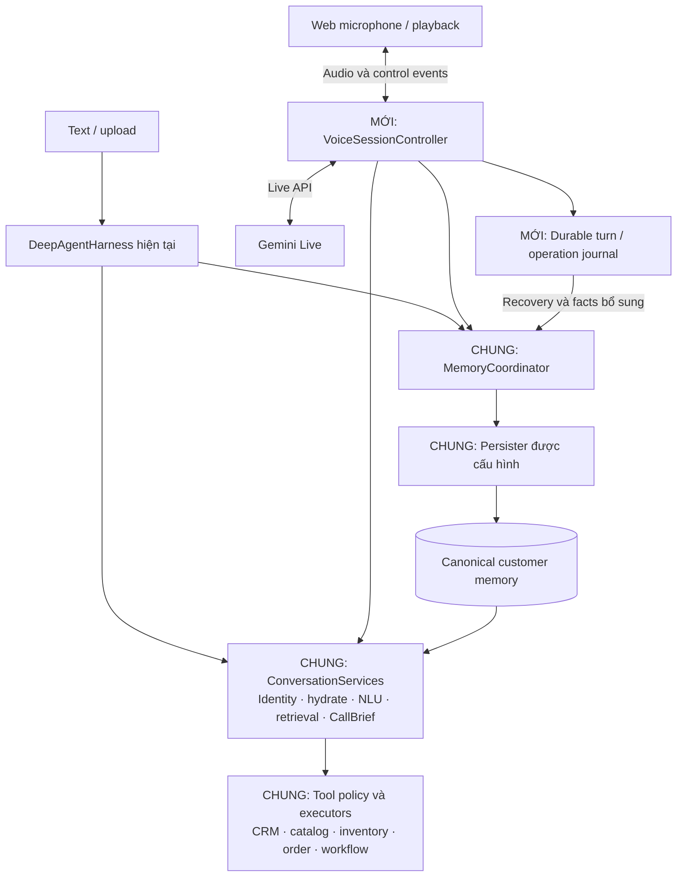

# Kế hoạch triển khai nhánh realtime voice bằng Gemini Live

- Ngày lập: 23/10/2026.
- Trạng thái: đã triển khai nhánh realtime tư vấn/tra cứu ngày 25/10/2026; xem mục 14.
- Phạm vi bản kế hoạch ban đầu ngày 23/10/2026: chỉ tài liệu. Việc triển khai được yêu cầu ở lượt tiếp theo.
- Mục tiêu: thêm nhánh native audio Gemini Live, dùng chung nghiệp vụ và canonical customer memory với nhánh text/upload hiện tại.

## 1. Phạm vi và các quyết định kiến trúc

### 1.1. Hướng triển khai đề xuất

1. Giữ DeepAgent cho text và upload ghi âm. Gemini Live đảm nhiệm hội thoại ở nhánh realtime; không gọi lại toàn bộ DeepAgentHarness.run_turn cho mỗi lượt voice hoặc function call.
2. Backend sở hữu identity, quyền tool, business mutations, journal và memory. Model chỉ đề xuất function calls; backend quyết định thực thi.
3. Dùng một bộ dịch vụ nghiệp vụ chung và một đường ghi canonical memory cho cả hai nhánh. Không sao chép nguyên pipeline DeepAgent sang một package voice mới.
4. MVP chạy một backend process/worker, proxy audio giữa trình duyệt và Gemini Live qua WebSocket. Đây là transport cho thử nghiệm có giới hạn; đánh giá WebRTC/LiveKit trước khi chốt transport production nếu mạng thực tế không đạt yêu cầu. Tách transport khỏi controller để có thể thay sau.
5. Bắt đầu với tool đọc. Chỉ bật tool ghi sau khi có idempotency, đối soát kết quả chưa rõ, memory recovery và kiểm thử ngắt lời.
6. Dùng các memory mode và persister đang có. Voice evaluation dùng kho in-memory riêng; không ghi vào memory khách thật.

### 1.2. Giới hạn phải được chốt ngay từ đầu

- Native audio không tương đương đường text được guard rồi mới phát hiện tại. Guardrail có thể kiểm tra context, tool input/output và transcript để quan sát; sửa transcript sau khi audio đã phát không thu hồi lời nói đó.
- Nếu sản phẩm bắt buộc duyệt mọi lời trước khi khách nghe, cần một thiết kế output riêng: text đã duyệt rồi TTS hoặc cơ chế giữ và kiểm tra toàn bộ output phù hợp. Không đánh dấu yêu cầu này đã đạt bằng cách lọc output transcript.
- Audio khách sẽ được truyền tới Gemini để xử lý. Nhánh Zipformer upload hiện tại vẫn nhận dạng local; hai đường có ranh giới xử lý dữ liệu khác nhau.
- Chưa bao gồm SIP/PSTN, video, nhiều instance backend, chuyển agent tự động hoặc DeepAgent làm tool cho Gemini.
- Không đặt tên model, SDK version, giới hạn phiên hoặc cấu hình thinking theo suy đoán. P0 sẽ chọn cặp model/SDK thực sự truy cập được và ghi vào cấu hình được kiểm thử.

## 2. Cơ sở từ repository hiện tại

Đường dẫn đầy đủ tính từ repository root. Trong bảng khảo sát, các tiền tố application/, adapters/ và core/ được rút gọn từ src/telesale_agent/. Tên file mới là đề xuất, không hàm ý chúng đã tồn tại.

| Thành phần hiện tại | Vị trí | Hệ quả với kế hoạch |
|---|---|---|
| HTTP, SSE và khóa từng conversation | src/telesale_agent/entrypoints/api/chat.py | Thêm router voice vào cùng app; tách quản lý state/khóa để tránh hai đường cập nhật không nhất quán. |
| Composition root và chọn memory mode | src/telesale_agent/bootstrap.py | Tách dựng shared services khỏi dựng DeepAgent; dùng cùng lựa chọn repository/persister. |
| Khởi tạo MCP, instructions và DeepAgent trong cùng runtime | application/deepagent/runtime.py | Tách vòng đời MCP; voice không phải khởi tạo graph, checkpointer và middleware DeepAgent để dùng business tools. |
| Identity, NLU, retrieval, refresh, CallBrief, prefetch, mutation và finalize | application/deepagent/turn.py | Đây là phần điều phối chính cần phân tách theo trách nhiệm. |
| Hydrate/refresh customer context | application/customer_context.py | Tái sử dụng trực tiếp qua adapter; không tạo dịch vụ hydrate thứ hai cho voice. |
| CallBrief projector | application/memory/call_brief.py | Tái sử dụng bản gọn; không bơm toàn bộ hồ sơ/lịch sử vào từng audio chunk. |
| ReadToolExecutor / MutationToolExecutor | application/deepagent/tools/reads.py, mutations.py | Chuyển logic nghiệp vụ sang vị trí dùng chung; giữ façade tương thích cho nhánh cũ. |
| Routing nghiệp vụ lẫn LangChain middleware | application/deepagent/tools/routing.py | Tách policy chọn tool khỏi IntentToolRoutingMiddleware. |
| Protocol nghiệp vụ lẫn giải mã message LangChain | application/deepagent/tools/protocol.py | Chỉ tách canonical names/args/results và AgentStep projection; extraction từ graph vẫn ở DeepAgent. |
| Facts, provenance, set/supersede | application/memory/persist.py, turn_facts.py | Dùng chung; chỉ facts có bằng chứng mới được đưa vào canonical memory. |
| Persister theo facts và theo LLM learning | adapters/memory/turn_persist.py, adapters/llm/llm_persist.py | Cả hai cần được kiểm thử với voice; không âm thầm thay persister mặc định. |
| Workspace cho một lần ghi snapshot | adapters/memory/write_session.py | Đã gom ghi remote một lần; chưa phải giao dịch nguyên tử giữa PostgreSQL và file/object storage. |
| Kho memory local/object storage | adapters/memory/file_memory.py, object_storage.py | Khóa local theo thao tác chưa thay thế điều phối toàn bộ read-modify-write giữa hai kênh. previous_snapshot không mặc nhiên là distributed CAS. |
| Mô hình input/state/context/result | core/models.py | Channel.VOICE đã có; session setup cần model riêng, không tạo tin nhắn khách giả để hydrate. |
| Client chat hiện tại | src/web/utils/chat-api.ts và app/page.tsx | Thêm voice client độc lập, giữ hợp đồng text/SSE cũ. |

Mốc hồi quy quan trọng: response_complete của text/SSE hiện đến trước persistence, complete đến sau persistence. Việc tách shared services phải bảo toàn thứ tự này.

## 3. Kiến trúc đích



Hai state riêng: ConversationState của nhánh text và LiveSessionState của nhánh voice. Chúng liên kết qua customer_id và canonical memory, không dùng chung một object mutable cho nhiều cuộc hội thoại. Khi cho phép dùng cùng conversation_id giữa hai transport, phải có ownership/serialization rõ ràng trước.

## 4. Phần cần tách để dùng chung

### 4.1. Các module dùng chung đề xuất

Tất cả nằm dưới src/telesale_agent/.

| Module đích | Nguồn hiện tại | Trách nhiệm và ranh giới |
|---|---|---|
| application/conversation/services.py | bootstrap.py, DeepAgentHarness.__init__ | ConversationServices chứa identity, customer_context, perceive, retrieve, call_brief, guardrail, persister và tool runtime. Không chứa graph/checkpointer/Live socket. |
| application/conversation/prepare.py | Các đoạn trước model trong deepagent/turn.py | initialize_customer_context và prepare_turn_context: chuẩn hóa, perceive, refresh, retrieval, brief. Tách initialization khỏi một user turn; không tự chạy mutation khi chỉ chuẩn bị context. |
| application/conversation/tool_policy.py | Phần policy trong tools/routing.py | Chọn allowed tools theo context; không import LangChain middleware. Server vẫn kiểm tra mỗi invocation. |
| application/conversation/finalize.py | Đoạn sau model trong deepagent/turn.py | Chuyển kết quả đã chuẩn hóa thành steps/tool_results, message/state và yêu cầu persist. Không tự kết luận audio đã phát chỉ vì model sinh xong. |
| application/conversation/response_policy.py | prepare_response và các helper nghiệp vụ liên quan | Chia quy tắc grounding/PII có thể tái sử dụng khỏi cách sửa text để phát. Nhánh cũ tiếp tục gọi cùng policy qua façade. |
| application/tools/reads.py, mutations.py | deepagent/tools/reads.py, mutations.py | Dùng lại executors, thêm seam cho operation_id và cancellation check khi triển khai tool ghi. |
| application/tools/protocol.py | Phần canonical trong deepagent/tools/protocol.py | Tên tool, canonical arguments, compact results và projection AgentStep. Giữ parser message LangChain ở nhánh DeepAgent. |
| application/tools/memory_archive.py | deepagent/tools/memory_archive.py | Tái sử dụng truy vấn memory; đảm bảo customer_id được bind từ backend. |
| adapters/mcp/runtime.py | Kết nối MCP và prewarm trong deepagent/runtime.py | Sở hữu AsyncExitStack, MCP sessions, tool registry và shutdown một lần. Không dựng DeepAgent. |
| application/memory/coordinator.py | Mới, gọi persister hiện có | Điều phối ghi của cả text/voice theo customer, nguồn ghi ổn định, retry và xử lý snapshot xung đột. |

### 4.2. Cách tách để giới hạn hồi quy

1. Đưa logic sang module mới, giữ re-export/wrapper ở đường dẫn cũ trong giai đoạn chuyển tiếp.
2. Chuyển DeepAgentHarness sang gọi shared services trước. Khi test nhánh hiện tại đạt mới cho voice dùng cùng service.
3. Giữ thứ tự prepare, prefetch, confirmed mutation, model, guard response và persist của text; không gộp side effect vào helper tưởng là chỉ đọc context.
4. Giữ IntentToolRoutingMiddleware, message extraction, graph/checkpointer, prompt định dạng cho DeepAgent và SSE AnswerStream tại package DeepAgent.
5. Tách quy tắc nghiệp vụ khỏi chuỗi prompt. Voice có context renderer riêng; không gửi nguyên enriched_user_msg kèm chỉ dẫn runtime DeepAgent vào Live API.
6. Composition root tạo một MCP runtime dùng chung trong lifespan. Hai controller không cùng sở hữu rồi đóng cùng một stack.
7. Không di chuyển toàn bộ package memory hoặc viết lại repository chỉ để đổi tên thư mục.

## 5. Module mới cho realtime voice

### 5.1. Backend và hợp đồng nội bộ

| File/module đề xuất | Chức năng | Ưu tiên |
|---|---|---|
| core/realtime.py | SessionInit, LiveSessionState, VoiceTurnRecord, normalized events, enums và các ID nội bộ. | P2 |
| core/interfaces.py, bổ sung ports | LiveModelClient, VoiceJournal, OperationStore; adapter không rò kiểu SDK vào application. | P2 |
| config/realtime.py | Feature flags, model, audio settings, queue limits, timeouts, giới hạn phiên và tools mode. | P0/P3 |
| application/realtime/controller.py | Chủ sở hữu phiên; đọc/ghi model, nhận client controls, phân phối mọi phần của event, quản lý tasks và shutdown. | P2/P3 |
| application/realtime/session.py | Khởi tạo identity/context, ownership, lifecycle, reconnect/resume và khôi phục context. | P2/P7 |
| application/realtime/turn.py | Gộp transcript/sự kiện theo lượt, snapshots theo revision, điều kiện finalize, xử lý late events. | P2 |
| application/realtime/context.py | Dựng Live instructions/CallBrief, tool schemas và context update tại thời điểm phù hợp với model đã chọn. | P3/P4 |
| application/realtime/tool_dispatch.py | Validate function call, bind identity, lấy context ổn định, policy gate, gọi executor và trả response. | P4/P6 |
| application/realtime/interruptions.py | Generation epoch, dừng audio cũ, tool cancellation và phân biệt model cancellation với domain outcome. | P3/P6 |
| application/realtime/memory_adapter.py | VoiceTurnRecord sang context/commit batch dùng chung; giữ incomplete và delivery metadata riêng. | P5 |
| application/realtime/metrics.py | Mốc end-of-speech, model output, playback, interrupt, tools, persist, reconnect và usage. | P3/P8 |
| adapters/llm/gemini_live.py | SDK Live client, model-specific setup, đủ audio/text/tool/event parts, function responses, resume/context update. | P3 |
| adapters/db/voice_models.py | Bảng journal, operation ledger và memory commit jobs; dùng PostgreSQL hiện có. | P5/P6 |
| adapters/db/voice_store.py | Đọc/ghi journal, claim operation, trạng thái recovery và deduplication. | P5/P6 |
| entrypoints/api/voice.py | HTTP tạo phiên, WebSocket audio/control, trạng thái và kết thúc phiên; gọi controller, không chứa logic order/memory. | P3 |
| scripts/migrate_voice.py | Migration bổ sung bảng/index cho voice, có kiểm tra tồn tại và hướng dẫn rollback. | P5 |

Các package mới có __init__.py khi cần. Có thể gộp file nhỏ sau khi chốt contracts; ưu tiên giữ ranh giới trách nhiệm hơn số lượng file.

Các file hiện có sẽ sửa ở giai đoạn triển khai: bootstrap.py, deepagent/harness.py, deepagent/runtime.py, deepagent/turn.py, entrypoints/api/chat.py, pyproject.toml, requirements.txt và .env.example. Trong lượt lập kế hoạch này chưa sửa các file đó.

Thêm dependency trực tiếp google-genai trong extra realtime riêng, kiểm tra tương thích với dependencies hiện có. Không đặt realtime vào extra voice đang dành cho Zipformer. Chốt version sau smoke test SDK; không nâng toàn bộ stack để thêm voice.

### 5.2. Frontend

| File đề xuất | Chức năng |
|---|---|
| src/web/utils/voice-api.ts | Tạo/đóng phiên, WebSocket protocol, reconnect ticket, normalized controls/events. |
| src/web/utils/voice-audio.ts | PCM encoding/resampling, format validation và nối capture/playback. |
| src/web/public/audio/voice-capture-worklet.js | Đọc microphone theo luồng, mono PCM, chuyển frame có sequence/timestamp. |
| src/web/public/audio/voice-playback-worklet.js | Playback buffer, progress, flush, loại generation cũ. |
| src/web/hooks/use-voice-session.ts | State/UI lifecycle, mic permission, listener cleanup, reconnect và lỗi. |
| src/web/components/voice-panel.tsx | Connect, mute, end; trạng thái nghe/nói/đang xử lý; transcript interim/final. |
| src/web/app/page.tsx, chỉnh khi triển khai | Thêm chế độ realtime dùng lại lựa chọn khách; không sửa contract của createChatClient. |

Trước khi viết frontend phải đọc hướng dẫn Next.js cài trong node_modules theo src/web/AGENTS.md. File worklet ở public là tài nguyên runtime dự kiến, không phải đổi cấu hình build ngay trong kế hoạch.

## 6. Contracts cần chốt trước khi nối provider

### 6.1. IDs và state

| Trường | Ý nghĩa |
|---|---|
| customer_id | Lấy từ identity service; model/client arguments không được ghi đè. |
| conversation_id | Hội thoại nghiệp vụ; liên kết voice session với khách đã được backend cho phép. |
| live_session_id / connection_epoch | Phiên ứng dụng và lần kết nối; tách khỏi provider session/resume handle. |
| turn_id / turn_sequence | Được backend cấp và journal hóa; không đổi khi finalize/recovery chạy lại. |
| generation_id | ID nội bộ để loại audio/control cũ sau interruption. |
| provider_tool_call_id | Dùng trả function response tương ứng, không dùng làm idempotency key nghiệp vụ duy nhất. |
| operation_id | Một yêu cầu ghi đã được khách xác nhận; ổn định qua retry/reconnect, đổi khi có yêu cầu độc lập hoặc nội dung xác nhận mới. |
| transcript_revision / context_revision | Revision để loại kết quả NLU cũ và context tính trên transcript đã bị sửa. |
| memory_source_id / memory_revision | Nguồn ghi ổn định và revision phía ứng dụng; không giả định repository hiện tại đã có distributed revision/CAS. |

VoiceTurnRecord giữ riêng transcript raw/normalized, finality, generated output text, generation status, playback progress, tool evidence, pending operations và trạng thái memory commit. Chưa có căn chỉnh text/audio thì chỉ ghi số mẫu/thời lượng đã phát, không khẳng định chính xác khách đã nghe những từ nào.

Không ép toàn bộ trạng thái vào một enum: connection, input turn, output generation, tool operation và memory job có lifecycle độc lập. Session model không thay ConversationState của text và không giả một user turn rỗng để khởi tạo identity.

### 6.2. API ứng dụng đề xuất

- POST /api/voice/sessions: tạo phiên, bind identity/ownership, trả session ID và ticket kết nối ngắn hạn.
- WS /api/voice/sessions/{session_id}/stream: binary audio và JSON controls/events có version, epoch, sequence.
- GET /api/voice/sessions/{session_id}: trạng thái ứng dụng và pending operations, kiểm tra ownership.
- DELETE /api/voice/sessions/{session_id}: yêu cầu đóng có kiểm soát; không xóa journal hay outcome đã commit.
- Browser controls: input_audio_end, playback_progress, mute, close; app events: session_ready, transcript_update, audio metadata, interrupted, operation_update, turn_status, memory_committed, error.

Đây là tên API/event nội bộ đề xuất, không phải tên event Google. Browser WebSocket không dùng tùy ý header X-API-Key: HTTP bootstrap áp dụng auth hiện có, ticket WebSocket có TTL, bind owner/session và kiểm tra Origin. Không đặt provider API key vào browser hoặc query URL. Bật realtime không được mở quyền truy cập phiên text sẵn có chỉ vì client biết conversation_id.

## 7. Chi tiết hành vi cần triển khai

### 7.1. Streaming audio và controller

1. Tách model receive loop, client receive loop và output sender. Một task xử lý tool/persist chậm không chặn việc nhận audio hoặc interruption.
2. Serialize cập nhật state của từng phiên qua event queue; task nền trả kết quả kèm turn/revision/epoch để kiểm tra trước khi áp dụng.
3. Gateway xử lý mọi phần của một provider event. Không dùng chuỗi if/elif khiến audio xuất hiện cùng transcript hoặc function call bị bỏ sót.
4. Audio format, sample rate và resampling theo model/SDK đã chọn. Dùng PCM streaming; không tái sử dụng cơ chế upload file hoặc FFmpeg theo từng frame.
5. Queue có giới hạn. Quá tải phải giảm/đóng luồng có tín hiệu, không tích lũy audio vô hạn; ưu tiên control events và interruption.
6. generation_complete, turn_complete và playback drained là các mốc khác nhau. Việc chốt application turn còn xét transcript, pending tools và interaction status nếu model yêu cầu.

Google mô tả transcript độc lập với model turn và cung cấp các tín hiệu generation/interruption riêng. Adapter cần normalize các tín hiệu này thay vì giả định thứ tự cố định. [LiveServerContent](https://googleapis.github.io/js-genai/release_docs/interfaces/types.LiveServerContent.html)

### 7.2. Context và NLU

1. Resolve/hydrate trước khi session ready; thiếu identity thì dùng context rỗng có kiểm soát, chưa đọc/ghi memory của một khách chưa xác định.
2. Interim transcript chỉ phục vụ UI và dự đoán có thể hủy. NLU/candidates phục vụ mutation phải gắn transcript đã chốt và revision hiện hành.
3. Cache prepared context theo turn/revision/memory snapshot. Chuẩn bị context không tự tạo đơn, callback hoặc handoff.
4. Nếu function call đến trước transcript đủ ổn định, dispatcher trả trạng thái pending/needs_clarification theo contract đã chọn; không lấy arguments do model tự điền làm bằng chứng xác nhận của khách.
5. Tool allowlist cố định ở setup có thể rộng hơn quyền của lượt; server luôn áp dụng policy theo lượt. Cập nhật declarations giữa phiên chỉ khi model/SDK hỗ trợ và có test.
6. Nạp CallBrief gọn lúc đầu. Sau memory/tool outcome, gửi thông tin cập nhật ở thời điểm an toàn bằng API context/tool response phù hợp; không lặp toàn bộ history hoặc bơm lại chính transcript đã có như một user turn mới.

Native Live không bảo toàn mặc định thứ tự NLU rồi model của nhánh text. Nếu bắt buộc mọi phản hồi nghiệp vụ chờ NLU, cần cơ chế kiểm soát phát phản hồi được kiểm chứng riêng; prompt yêu cầu gọi tool trước không phải bảo đảm ở backend.

### 7.3. Tool calling, idempotency và recovery

1. Chuẩn hóa tên/schema/arguments, bind customer_id ở server, kiểm tra allowlist và generation hiện hành trước dispatch.
2. Tool đọc dùng cache/prefetch có freshness; giá và tồn kho phải revalidate khi commit mutation.
3. Tool ghi đi qua MutationToolExecutor dùng chung. Cùng một hành động có một operation_id, kể cả được bước tương đương 8b chủ động chọn hay Gemini yêu cầu.
4. Ledger chuyển trạng thái: requested → validated → executing → succeeded / failed / unknown. cancelled chỉ dùng khi biết chắc chưa tạo side effect hoặc domain đã xác nhận hủy.
5. Claim operation có unique constraint trước side effect; lưu request fingerprint và confirmation evidence. Cùng ID khác payload trả conflict; mua thêm cùng SKU có xác nhận mới phải tạo operation mới.
6. Mutation executor hiện có idempotency_key theo conversation/call/SKU. Khi tích hợp, bổ sung cơ chế nhận operation key mà vẫn giữ fallback cũ; kiểm thử hai yêu cầu mua độc lập cùng SKU trong một cuộc gọi.
7. Tạo đơn hiện có cơ chế idempotency ở src/mcp_servers/tools/order.py. Audit từng tool callback/update/handoff; tool nào chưa chống trùng hoặc chưa đối soát được thì giữ disabled ở voice.
8. Sau timeout/crash, kiểm tra domain outcome theo operation key trước retry. Ledger và side effect qua MCP không tự nằm trong một DB transaction; cần domain idempotency và reconciliation để xử lý khoảng trống đó.
9. Tool response giữ call ID tương ứng và trạng thái chuẩn. Nếu provider đã hủy call, vẫn ghi outcome nghiệp vụ vào journal/memory; chỉ đồng bộ lại session khi hợp lệ, tránh phát lại câu trả lời cũ.

Luồng gọi function và trả kết quả thuộc code ứng dụng. [Gemini Live tool use](https://ai.google.dev/gemini-api/docs/live-api/tools)

### 7.4. Memory dùng chung

1. Tạo durable turn record trước khi finalize; transcript chưa chốt hoặc input thiếu chỉ tạo incomplete trace, chưa tạo customer facts từ phần chưa xác minh.
2. Chuyển transcript chuẩn hóa, perception, verified tool results và AgentStep vào context tương thích. Generated speech không là bằng chứng đơn hàng đã thành công.
3. MemoryCoordinator điều phối read-modify-write theo customer cho cả text và voice. Khóa ngắn để rebase/commit; không khóa microphone hoặc giữ customer lock suốt cuộc gọi.
4. MVP một process dùng cùng coordinator cho mọi kênh. Trước nhiều process/host, thêm DB-backed serialization hoặc version/CAS có kiểm thử. Atomic file write và RLock từng thao tác không bảo đảm toàn bộ luồng read-modify-write.
5. Phân biệt journal PostgreSQL với canonical memory file/object storage. Dùng commit job có source/revision ổn định, retry và đối soát; không tuyên bố commit nguyên tử xuyên hai kho.
6. persist_turn_memory và LLMPersister hiện suy ra nguồn theo call_key và turn_number + 1. Cần seam memory_source_id ổn định trong cả hai, giữ fallback text cũ; late events không được lấy số lượt hiện tại để ghi nhầm nguồn.
7. Cache prepared write batch/learning output theo source/revision trước khi retry. Bảo đảm replay không append lại atomic facts, episode hoặc foresight; không chỉ chống trùng upsert facts.
8. TurnMemoryPersister và LLMPersister đều đi qua coordinator. NLU memory_deltas tạm phải thuộc từng turn/revision, không dùng chung dict đang bị hai lượt cập nhật.
9. Tool thành công sau khi lượt bị ngắt tạo supplemental evidence cho turn gốc. Những facts còn pending được đối soát tiếp; không chặn mọi lượt mới chỉ để chờ một tool không rõ kết quả.
10. Chỉ báo memory_committed sau khi canonical store đã ghi thành công. Nếu persist thất bại, giữ job pending và snapshot trước; lượt cần dữ liệu đó phải đọc journal hoặc chờ barrier phù hợp.
11. Sau commit, refresh CallBrief/context. Nếu job học episode chạy nền, truy xuất facts đã commit vẫn nhất quán; tách facts/learning thành hai phase chỉ khi có contract và tests, không âm thầm thay hành vi LLMPersister.

### 7.5. Ngắt lời

1. Client phát hiện speech start có thể dừng playback cục bộ ngay; controller đối chiếu interruption từ provider để xác nhận state.
2. Flush playback queue, tăng output epoch và bỏ audio/frame muộn của generation cũ. Không dừng việc nhận lời mới của khách.
3. Pending tool chưa dispatch và đã mất hiệu lực: hủy. Tool đọc đang chạy: hủy hoặc bỏ kết quả nếu không còn cần.
4. Mutation đang chạy: cố hủy chỉ khi domain hỗ trợ; nếu chưa biết kết quả thì chuyển unknown và đối soát. Mutation đã commit giữ nguyên outcome.
5. Lượt cũ ghi interrupted cùng playback progress; không biến generated transcript thành toàn bộ lời khách đã nghe.
6. Yêu cầu mới như đổi địa chỉ phải dựa trên order thực tế đã tạo. Không tạo lại order để bù cho việc lời xác nhận trước bị ngắt.
7. Trước dispatch mutation, kiểm tra lại epoch/confirmation. Nếu interruption xảy ra trong lúc commit, domain outcome và ledger quyết định bước tiếp theo.

Hành vi dừng playback khi nhận interrupted dựa trên [Live API capabilities](https://ai.google.dev/gemini-api/docs/live-api/capabilities). Chính sách operation và memory ở trên là thiết kế ứng dụng đề xuất.

### 7.6. Mất kết nối và đóng phiên

- Mất kết nối client: đóng nhận audio, ghi disconnected, giữ lại journal và xử lý/đối soát mutation đã dispatch.
- Mất kết nối provider: thử resume theo model đã chọn; nếu không thể thì mở phiên mới với snapshot, brief và pending operations mới nhất. Không replay raw mutation như một yêu cầu mới.
- GoAway/shutdown: ngừng nhận phiên mới, checkpoint phiên đang chạy, drain tác vụ có thời hạn và để recovery xử lý phần chưa xong.
- Resume handle giúp liên tục phiên model, không thay canonical memory hoặc operation ledger. Handle được giữ ở server và kiểm tra ownership khi nối lại. [Session management](https://ai.google.dev/gemini-api/docs/live-api/session-management)

## 8. Thứ tự thực hiện và điều kiện hoàn thành

Mỗi pha là một nhóm thay đổi có thể review độc lập. Kiểm tra xong mới chuyển pha phụ thuộc; chưa bật tool ghi cho người dùng ở giai đoạn chỉ đọc.

| Pha | Công việc chính | Phụ thuộc | Điều kiện hoàn thành |
|---|---|---|---|
| P0 — Chốt baseline | Ghi model/SDK khả dụng, transport MVP, chính sách native-audio guardrail; thu fixture text/upload/SSE và memory modes. Lập schema contracts và flags mặc định tắt. | Không | Quyết định rõ giới hạn MVP; biết chuẩn đầu ra để so sánh hồi quy. |
| P1 — Tách shared services | services, prepare, policy, finalize, executors và MCP runtime; composition root dùng chung, giữ façade. | P0 | Text/upload giữ response, tool trace, memory writes và thứ tự SSE; startup/shutdown MCP đúng một lần. |
| P2 — State machine giả lập | core/realtime, controller/turn/session, fake LiveModelClient; event replay không gọi API thật. | P1 | Xử lý event đảo thứ tự, nhiều part, late events, interruption và task cleanup. |
| P3 — Audio đầu cuối | Gemini adapter, voice router, capture/playback worklets, voice panel; giới hạn queue; ngắt lời audio cơ bản. Business mutations tắt. | P2 | Nói/nghe được, transcript hiển thị, dừng audio cũ, đóng phiên không rò task/socket; không ảnh hưởng chat. |
| P4 — Tool đọc và context | Dispatcher, schema conversion, NLU snapshot/cache, allowlist; CRM/catalog/inventory/policy tools. | P3 | Function response đúng call ID; transcript muộn không bypass gate; trả lời dựa trên dữ liệu tool. |
| P5 — Memory chung và recovery | Memory adapter/coordinator, journal DB/migration, stable source IDs, retry/dedup; kết nối text vào cùng writer. | P2, P4 | Voice → text và text → voice thấy đúng facts; replay/crash không trùng episode; persist lỗi không báo committed. |
| P6 — Mutation có kiểm soát | Durable operation ledger, domain idempotency, confirmation gates, cancellation/reconciliation cho từng tool ghi. | P4, P5 | Tạo/sửa đơn một lần theo operation, đủ bằng chứng; interruption/timeout/restart không tạo side effect trùng. |
| P7 — Reconnect và hardening | Resume/rebuild, ownership/ticket/Origin, overload, shutdown/recovery; ràng buộc một worker được enforce/document. | P3, P5, P6 | Nối lại không replay mutation; outcome muộn vẫn về đúng turn; tài nguyên được dọn. |
| P8 — Đánh giá và rollout | Replay suite, audio benchmark tiếng Việt, metrics, staging limited access, rollout flags và rollback. | P7 | Các tiêu chí mục 10 đạt trên môi trường đo; giới hạn chất lượng native audio được ghi rõ. |

Thứ tự mặc định: P0 → P1 → P2 → P3 → P4 → P5 → P6 → P7 → P8. P5 có thể chuẩn bị schema từ P2 nhưng chỉ nghiệm thu sau luồng tool đọc.

### 8.1. Các mốc review

- Mốc A, sau P1: chỉ refactor dùng chung, chưa có thay đổi trải nghiệm voice.
- Mốc B, sau P4: demo native voice với tool đọc; memory chưa đạt P5 thì dùng evaluation mode, không quảng bá là đã nhớ bền vững.
- Mốc C, sau P5: voice dùng chung canonical memory; mutations vẫn tắt.
- Mốc D, sau P7: bật từng tool ghi trong môi trường kiểm thử, sau đó mới limited rollout.

## 9. Kiểm thử dự kiến

Các file test dưới đây sẽ tạo khi triển khai; lượt hiện tại không thêm hay chạy test ứng dụng.

| File/nhóm test đề xuất | Trường hợp cần chứng minh |
|---|---|
| tests/test_conversation_services.py | Kết quả prepare/finalize và business semantics giữ nguyên sau extraction; memory modes và MCP lifecycle. |
| tests/test_realtime_turns.py | Audio+transcript chung event, transcript đến sau turn signal, interim sửa lại, async tool event muộn, timeout finality, tách nhiều generation. |
| tests/test_realtime_tools.py | Bind identity, tool/schema không hợp lệ, missing confirmation, stale revision, read freshness, phân biệt hai order cùng SKU. |
| tests/test_realtime_memory.py | Voice/text cùng customer, incomplete input, verified tool facts, supersede đúng, LLMPersister mode, duplicate learning output, persist retry. |
| tests/test_realtime_recovery.py | Crash trước/sau domain commit, trước/sau canonical write, late success sau interruption, unknown reconciliation và resume thất bại. |
| tests/test_voice_api.py | Session ownership, ticket TTL/reuse, Origin, invalid audio, queue overflow, disconnect và đóng phiên. |
| src/web/tests/voice-api.test.mjs | Protocol/epoch, reconnect, listener cleanup, giả lập progress/flush, lỗi mic; không cần model thật. |
| Browser audio QA | Resampling thực tế, speaker/mic, echo, mute/unmute, audio cũ sau interrupt, chuyển tab và network change. |

Giữ tests/test_streaming.py và các test eval/frontend hiện có làm regression. Thêm fixture để chứng minh hành vi nghiệp vụ được giữ nguyên, tránh snapshot theo câu chữ LLM không ổn định.

Lệnh dự kiến khi triển khai, điều chỉnh nếu repository bổ sung cấu hình test:

```powershell
.\.venv\Scripts\python.exe -X utf8 -m pytest tests
.\.venv\Scripts\python.exe -X utf8 -m unittest discover -s src\eval -p test_*.py -v
```

Trong src/web chạy npm test, npm run lint và npm run build sau phần frontend. Smoke test Gemini thật tách khỏi test mặc định, dùng tài khoản/model đã cấu hình, test customer riêng và tool đọc trước; không chạy full paid eval như một bước ngầm của unit tests.

## 10. Tiêu chí nghiệm thu và đo lường

### 10.1. Tính đúng

- Feature flag tắt: text/upload/API/SSE và memory mode giữ hành vi hiện tại.
- Bật voice: không lẫn customer/session; không thực thi tool ngoài policy hoặc mutation thiếu xác nhận.
- Retry/reconnect cùng operation không tạo đơn/callback trùng; yêu cầu nghiệp vụ độc lập vẫn thực hiện được.
- Tool đã commit vẫn được ghi nhận khi lời xác nhận bị ngắt; tool unknown không được ghi như thành công.
- Canonical memory đi qua cùng persister/coordinator; duplicate replay không nhân atomic facts/episode/foresight.
- Cùng customer ở text và voice không mất cập nhật; store lỗi có recovery job và trạng thái minh bạch.
- Audio cũ không phát sau interruption; các mốc generated, delivered và persisted không bị gộp thành complete giả.
- Startup/shutdown, disconnect và quá tải không để lại task, MCP session hoặc socket không được quản lý.

### 10.2. Chất lượng và latency

- Đo riêng end-of-speech → first audio ở backend và end-of-speech → first playback ở client. Báo rõ điểm đo/đồng hồ; không trừ ASR theo cách của offline upload để báo voice nhanh hơn.
- Đo interruption → playback stopped; tool read/write latency; memory commit latency; reconnect; queue depth và usage/cost theo phiên.
- Dùng kịch bản tiếng Việt có giọng vùng miền, tên sản phẩm/SKU, số tiền, địa chỉ, nói ngập ngừng, sửa ý và nói chen.
- Mốc TTFA <= 2,5 giây trong eval hiện tại chỉ là yêu cầu tham chiếu cần đo lại. Chốt ngưỡng nghiệm thu p50/p95 sau baseline P3; không tuyên bố đạt SLA từ unit test hoặc demo vài lượt.
- Báo cỡ mẫu, warm-up, môi trường, model/SDK, mạng và các lỗi. Ít mẫu chỉ dùng quan sát; không dùng làm kết luận production.

## 11. Cấu hình, vận hành và rollback

Các tên dưới đây là đề xuất cho giai đoạn triển khai:

- REALTIME_VOICE_ENABLED=false và REALTIME_VOICE_UI_ENABLED=false mặc định.
- GEMINI_LIVE_MODEL, GEMINI_LIVE_API_VERSION và tham chiếu credential phía server.
- REALTIME_TOOLS_MODE=off|read_only|read_write; bật từng write tool sau khi đạt P6/P7.
- REALTIME_MAX_SESSIONS, REALTIME_AUDIO_QUEUE_LIMIT, REALTIME_TOOL_TIMEOUT_SECONDS, REALTIME_FINALIZE_TIMEOUT_SECONDS và REALTIME_SESSION_IDLE_TIMEOUT_SECONDS.
- Chế độ memory tiếp tục dùng cấu hình hiện có; không tạo kho canonical voice riêng. Evaluation chọn repository riêng qua composition root.

Migration chỉ bổ sung bảng/index voice; không sửa dữ liệu canonical cũ để bật tính năng. Journal/ledger lưu trạng thái tối thiểu cần recovery, không lưu raw audio mặc định; cấu hình retention riêng trước rollout.

Rollout: test giả lập → local/staging tool đọc → memory chung → từng tool ghi → nhóm người dùng giới hạn. Trước nhiều worker phải hoàn thành điều phối ghi/operation xuyên process và transport/load test tương ứng.

Rollback: ngừng nhận phiên voice mới, giữ đường text, drain/đối soát tool đang chạy rồi tắt UI/router qua flags. Giữ journal và recovery jobs đến khi đối soát xong; không xóa bảng hay memory để rollback. Không để việc tắt voice làm đóng MCP runtime mà text đang dùng.

## 12. Checklist bắt đầu triển khai

- [ ] P0: chốt model/SDK, transport MVP và mức bảo đảm guardrail native audio.
- [ ] Ghi baseline text/upload/SSE, memory modes và tool outcomes.
- [ ] Tách shared services cùng MCP lifecycle, cho nhánh cũ dùng trước.
- [ ] Chốt IDs, event contracts, finality và fake-event state machine.
- [ ] Nối audio thật và ngắt lời trước khi thêm business mutations.
- [ ] Nối tool đọc, context policy và cache theo revision.
- [ ] Hoàn thành writer dùng chung, journal, stable memory source và recovery.
- [ ] Hoàn thành ledger/idempotency/reconciliation cho từng tool ghi.
- [ ] Đạt reconnect/shutdown/overload tests và kiểm thử tiếng Việt.
- [ ] Review limited rollout, metrics và rollback trước khi bật cho người dùng.

## 13. Tài liệu đối chiếu

- [Kiến trúc DeepAgent hiện tại](./deep_agent_architecture.md).
- [Luồng context và memory hiện tại](./deepagent_context_memory_flow.md).
- [Voice upload và Zipformer](../deployment/local_voice_input.md).
- [Eval và quy ước latency hiện tại](../../src/eval/README.md).
- [Gemini Live overview](https://ai.google.dev/gemini-api/docs/live-api).
- [Gemini Live capabilities](https://ai.google.dev/gemini-api/docs/live-api/capabilities).
- [Gemini Live tool use](https://ai.google.dev/gemini-api/docs/live-api/tools).
- [Gemini Live session management](https://ai.google.dev/gemini-api/docs/live-api/session-management).
- [Google Gen AI SDK: LiveServerContent](https://googleapis.github.io/js-genai/release_docs/interfaces/types.LiveServerContent.html).

Các ràng buộc provider cần được đối chiếu lại ở P0 cho model/SDK được chọn. Sơ đồ module, operation journal và memory coordination là thiết kế đề xuất cho repository này, không phải tính năng có sẵn của Gemini Live.

## 14. Đối chiếu bản triển khai ngày 25/10/2026

- Đã thêm nút chuyển chế độ trên page.tsx và VoicePanel; audio capture/playback bằng worklet.
- Đã tách context preparation, tool policy, business executors/protocol và MCP connection runtime; giữ façade import của DeepAgent.
- ConversationServices lấy các dependency đã được composition root hiện tại khởi tạo; MCP vẫn có một lifecycle owner là harness trong lifespan.
- Voice controller, Gemini adapter, router, session tickets, read-only tool dispatcher và memory adapter/coordinator đã có code cùng kiểm thử giả lập.
- Memory jobs dùng PostgreSQL voice_turn_journal, nguồn voice ổn định và prepared write batches. Script migration được cung cấp nhưng không tự chạy lên database người dùng.
- Một số module trong đề xuất được gộp: turn/session event handling, interruption và finalize nằm ở controller.py; response policy cho text vẫn ở đường hiện tại.
- Pha P6 cho tool ghi chưa bật: chưa có operation ledger/reconciliation đã nghiệm thu cho mọi domain mutation. Server từ chối read_write; dùng chat cho tạo/sửa đơn.
- Provider reconnect/resume có xử lý; browser transport mất kết nối thì kết thúc phiên và cho người dùng chủ động mở lại. Chưa triển khai reconnect browser tự động hoặc nhiều worker.
- Các tiêu chí rollout, audio QA trên Gemini thật và benchmark tiếng Việt phải được đo trên tài khoản/môi trường triển khai; tests tự động không phải chứng nhận SLA.
- Hướng dẫn cấu hình và phạm vi thực tế: [Gemini Live deployment](../deployment/gemini_live.md).
