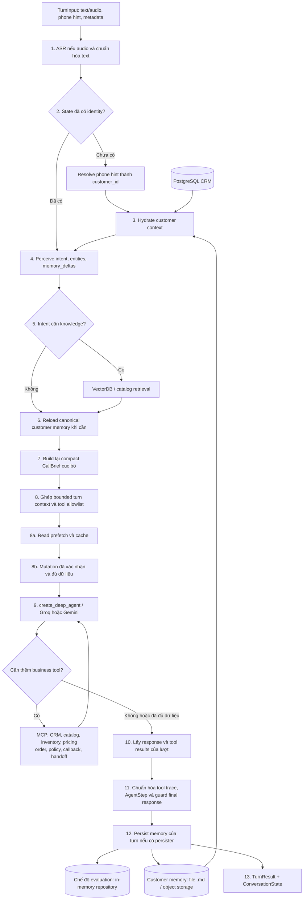
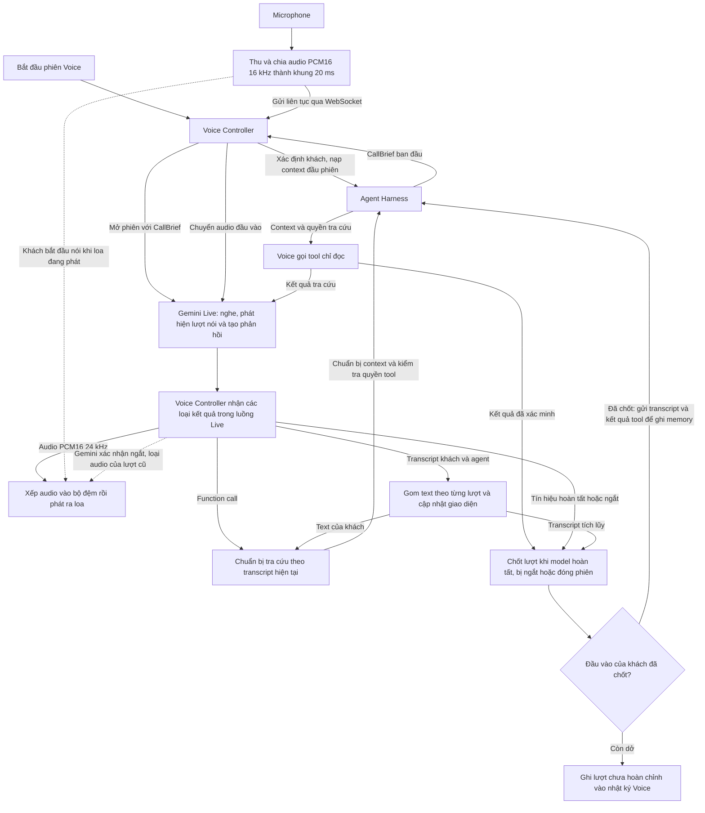

# Vòng lặp Agent Harness và Realtime Voice

Agent Harness điều phối một lượt tư vấn từ lúc nhận lời khách đến lúc trả lời và ghi nhớ. Nó xác định khách, nạp dữ liệu, chuẩn bị context, kiểm soát công cụ và lưu thông tin có ích cho lần sau. Với chat và file ghi âm, DeepAgent chạy vòng lặp suy luận và gọi tool. Với microphone trực tiếp, Gemini Live nghe và nói theo luồng, còn Realtime Voice dùng lại Agent Harness để chuẩn bị context, kiểm tra quyền tra cứu và ghi memory.

## A. Agent Harness cho chat và file ghi âm

### Luồng xử lý một lượt

| Thành phần | Làm gì trong lượt |
| --- | --- |
| Đầu vào và ASR | Chuẩn hóa tin nhắn. Nếu khách gửi file ghi âm, Zipformer nhận dạng tiếng nói trên máy chủ rồi chuyển transcript vào cùng luồng xử lý. |
| Identity và hồ sơ | Xác định `customer_id` từ thông tin khách cung cấp. Nạp hồ sơ CRM, lịch sử đơn và customer memory theo ID này. |
| Perception và retrieval | Xác định khách muốn gì, nhận diện các dữ kiện như sản phẩm, size hoặc ngân sách, rồi tra catalog hoặc chính sách khi câu hỏi cần. Dữ kiện mới được giữ tạm dưới dạng `memory_deltas`. |
| CallBrief | Kết hợp hồ sơ CRM, memory đã lưu và dữ kiện của lượt hiện tại thành bản tóm tắt ngắn. Agent có thể dùng ngay điều khách vừa sửa trong lượt này. |
| Điều phối công cụ | Chọn tool phù hợp với câu hỏi. Harness chủ động tra cứu khi đủ dữ liệu và xử lý tạo hoặc đổi đơn, hẹn gọi lại hay chuyển tiếp khi khách đã xác nhận và đáp ứng điều kiện. |
| DeepAgent | Nhận lời khách, CallBrief, vài tin nhắn gần nhất và kết quả tra cứu sẵn có. Model gọi thêm tool được phép nếu cần rồi soạn câu trả lời. |
| Hoàn tất | Đối chiếu câu trả lời với kết quả tool, kiểm tra thông tin cá nhân, ghi memory và cập nhật hội thoại. API trả JSON sau khi hoàn tất. Với SSE, giao diện có thể hiển thị bản nháp sớm và thay bằng kết quả cuối khi nhận `done`. |

CRM cung cấp thông tin khách đã xác minh. Giá, khuyến mãi, tồn kho và trạng thái đơn hiện tại lấy từ tool nghiệp vụ. Customer memory giữ nhu cầu, sở thích và dữ kiện từng tư vấn để agent biết cần hỏi hoặc kiểm tra lại điều gì.

### Memory được đọc và ghi ở đâu?

1. **Đọc trước khi dựng CallBrief.** Ở đầu cuộc gọi, Harness nạp memory khi xác định được `customer_id`. Các lượt sau đọc lại snapshot khi cần trước khi dựng brief. Nếu lượt vừa nạp memory thì dùng luôn snapshot đó.
2. **Dùng trong lượt.** CallBrief chọn dữ kiện liên quan từ snapshot và từ lời khách vừa nói. Ví dụ, khách nâng ngân sách từ 5 lên 6 triệu thì agent có thể tư vấn theo mức 6 triệu ngay trong câu trả lời hiện tại.
3. **Ghi sau khi có câu trả lời và kết quả tool.** Harness kết hợp dữ kiện đủ điều kiện từ lời khách với kết quả nghiệp vụ đã xác minh, rồi cập nhật memory theo khách. Một key như `budget_vnd` giữ giá trị mới nhất. Tùy cấu hình, cùng bước này có thể lưu thêm tóm tắt tương tác và gợi ý cho lần gọi sau. Lượt sau dùng snapshot mới để dựng lại brief.

| Thông số | Mặc định |
| --- | --- |
| Vòng lặp DeepAgent mỗi lượt | Tối đa 3 lần gọi model và 3 lần gọi tool bên trong vòng lặp. Phân tích đầu vào, tra cứu do Harness thực hiện và ghi memory có bước xử lý riêng. |
| Facts gửi vào prompt | Tối đa 6, ưu tiên theo câu hỏi. |
| Tin nhắn gần nhất | Tối đa 2 tin, 300 ký tự mỗi tin và tổng context tin nhắn gần nhất tối đa 800 ký tự. |
| Phạm vi checkpoint DeepAgent | Một lượt. Các lượt nối tiếp nhau qua trạng thái hội thoại và CallBrief. |

## B. Realtime Voice với Gemini Live

### Pipeline từ microphone đến loa

Voice Controller mở phiên với CallBrief của khách, chuyển audio từ trình duyệt tới Gemini Live, rồi tách audio, transcript và yêu cầu tra cứu để xử lý song song. Hai chế độ có trạng thái hội thoại riêng và chia sẻ customer memory theo cùng `customer_id`.

| Luồng | Xử lý realtime |
| --- | --- |
| Microphone | Trình duyệt gửi từng khung PCM16 mono 16 kHz qua WebSocket. Gemini Live nhận audio liên tục và phát hiện thời điểm khách bắt đầu hoặc kết thúc lời nói. |
| Audio trả lời | Gemini sinh audio trực tiếp. Trình duyệt phát PCM16 24 kHz ngay khi có dữ liệu và đệm những đoạn đến nhanh hơn tốc độ phát. |
| Text của khách | Transcript tạm hiển thị khi khách còn nói. Các đoạn transcript theo lượt được tích lũy để cập nhật giao diện, chuẩn bị tra cứu và chốt đầu vào cho memory. |
| Text của agent | Gemini trả transcript của lời agent nói. Controller nối các đoạn text rồi cập nhật cùng một dòng hội thoại theo lượt. Loa phát audio Gemini và giao diện hiển thị transcript song song. |
| Tra cứu | Khi Gemini yêu cầu tool, Controller dùng transcript hiện tại để lấy context và quyền tra cứu từ Agent Harness. Context đã chuẩn bị có thể dùng lại khi transcript còn nguyên và được làm mới khi transcript thay đổi. Voice gọi tool chỉ đọc, chẳng hạn tìm sản phẩm, kiểm tra tồn kho, giá hoặc chính sách, rồi gửi kết quả về Gemini để trả lời tiếp. |

### Khi khách ngập ngừng hoặc ngắt lời

- **Khách đang nói rồi ngập ngừng.** Microphone tiếp tục gửi audio. Gemini Live dùng phát hiện hoạt động giọng nói (VAD) để quyết định khi nào tới lượt trả lời. Backend chờ transcript đến muộn trước khi chốt lượt. Khi cần tra cứu, một đoạn transcript đã ổn định khoảng 0,4 giây có thể được dùng làm context đọc trong lúc lượt vẫn đang diễn ra. Quyết định ghi memory có bước kiểm tra đầu vào riêng.
- **Khách nói chen lúc agent đang phát audio.** Trình duyệt dọn phần audio đang chờ để nhường lời ngay khi phát hiện khách bắt đầu nói. Khi Gemini xác nhận ngắt, Controller đánh dấu lượt cũ bị ngắt, dừng các tra cứu còn chờ của lượt đó và báo trình duyệt bỏ các gói audio cũ đến muộn.
- **Model báo xong.** Controller đợi khoảng 0,5 giây rồi kiểm tra transcript của khách đã ổn định ít nhất 0,4 giây. Nếu tương tác đã hoàn tất bình thường và có transcript khách, Controller có thể chốt đầu vào dù thiếu tín hiệu transcript hoàn tất riêng. Nếu lượt bị ngắt hoặc đóng giữa câu, trạng thái chốt đã nhận từ trước quyết định đầu vào có đủ điều kiện ghi memory. Model báo xong, loa phát xong và ghi memory xong là ba mốc riêng.

### Voice ghi memory giống Agent Harness thế nào?

**Voice dùng cùng kho memory, cùng quy tắc trích và cập nhật facts, và cùng persister với Chat.** Khi bắt đầu phiên, Voice lấy CallBrief từ Agent Harness. Khi cần tra cứu hoặc hoàn tất lượt, Voice đưa transcript khách vào luồng chuẩn bị context dùng chung. Khi đầu vào đã chốt, transcript này và kết quả tool đã xác minh đi qua cùng quy tắc ghi memory theo `customer_id`. Lượt chat hoặc voice sau có thể đọc lại dữ kiện đã lưu qua CallBrief.

Voice có thêm nhật ký để theo dõi lượt đã chốt và phục hồi công việc ghi nếu bị gián đoạn. Lượt còn dở được đánh dấu trong nhật ký. Nếu khách đã nói xong rồi mới ngắt lời agent, đầu vào đã chốt vẫn đủ điều kiện ghi. Transcript lời agent giúp hiển thị và lưu diễn biến, còn dữ kiện về khách được lấy từ lời khách và kết quả tool đã xác minh.

| Thông số realtime | Mặc định hoặc định dạng |
| --- | --- |
| Model hội thoại trực tiếp | `gemini-3.8-live` |
| Audio vào | PCM16 mono, 16 kHz, mỗi khung 20 ms |
| Audio ra | PCM16, 24 kHz |
| Bộ đệm phát | Bắt đầu với dung lượng 2 giây, có thể tăng đến 60 giây. Phát ngay khi có audio. |
| Tra cứu nghiệp vụ | Chỉ đọc theo mặc định. Thời gian chờ thực thi một tool là 25 giây. |
| Phiên đồng thời và thời lượng | Tối đa 4 phiên, mỗi phiên tối đa 10 phút. |

Chi tiết cấu trúc kho và đường đọc ghi nằm trong [Thiết kế bộ nhớ](memory-design.md). Tham khảo thêm [Kiến trúc DeepAgent](../agent/deep_agent_architecture.md) và [Kiến trúc Gemini Live](../agent/gemini_live_architecture.md).
