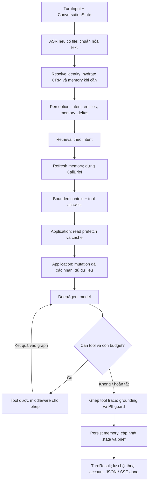
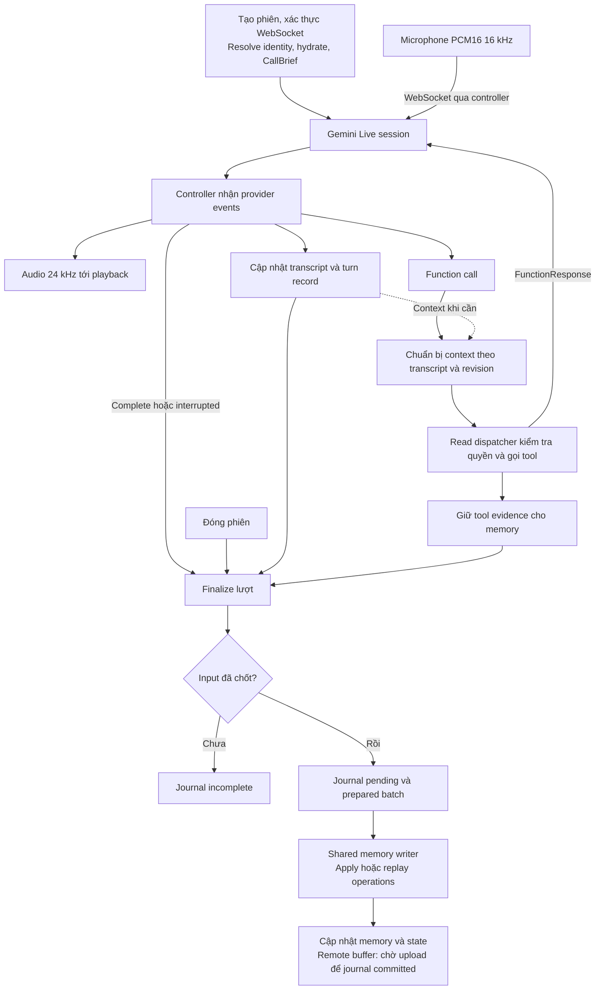

# Vòng lặp agent harness

> Đối chiếu mã nguồn ngày 18/11/2026. Xem [tổng quan hệ thống](system-architecture.md), [bộ nhớ](memory-design.md), [tool](tool-catalog.md) và [quyết định thiết kế](design-decisions.md).

## 1. Harness kiểm soát những gì?

Harness là lớp điều phối bao quanh model: chuẩn hóa đầu vào, xác định khách, cung cấp context, giới hạn tool, thu thập bằng chứng, kiểm tra câu trả lời và ghi memory. Hệ thống dùng cách điều phối hybrid: application chủ động chuẩn bị dữ liệu và xử lý mutation đã xác nhận; model quyết định các lời gọi còn được phép và diễn đạt câu trả lời.

FastAPI lifespan khởi tạo harness, mở ba MCP server và nạp instruction một lần. Voice tái sử dụng dependency qua `ConversationServices.from_harness()`. Khi shutdown, ứng dụng đợi các lượt Chat đang chạy, dừng Voice rồi đóng harness, memory buffer và MCP.

## 2. Vòng xử lý Chat/file ghi âm

1. **Input:** tạo `TurnContext` từ input và state đúng `conversation_id`. Text được chuẩn hóa; file ghi âm chạy ASR local trước khi tiếp tục. Raw input được giữ trong metadata phục vụ debug.
2. **Identity/context:** phone hint hoặc contact của account được resolve thành `customer_id`. Hydrate nạp CRM, order history và memory riêng biệt khi cần. Chưa có identity hợp lệ thì không ghi memory cá nhân.
3. **Perception/retrieval:** LLM structured output tạo intent, entities và memory deltas; PII được mask trước perception. Retrieval chạy theo nhu cầu của lượt.
4. **CallBrief:** reload memory nếu lượt chưa hydrate; dựng projection cục bộ từ CRM, memory và current turn. `FreshCallBrief` còn kiểm tra dữ liệu biến động của sản phẩm đã nhớ ở đầu cuộc gọi. Bản projection không cần thêm LLM call.
5. **Application tools:** chọn allowlist theo intent, transcript và facts; prefetch read chain có đủ arguments, tái sử dụng cache. Mutation executor kiểm tra xác nhận, identity, pending checkout và dữ liệu bắt buộc trước hành động; thiếu dữ liệu thì yêu cầu làm rõ.
6. **Model/tool loop:** DeepAgent nhận bounded context và runtime context gồm allowlist/customer ID. Middleware lọc tool; kết quả tool quay lại model để tiếp tục hoặc kết thúc trong budget.
7. **Hoàn tất:** chuẩn hóa lời gọi thành `AgentStep`, áp dụng grounding/PII cho final response, gọi `persist_shared()`, dựng lại brief cục bộ và tăng turn. API lưu thêm kết quả/checkpoint đối với account trước khi báo thành công.

Prefetch và mutation của application vẫn được ghi evidence để persistence/evaluation sử dụng. Kết quả cache không bị ghi thành một execution mới. `AgentStep` là biểu diễn trace của hành động đã chạy, không phải một planner loop riêng.

## 3. Context, checkpoint và giới hạn vòng lặp

Context mỗi lượt gồm instruction cố định, utterance hiện tại, perception, compact CallBrief, một ít recent messages và kết quả tool cần thiết. Mặc định thread graph là `<conversation_id>__turn_<n>`; continuity qua lượt do application state và memory đảm nhiệm.

| Cấu hình | Mặc định trong code | Phạm vi |
| --- | --- | --- |
| `DEEPAGENT_CHECKPOINT_SCOPE` | `turn` | Có thể đổi sang `conversation`; raw graph history khi đó tăng qua lượt |
| `DEEPAGENT_MAX_MODEL_CALLS` | 3 | Số model call trong DeepAgent run |
| `DEEPAGENT_MAX_TOOL_CALLS` | 3 | Số tool call trong DeepAgent run |
| `DEEPAGENT_RECURSION_LIMIT` | 30 | Giới hạn graph |
| `DEEPAGENT_RECENT_MESSAGE_COUNT` | 2 | Recent messages đưa vào prompt |
| `DEEPAGENT_RECENT_MESSAGE_CHARS` | 300 | Ký tự mỗi recent message |
| `DEEPAGENT_RECENT_CONTEXT_CHARS` | 800 | Tổng ký tự recent context |
| `DEEPAGENT_PREFETCH_CONTEXT_CHARS` | 2.400 | Context kết quả orchestrated tools |

Các bộ đếm model/tool của graph không tính NLU, LLM memory learning hoặc tool do application executor gọi. Giới hạn prompt không tự dọn toàn bộ messages/checkpoints đã giữ trong RAM. Filesystem/shell tool bị ẩn và general-purpose subagent bị tắt trong harness profile.

## 4. JSON và SSE của Chat

Không yêu cầu SSE thì harness dùng `ainvoke()` và API trả JSON sau khi xử lý xong. Khi request có `Accept: text/event-stream`, harness dùng `astream()`; API phát `status`, `text`, sau đó `done` hoặc `error`.

`text` là bản nháp tích lũy của model trước bước kiểm tra final response. `done` chứa kết quả cuối sau guardrail, persister và bước lưu hội thoại account; UI cần dùng kết quả này thay bản nháp. Với memory buffer remote, hoàn tất persister chỉ có nghĩa snapshot đã cập nhật trong RAM, chưa bảo đảm đã upload remote.

API khóa theo `conversation_id` để tuần tự hóa các lượt. SSE mất kết nối vẫn để lượt đang chạy hoàn tất/lưu; không tự replay mutation. Nếu lưu account thất bại sau khi agent đã chạy, API trả `turn_outcome_unknown` và yêu cầu kiểm tra lịch sử trước khi gửi lại. Provider rate limit tạo cooldown và thông tin thời gian thử lại.

## 5. Vòng điều phối Voice realtime

Voice có vòng I/O riêng, **không gọi DeepAgent cho từng audio chunk**. Model Live trực tiếp xử lý audio; NLU và memory learning vẫn có thể gọi LLM riêng khi cần.

Manager cấp session, `conversation_id`, owner token và ticket kết nối dùng một lần. Controller chạy các vòng nhận client/provider và gửi outbox đồng thời; tool tasks và finalizers chạy riêng để không buộc audio chờ toàn bộ NLU/persist.

Read dispatcher kiểm tra schema, allowlist theo lượt và bind identity/ngày từ backend. Registry có mutation cho Chat không có nghĩa Voice được dùng. Function result trả model được mask PII và giới hạn kích thước; evidence đầy đủ được giữ cho memory.

Khi khách bắt đầu nói, client flush playback. Khi provider báo interruption, backend tăng `generation`, hủy read task cũ và đồng bộ generation về client để bỏ audio đến muộn. Hủy read không phải rollback nghiệp vụ.

## 6. Hoàn tất, lỗi và phục hồi Voice

- **Input chưa hoàn chỉnh:** journal đánh dấu `incomplete`; interim transcript không trực tiếp thành canonical memory.
- **Input đã chốt:** chờ transcript ổn định và tool tasks; chuẩn bị context, lưu/replay prepared operations rồi cập nhật state. Chi tiết ở [thiết kế bộ nhớ](memory-design.md).
- **Ba mốc riêng:** model complete, playback progress và memory processing/commit không tương đương. Với remote buffer, phải phân biệt memory đã thấy trong process với journal `committed` sau upload.
- **Provider mất kết nối:** controller có thử reconnect/resume bằng handle trong RAM. Browser mất WebSocket cần mở phiên mới; backend restart mất Live session nhưng có thể phục hồi job memory đã lưu journal.

Native audio được phát trực tiếp; đường guard final text của Chat không duyệt trước từng audio chunk. Recovery dựa trên journal đã ghi thành công, không bảo đảm cứu được audio/turn chỉ còn trong RAM.

## 7. Căn cứ triển khai

- [Harness](../../src/telesale_agent/application/deepagent/harness.py), [runtime](../../src/telesale_agent/application/deepagent/runtime.py), [turn orchestration](../../src/telesale_agent/application/deepagent/turn.py), [prompt bounds](../../src/telesale_agent/application/deepagent/context/prompt.py).
- [Chat API/SSE](../../src/telesale_agent/entrypoints/api/chat.py), [Voice controller](../../src/telesale_agent/application/realtime/controller.py), [Voice dispatcher](../../src/telesale_agent/application/realtime/tool_dispatch.py).
- Bản chi tiết: [DeepAgent](../agent/deep_agent_architecture.md), [Gemini Live](../agent/gemini_live_architecture.md). Khi có khác biệt, mô tả hiện trạng ở đây dựa trên code ngày đối chiếu.
