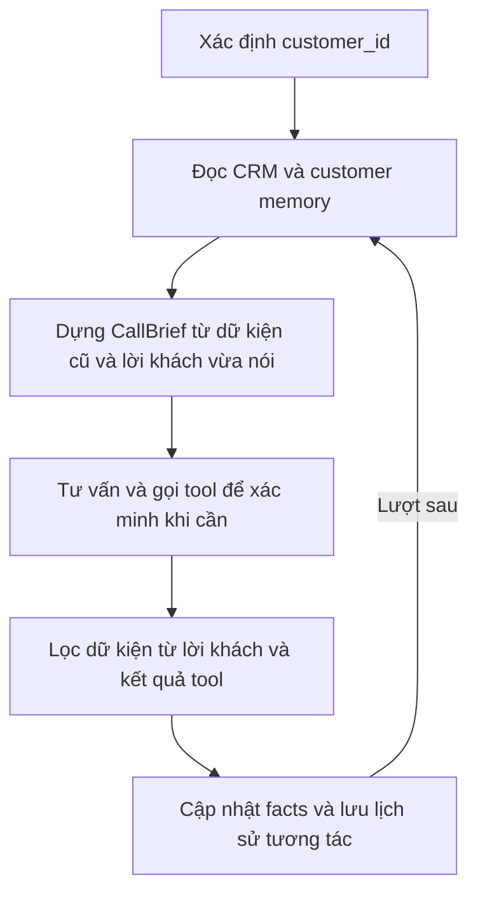

# Thiết kế bộ nhớ của agent

Backend giữ dữ kiện và lịch sử theo từng `customer_id` từ CRM. Mỗi lượt lấy phần liên quan để dựng `CallBrief`. Ví dụ, khi khách đổi ngân sách từ 5 lên 6 triệu, `facts.md` giữ giá trị 6 triệu, còn nhật ký thay đổi có thể giữ dấu vết của cả hai lượt.

## Các tầng memory

| Tầng | Format và nơi lưu | Khi nào dùng |
| --- | --- | --- |
| **Ngữ cảnh đang chạy** | `ConversationState` trong RAM gồm danh tính, tin nhắn gần nhất, `CallBrief` và dữ kiện mới của lượt. DeepAgent giữ checkpoint của message/tool loop, mặc định theo lượt. | Backend dựng prompt cho lượt hiện tại. Chat tài khoản lưu thêm checkpoint phiên trong PostgreSQL. |
| **Customer memory** | Markdown theo `users/<customer_id>/`. Bản filesystem gồm các file riêng. Object storage có thêm `current.md` chứa snapshot tổng hợp. | Đọc ở các lượt sau và khi khách quay lại. |
| **Agent instructions** | `agents/telesales_agent/{soul,agent,tools}.md` chứa persona, playbook và quy tắc dùng tool. | Harness đọc khi khởi động để dựng system prompt. |
| **Agent lessons** | Lesson Markdown có metadata cùng các mục `When`, `Do`, `Otherwise`. PostgreSQL giữ job học và object storage giữ lesson đã duyệt. | Chat chọn bài học phù hợp ở phiên sau. [Luồng self-learning](self-learning.md) |

PostgreSQL cũng giữ hồ sơ CRM, dữ liệu nghiệp vụ, lịch sử Chat tài khoản và Voice journal. Giá, tồn kho, trạng thái đơn và chính sách hiện tại được xác minh qua tool nghiệp vụ.

## Cấu trúc customer memory

```text
users/<customer_id>/
├── facts.md                          # Dữ kiện hiện tại theo key
├── user.md                           # Mô tả hồ sơ
├── behaviors.md                      # Hành vi hoặc sở thích ghi nhận được
├── atomic_facts/fact-YYYY-MM-DD.md    # Nhật ký thay đổi dữ kiện
├── episodes/episode-YYYY-MM-DD.md     # Tóm tắt từng tương tác
└── foresights/foresight-YYYY-MM-DD.md # Gợi ý cho lượt tư vấn sau
```

Với filesystem, cây này nằm dưới `data/memory-root/` theo mặc định. Các file và thư mục được tạo khi có dữ liệu cần ghi.

| File | Format và cách cập nhật |
| --- | --- |
| `facts.md` | Mỗi dòng là `- key: <JSON value>`. Ghi mới hoặc thay giá trị theo key để giữ đúng kiểu số, chuỗi, boolean và danh sách. Bỏ qua giá trị giống bản hiện tại. |
| `user.md`, `behaviors.md` | Danh sách Markdown, mỗi dòng là một mô tả ngắn về hồ sơ hoặc hành vi của khách. |
| `atomic_facts/` | Nối bản ghi theo ngày, dạng `- key: <JSON value> \| source: <lượt>` để truy nguồn thay đổi. |
| `episodes/` | Mỗi đoạn bắt đầu bằng `### Session at HH:MM:SS`, sau đó là tóm tắt ngắn. Có marker `source_id` khi lượt cung cấp ID để tránh ghi trùng khi chạy lại. |
| `foresights/` | Danh sách gợi ý có căn cứ cho lần tư vấn sau. Ghi bổ sung theo ngày và lọc gợi ý trùng. |

Ví dụ `facts.md` sau khi khách đổi ngân sách và đã được tư vấn AirPure X:

```markdown
# Customer Facts

- budget_vnd: 6000000
- room_area_m2: 25
- product_advised: "SKU-AP-X"
```

Với object storage, `users/<customer_id>/current.md` có tiêu đề `# Customer Memory` và một khối JSON. `facts` là JSON object, `profile` và `behaviors` là chuỗi Markdown, còn mỗi mục trong ba danh sách theo ngày có `source` và `content`. Snapshot rút gọn của ví dụ trên:

```json
{
  "customer_id": "C031",
  "profile": "",
  "behaviors": "",
  "facts": {"budget_vnd": 6000000, "room_area_m2": 25, "product_advised": "SKU-AP-X"},
  "atomic_facts": [],
  "episodes": [],
  "foresights": []
}
```

### Ba nhóm memory theo ngày

Trong chế độ `llm_learning`, `LLMPersister` cập nhật các nhóm này sau mỗi lượt đã xác định được khách. Ví dụ xuyên suốt là khách đổi ngân sách từ 5 lên 6 triệu, đang cân nhắc AirPure X cho phòng ngủ và còn băn khoăn về độ ồn.

| Nhóm | Ghi và cập nhật thế nào | Dùng ở lượt hoặc phiên sau |
| --- | --- | --- |
| **`atomic_facts/`** | Khi persister thực sự thêm hoặc đổi một fact, nó ghi thêm một dòng có giá trị và nguồn lượt vào file của ngày đó. Ví dụ `- budget_vnd: 6000000 \| source: call_1#turn2`. Dòng 5 triệu cũ vẫn nằm trong nhật ký nếu đã được ghi trước đó. | Tra lại **dữ kiện đã đổi khi nào và từ lượt nào**. Chat ưu tiên giá trị mới nhất trong `facts.md`. Khi brief thiếu facts, prompt Chat có thể lấy tối đa 5 mục atomic gần nhất làm dữ kiện dự phòng. Chi tiết cũ có thể tra qua tool archive. |
| **`episodes/`** | LLM tóm tắt lời khách đã che thông tin cá nhân và các cập nhật fact đã xác minh. Nếu có nội dung đáng lưu, persister nối một đoạn theo lượt, gồm thông tin xác lập, sản phẩm có căn cứ hoặc điều khách còn băn khoăn. Ví dụ “Khách cân nhắc AirPure X cho phòng ngủ, còn lo về độ ồn”. `source_id` giúp tránh ghi trùng khi xử lý lại cùng lượt. | Giúp hiểu **lần tư vấn trước đã nói gì và đang dừng ở đâu**. `CallBrief` giữ nhóm `relevant_episodes` và có thể dùng episode gần đây làm tóm tắt dự phòng. Khi khách hỏi “Lần trước mình đang cân nhắc gì?”, Chat có thể tra episode qua tool archive. |
| **`foresights/`** | LLM đề xuất việc nên làm ở lần sau dựa trên lời khách. Persister xem tối đa 3 gợi ý mỗi lượt, lọc gợi ý rỗng hoặc trùng và nối phần còn lại vào file theo ngày. Ví dụ “Khi khách hỏi tiếp về AirPure X, tra thông số độ ồn trước khi so sánh”. | Gợi ý **nên tiếp tục tư vấn theo hướng nào**. Backend đưa foresight vào `CallBrief.remembered_preferences`. Realtime Voice có thể nhận qua brief đã che thông tin cá nhân. Prompt Chat thông thường tập trung vào facts và câu hỏi còn mở. Chat có thể tra foresight qua tool archive khi cần. |

Trong ví dụ trên, `facts.md` cho biết ngân sách hiện tại là 6 triệu, `atomic_facts` giải thích thay đổi đó, `episodes` nhắc lại mối quan tâm về độ ồn và `foresights` gợi ý tra thông số trước khi tư vấn tiếp. Agent dùng kết quả tra cứu hiện tại để trả lời về thông số sản phẩm.

## Luồng đọc và ghi



1. **Đọc.** Backend nạp dữ kiện của đúng khách và làm mới trước khi dựng `CallBrief`. Lời khách vừa nói có thể cập nhật ngữ cảnh ngay trong lượt hiện tại. Agent nhận brief gọn cùng các tin nhắn gần nhất. Gemini Live nhận brief đã che thông tin cá nhân và có thể lấy thêm context qua tool.
2. **Ghi.** Sau khi xử lý lượt, persister lọc dữ kiện từ lời khách và kết quả tool đã kiểm chứng rồi cập nhật memory theo `customer_id`. Chế độ `llm_learning` còn ghi nhật ký thay đổi và có thể tạo episode hoặc foresight. Nếu bước tóm tắt lỗi, các facts đã xác minh vẫn được lưu.
3. **Đọc lại.** Lượt sau dùng snapshot mới khi dựng brief. Khi khách hỏi chi tiết cũ, tool archive có thể tra bổ sung trong phạm vi `customer_id` của phiên.

## Khi nào dữ liệu được lưu bền vững

| Cơ chế | Cách lưu và phục hồi |
| --- | --- |
| **Filesystem** | Mỗi file được thay thế nguyên tử. Backend khóa ghi theo khách trong cùng process. |
| **Object storage** | Bản mới hiện trong RAM để lượt sau đọc ngay. Backend thử đồng bộ khi kết thúc phiên, lúc shutdown hoặc sau 120 giây không hoạt động theo mặc định. Upload các file thay đổi và archive trước, rồi ghi `current.md` cuối cùng. Snapshot giữ dữ liệu của hai ngày có hoạt động gần nhất trong các nhóm lưu theo ngày. |
| **Voice journal** | PostgreSQL giữ transcript, evidence và batch ghi đã chuẩn bị. Input đã chốt đi qua `pending` → `prepared` → `committed`. Nếu upload gián đoạn, batch đã chuẩn bị có thể chạy lại. `committed` được ghi sau khi kho xác nhận dữ liệu đã lưu. |
