# Thiết kế bộ nhớ

> Đối chiếu mã nguồn ngày 18/11/2026. Liên quan: [hệ thống](system-architecture.md), [harness](agent-harness-loop.md), [tool](tool-catalog.md), [quyết định thiết kế](design-decisions.md).

## 1. Mục tiêu và các scope

Memory giữ thông tin có ích qua nhiều cuộc gọi mà không replay toàn bộ transcript vào model. Application sở hữu việc ghi; agent tư vấn không được tự sửa instruction hay gọi tool ghi customer memory.

| Loại dữ liệu | Phạm vi/lưu trữ | Vai trò |
| --- | --- | --- |
| Turn context/deltas | Một lượt, RAM | Intent, entities, memory candidate và tool evidence chưa persist |
| `ConversationState` | Một cuộc gọi | Identity, messages, pending order, read cache, brief và số turn; account có checkpoint lưu DB |
| DeepAgent checkpoint | `MemorySaver` trong process; thread mặc định theo turn | Tiếp tục model/tool loop; không thay customer memory |
| Customer memory | Theo canonical `customer_id`; file hoặc object storage | Facts, profile, behaviors, episodes và foresights qua nhiều cuộc gọi |
| Agent instructions | `agents/telesales_agent/{soul,agent,tools}.md` | Quy tắc/persona đọc một lần lúc startup, đưa vào system prompt |
| Conversation history / Voice journal | PostgreSQL | Transcript, feedback, snapshot và job memory phục vụ xem lại/phục hồi |

Phone và hồ sơ xác minh thuộc CRM; dùng `customer_id` làm khóa memory và kiểm tra đường dẫn an toàn. Giá, tồn kho, ưu đãi và trạng thái đơn hiện tại phải tra tool; giá từng tư vấn trong memory chỉ là lịch sử.

## 2. Mô hình customer memory

Backend file mặc định dùng `data/memory-root/users`; có thể đổi qua `CUSTOMER_MEMORY_ROOT`.

```text
<root>/<customer_id>/
├── facts.md
├── user.md
├── behaviors.md
├── atomic_facts/fact-YYYY-MM-DD.md
├── episodes/episode-YYYY-MM-DD.md
└── foresights/foresight-YYYY-MM-DD.md
```

| Thành phần | Ý nghĩa và cách cập nhật |
| --- | --- |
| `facts.md` | Map key/value hiện tại, upsert theo key; JSON value giữ kiểu số, boolean, list/object |
| `user.md` | Ghi chú profile dạng văn bản; append qua repository |
| `behaviors.md` | Pattern hành vi; append, không có cơ chế supersede chung như facts |
| `atomic_facts/` | Audit fact theo ngày khi dùng LLM persister; đồng thời tương thích dữ liệu cũ |
| `episodes/` | Tóm tắt tương tác; append, có source marker cho episode |
| `foresights/` | Gợi ý cụ thể cho lần gọi sau; LLM persister giới hạn và lọc trùng |

Ví dụ `budget_vnd: 5000000` được thay bằng `6000000` khi khách sửa ngân sách; canonical map chỉ giữ giá trị mới. Episode/audit có thể giữ lịch sử thay đổi. Loader ưu tiên `.md`, vẫn đọc `.mmd` cũ; khi chưa có canonical facts có thể fold atomic-fact legacy thành map.

## 3. Vòng đọc/ghi qua các lượt

```mermaid
flowchart LR
    Customer["Customer utterance"] --> Delta["Perception deltas"]
    Tools["Verified tool results"] --> Candidates["Chuẩn hóa / merge candidates"]
    Delta --> Candidates
    Candidates --> Facts["Upsert facts + memory_writes"]
    Facts --> Learning["Tùy persister: audit, episode, foresight"]
    Learning --> Store["File hoặc RAM snapshot buffer"]
    Store --> Refresh["Lượt sau: reload repository"]
    Refresh --> Brief["Compact CallBrief + chọn facts"]
    Brief --> Agent["Agent trả lời / dùng tool"]
    Agent --> Tools
```



1. Đầu lượt, hydrate hoặc refresh snapshot đã có; CallBrief kết hợp CRM, memory và perception hiện tại. Delta mới chưa cần ghi ngay để được dùng trong lượt hiện tại.
2. Application và model chạy tool. Evidence được chuẩn hóa từ kết quả thực tế, không lấy câu agent tự nói làm bằng chứng giao dịch thành công.
3. Cuối lượt Chat, `persist_shared()` lấy khóa theo customer và refresh lại memory trong khóa. Persister chuẩn hóa customer candidates, lấy thêm fact từ tool rồi upsert.
4. Giá trị không đổi được bỏ qua. Giá trị mới tạo `set`; thay giá trị cũ tạo `supersede`. `memory_writes` có `key`, `value`, `previous_value`, `customer_id`, `source`, `provenance` để trace.
5. Persister clear deltas, cập nhật snapshot state; lượt kế tiếp đọc lại repository và dựng brief mới. Memory chưa có identity hợp lệ không được ghi.

Trong `persist_turn_memory()`, merge hiện là `{**tool_candidates, **customer_candidates}`: customer candidate thắng khi trùng key sau các bước lọc. Không có quy tắc tổng quát “mọi tool fact luôn ghi đè delta”. Một số field có kiểm soát riêng: mapping order ID chỉ nhận từ tool; lịch callback đã điều chỉnh cần kết quả scheduler; địa chỉ xác nhận được giữ dưới `delivery_address`, còn phone giữ ở CRM. Giá quote trước đó được giữ riêng khi giá đổi.

## 4. Persister và chế độ chạy

| Cấu hình bootstrap | Repository | Cách ghi |
| --- | --- | --- |
| `durable`, backend `file` mặc định | `FileCustomerMemoryRepository` | Ghi Markdown local |
| `durable`, backend `object_storage` hoặc `s3` | `BufferedCustomerMemoryStore` bọc object repository | Cập nhật snapshot RAM, flush remote sau |
| `evaluation` | In-memory, seed từ file | `TurnMemoryPersister`; write không làm đổi file seed |
| `disabled` | In-memory rỗng | Không có persister |

Trong durable mode, `MEMORY_PERSISTER_MODE` mặc định là **`llm_learning`**; `llm_learning` và `llm_episode` đều chọn `LLMPersister`. Giá trị khác, ví dụ `turn`, chọn `TurnMemoryPersister` deterministic.

`TurnMemoryPersister` chỉ ghi canonical facts. `LLMPersister` ghi facts và atomic audit, rồi gọi structured LLM để tạo episode/foresight từ customer text đã mask và fact updates. Prompt học memory không dùng agent statement làm bằng chứng; loại phone/địa chỉ khỏi phần updates gửi học. Lỗi bước LLM summary không xóa facts đã xử lý; lỗi commit snapshot vẫn được truyền lên. Chế độ bootstrap `evaluation` khác nhánh `full` của bộ benchmark, vốn có thể dùng durable memory trong vùng đánh giá riêng.

## 5. Projection và dung lượng context

`CallBriefProjector` dựng brief cục bộ, tách verified CRM data khỏi remembered preferences. Prompt DeepAgent chọn mặc định tối đa **6 facts** theo ưu tiên intent/loại câu hỏi rồi bổ sung fact còn lại, giới hạn độ dài value và recent messages. Đây là selector theo quy tắc, chưa phải semantic retrieval toàn bộ memory.

Episode/foresight không bị dump nguyên kho vào từng prompt. Archive chỉ được tra theo nhu cầu khi repository có `search_archive()`, với customer ID do backend bind. Memory có thể tăng trên storage dù prompt vẫn nhỏ; giới hạn context không thay thế retention policy.

## 6. File và object storage: ranh giới bền vững

**File:** repository có khóa `threading.RLock` theo customer trong process và atomic replacement cho file. Nhiều file của một lượt không nằm trong một transaction nguyên tử; chưa có lock liên process.

**Object storage:** canonical object là `<prefix>/<customer_id>/current.md`, prefix mặc định `users`. Remote snapshot giữ daily collections của hai ngày hoạt động gần nhất; chi tiết cũ được export thành archive để tra khi cần. Static/daily files được đồng bộ trước khi publish snapshot theo logic adapter.

Bootstrap bọc remote adapter bằng **RAM buffer**. `TurnMemoryWriteSession` xử lý trên workspace RAM rồi publish snapshot vào buffer; các session cùng process đọc được bản mới ngay. Worker kiểm tra mỗi 5 giây, flush sau 120 giây không có truy cập/cập nhật customer theo mặc định; shutdown cũng thử flush. Upload có retry và version để không đánh dấu nhầm cập nhật mới là đã lưu.

Vì vậy, “persister hoàn tất” chưa đồng nghĩa “S3 đã lưu”. Buffer không bền vững khi crash; Chat chưa có durable write journal tương đương Voice. Không có distributed CAS để hòa giải nhiều backend writer.

## 7. Voice journal và phục hồi

Voice lưu transcript, evidence, interruption, playback progress và prepared batch trong `voice_turn_journal`; không lưu raw audio. `source_id` dạng `voice:{conversation_id}:{turn_id}` gắn lượt với job.

```text
Input chưa chốt → incomplete
Input đã chốt  → pending → chuẩn bị operations trong RAM → prepared
              → apply operations → committed sau khi dữ liệu đã lưu
```

`commit_voice()` dùng cùng khóa customer writer và persister với Chat. Prepared batch ghi lại hiệu ứng của persister; retry batch đã chuẩn bị không gọi lại LLM learning. Append có marker chống lặp; upsert kiểm tra previous/current value để tránh batch cũ ghi đè fact đã đổi.

Khi dùng remote buffer, journal được giữ replayable và chỉ chuyển `committed` qua acknowledgement sau upload. Event memory phía client và snapshot trong state cần được phân biệt với trạng thái durable này.

`recover_memory()` thử tối đa 30 job khi Voice manager initialize lần đầu; chưa có worker định kỳ quét toàn bộ journal. Worker flush RAM buffer là cơ chế khác. Journal chưa ghi thành công hoặc input còn trong RAM trước finalize có thể mất khi crash; PostgreSQL và memory store không có transaction chung.

## 8. Giới hạn cần tính đến

- Khóa chỉ trong process; chưa hỗ trợ nhiều writer phân tán an toàn.
- Canonical facts chưa có metadata timestamp/confidence/TTL đầy đủ; provenance nằm trong trace/audit, không phải mọi value đều có metadata riêng trong `facts.md`.
- Chưa có schema registry chung cho toàn bộ memory key hoặc retention job cho mọi collection/journal.
- Mask dữ liệu gửi model không đồng nghĩa transcript, journal và toàn bộ storage đã được ẩn PII.

## 9. Căn cứ triển khai

- [Bootstrap](../../src/telesale_agent/bootstrap.py), [CallBrief](../../src/telesale_agent/application/memory/call_brief.py), [fact selector](../../src/telesale_agent/application/deepagent/context/facts.py).
- [Fact persistence](../../src/telesale_agent/application/memory/persist.py), [LLM persister](../../src/telesale_agent/adapters/llm/llm_persist.py), [coordinator](../../src/telesale_agent/application/memory/coordinator.py).
- [File repository](../../src/telesale_agent/adapters/memory/file_memory.py), [write session](../../src/telesale_agent/adapters/memory/write_session.py), [RAM buffer](../../src/telesale_agent/adapters/memory/buffered.py), [object storage](../../src/telesale_agent/adapters/memory/object_storage.py).
- Tài liệu nền: [customer memory flow](../agent/deepagent_context_memory_flow.md); bản tổng hợp này cập nhật các điểm đã thay đổi trong code.
