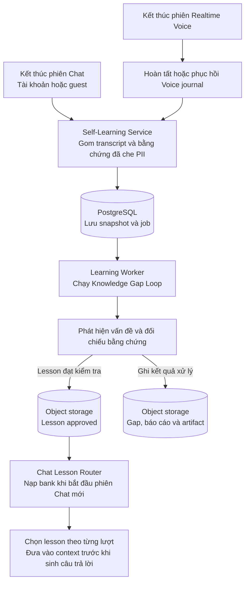

# Self-Learning Service

Chat và Realtime Voice cung cấp dữ liệu học sau khi kết thúc phiên. Một worker trong Backend FastAPI kiểm chứng vấn đề và lưu bài học dùng chung cho agent. Chat dùng lesson phù hợp ở phiên sau. Với Realtime Voice, phạm vi hiện tại là tạo dữ liệu học.

## Luồng xử lý

## Component chính

| Component | Trách nhiệm |
| --- | --- |
| **Self-Learning Service** | Gom transcript, kết quả tool và feedback nếu có, rồi che thông tin cá nhân trước khi tạo snapshot. Chat tài khoản ghi job cùng transaction chốt phiên. Voice chờ journal hoàn tất trước khi enqueue. |
| **Learning Repository và Worker** | PostgreSQL giữ evidence, snapshot và trạng thái job. Khóa theo phiên, revision và phiên bản luồng học giúp tránh tạo job trùng. Worker chạy tối đa 3 lần, chờ 5 rồi 30 giây giữa các lần thử lại. Job bị gián đoạn được đưa về hàng đợi khi Backend khởi động. |
| **Knowledge Gap Loop** | Kiểm chứng lỗi trả lời bằng transcript và kết quả tool trước khi lưu lesson tổng quát. Với câu hỏi còn thiếu thông tin, gọi `search_policy` để tìm nguồn cho FAQ ứng viên. Gap thiếu nguồn được giữ lại để theo dõi. |
| **Agent Memory Store** | Lưu lesson Markdown tại `agents/telesales_agent/knowledge_gap_loop/lessons/approved/` và báo cáo tại `learning-runtime/telesales_agent/` theo cấu hình mặc định. Customer memory dùng prefix riêng. |
| **Chat Lesson Router** | Cố định danh sách lesson từ đầu phiên, chọn tối đa 3 lesson với tổng 2.400 ký tự mỗi lượt. Với file ghi âm, router chọn sau ASR. Chat vẫn trả lời khi kho lesson hoặc routing gặp lỗi. |

Lesson hướng dẫn cách xử lý tình huống. Giá, tồn kho và chính sách vẫn dựa trên dữ liệu nghiệp vụ đã xác minh.

Backend bật tính năng qua `KNOWLEDGE_GAP_LOOP_ENABLED=true`. Tạo các bảng learning bằng migration riêng trước khi bật trên Render. [Hướng dẫn tích hợp Backend](../../src/self_agent/README.md#tích-hợp-backend)
