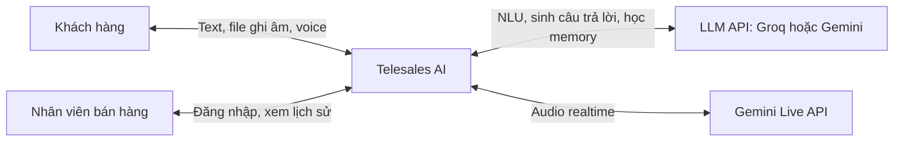
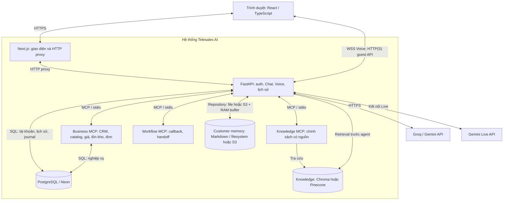

# Kiến trúc hệ thống Telesales AI

> Bản tổng hợp đối chiếu mã nguồn ngày 18/11/2026. Các giá trị mặc định trong bộ tài liệu có thể được thay đổi bằng cấu hình môi trường.

## 1. Phạm vi và cách đọc

Hệ thống tư vấn bán hàng bằng tiếng Việt qua text, file ghi âm và giọng nói realtime; tra cứu dữ liệu nghiệp vụ, ghi nhớ nhu cầu khách qua nhiều cuộc gọi và lưu lịch sử cho nhân viên bán hàng.

| Phần | Nội dung |
| --- | --- |
| [Kiến trúc hệ thống](system-architecture.md) | Sơ đồ, thành phần, nguồn dữ liệu và ranh giới triển khai |
| [Vòng lặp agent harness](agent-harness-loop.md) | Luồng Chat/file audio và vòng điều phối Voice realtime |
| [Thiết kế bộ nhớ](memory-design.md) | Scope, cấu trúc lưu trữ, đọc/ghi và phục hồi |
| [Danh sách tool](tool-catalog.md) | Tên runtime, tên trace, đầu vào/đầu ra và quyền thực thi |
| [Quyết định thiết kế](design-decisions.md) | Các lựa chọn đã triển khai, lý do và đánh đổi |

## 2. Ngữ cảnh hệ thống

Khách hàng dùng các chức năng tư vấn và hội thoại thuộc tài khoản của mình. Nhân viên có role `salesman` đọc transcript, CallBrief và snapshot đã lưu; màn hình lịch sử không chạy lại agent để tạo nội dung mới. Kho nghiệp vụ, knowledge và customer memory thuộc phạm vi hệ thống, dù có thể được lưu trên dịch vụ cloud.

## 3. Sơ đồ container

Ba MCP server là ba process con do backend mở qua stdio. Tool đọc memory archive được gắn trực tiếp vào registry khi repository hỗ trợ, không có MCP memory server trong đường khởi tạo này. `VectorDBRetriever` trước agent và Knowledge MCP là hai đường retrieval riêng; Knowledge MCP chọn Chroma/Pinecone theo cấu hình, còn retrieval trước agent dùng Chroma cho policy và PostgreSQL cho catalog.

## 4. Thành phần và trách nhiệm

Backend tổ chức theo các lớp: `core/` chứa model/contract; `application/` điều phối nghiệp vụ; `adapters/` kết nối dịch vụ; `entrypoints/api/` nhận HTTP/WebSocket. `bootstrap.py` lắp các dependency thành harness dùng chung trong process.

| Thành phần | Trách nhiệm |
| --- | --- |
| API, auth và repository ứng dụng | Xác thực session/API key theo chế độ, kiểm tra chủ hội thoại/role, lưu tài khoản, tin nhắn, checkpoint và feedback |
| `DeepAgentHarness` | Điều phối từng lượt text/file ghi âm; sở hữu model, checkpointer và vòng đời MCP |
| Local ASR | Zipformer/sherpa-onnx trên CPU chuyển file ghi âm thành text; dùng cùng pipeline với Chat |
| Shared conversation services | Resolve identity, nạp CRM/memory, perception, retrieval và dựng CallBrief |
| Read/mutation executors | Prefetch dữ liệu có đủ arguments, cache kết quả và xử lý hành động đã xác nhận trước model loop |
| DeepAgent runtime | Model/tool loop với allowlist theo lượt, giới hạn lời gọi và ngữ cảnh có giới hạn |
| Voice manager/controller | Quản lý phiên realtime, audio/transcript, function call, ngắt lời và hoàn tất lượt |
| Memory coordinator/persister | Khóa ghi theo khách, cập nhật facts, học episode/foresight và replay batch Voice |
| Salesman history reader | Đọc bản lưu Chat/Voice, brief và memory snapshot cho nhân viên |

## 5. Hai đường hội thoại

| Đặc điểm | Chat và file ghi âm | Voice realtime |
| --- | --- | --- |
| Tiếp nhận | `POST /api/chat`, `POST /api/chat/audio` | Tạo phiên HTTP rồi mở WebSocket Voice |
| Xử lý audio | ASR local trước harness nếu là file | Gemini Live nhận/sinh audio trực tiếp |
| Điều phối | Application chuẩn bị context → DeepAgent loop → kiểm tra response → persist | Controller xử lý audio/events; chuẩn bị context khi tool cần hoặc khi finalize |
| Phản hồi | JSON; hoặc SSE khi `Accept: text/event-stream` | Audio binary và JSON events qua WebSocket |
| Tool | Đọc và mutation có điều kiện | Chỉ đọc; tạo/sửa đơn, callback, handoff bị khóa |
| State | Guest ở RAM; account có checkpoint/lịch sử trong PostgreSQL | State/session và resume handle ở RAM; journal từng lượt trong PostgreSQL |

Hai nhánh dùng chung canonical `customer_id`, repository memory và persister, nhưng có state hội thoại riêng. Voice cấp `conversation_id` dạng `live-{session_id}`; chuyển chế độ không chuyển nguyên checkpoint Chat sang Gemini Live.

## 6. Nguồn sự thật và giới hạn triển khai

| Dữ liệu | Nguồn có thẩm quyền |
| --- | --- |
| Identity, hồ sơ CRM, catalog, đơn hàng | PostgreSQL qua adapter/tool nghiệp vụ |
| Giá, ưu đãi, tồn kho hiện tại | Kết quả pricing/inventory tại ngày nghiệp vụ đang xét |
| Chính sách, vận chuyển, bảo hành | Knowledge retrieval có nguồn và hiệu lực tài liệu |
| Nhu cầu, budget, blocker, lịch sử tư vấn | Customer memory; thông tin lịch sử không thay xác minh nghiệp vụ mới |
| Persona và quy tắc agent | `soul.md`, `agent.md`, `tools.md` đọc lúc startup |
| Transcript, feedback, trạng thái job Voice | Database ứng dụng; khác với canonical customer memory |

Ứng dụng hiện hướng tới **một backend worker**: session, cache và khóa customer writer nằm trong process. Voice dùng PostgreSQL advisory lock để giữ lease, nhưng chưa có distributed writer/CAS cho memory. Với object storage, cập nhật được thấy ngay trong RAM cùng process và đồng bộ lên remote sau; RAM chưa flush có thể mất khi process bị kill.

Workflow callback/handoff hiện tạo kết quả nghiệp vụ, chưa có hàng đợi bền vững hoặc gửi thông báo cho nhân viên. Voice chưa có SIP/PSTN/WebRTC hoặc khôi phục nguyên phiên sau backend restart. Các đánh đổi được ghi ở [quyết định thiết kế](design-decisions.md).

## 7. Căn cứ triển khai

- [Bootstrap](../../src/telesale_agent/bootstrap.py), [FastAPI Chat](../../src/telesale_agent/entrypoints/api/chat.py), [Auth](../../src/telesale_agent/entrypoints/api/auth.py).
- [DeepAgent runtime](../../src/telesale_agent/application/deepagent/runtime.py), [MCP runtime](../../src/telesale_agent/adapters/mcp/runtime.py), [Voice manager](../../src/telesale_agent/application/realtime/session.py).
- Tài liệu nền: [kiến trúc hệ thống đầy đủ](../system-architecture.md), [DeepAgent](../agent/deep_agent_architecture.md), [Gemini Live](../agent/gemini_live_architecture.md).
