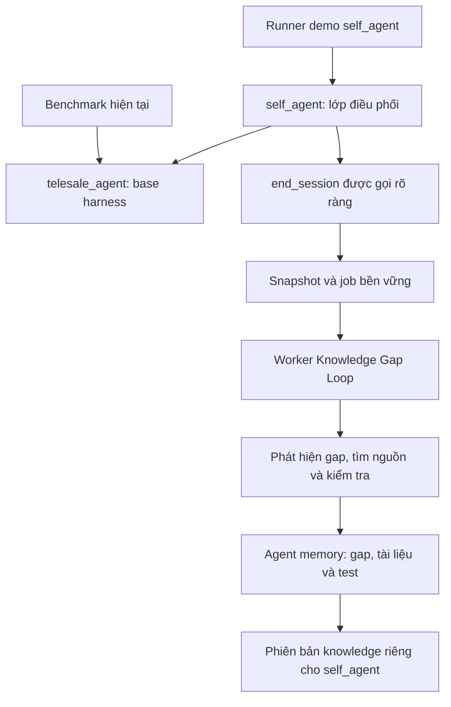
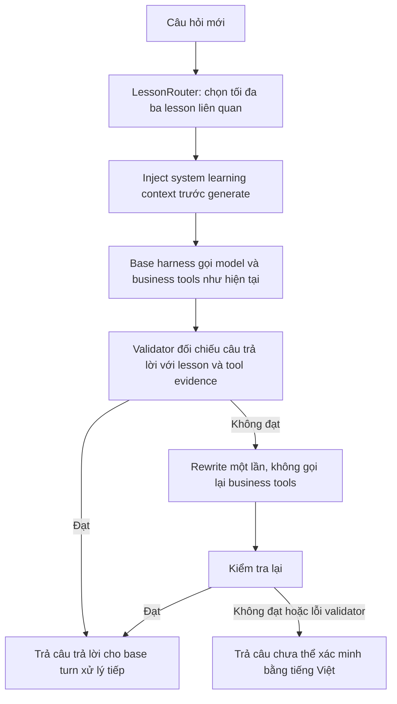

# Implementation plan: Knowledge Gap Loop qua `src/self_agent/`

Ngày cập nhật: **16/11/2026**. Trạng thái: **đã triển khai lesson Markdown tiếng Anh, routing theo câu hỏi và validation/repair có giới hạn; kiểm tra offline, chưa xác minh bản lesson runtime mới với LLM/DB thật**.

> **Bản thiết kế hiện hành xem mục 14.** Các mục trước giữ lại để trace quá trình thiết kế. Đề xuất dựng backend/index riêng tại mục 9 không phải yêu cầu hiện tại: tiếp tục dùng DB/Pinecone có sẵn. Không sửa core `telesale_agent` hoặc benchmark cũ. Kết quả hai vòng cũ không được dùng để khẳng định bản lesson runtime mới đã improve.

Hướng dẫn sử dụng và giới hạn bản đầu: [src/self_agent/README.md](../../src/self_agent/README.md). Các trách nhiệm detector/resolver/validator được gộp trong `learning/knowledge_gap.py`. Theo yêu cầu cập nhật, tái sử dụng tầng DB/Pinecone hiện có; không ép Chroma hoặc backend mới. Worker tìm nguồn qua tool của base harness; publisher nhận index Pinecone đang có. Việc tự gọi publisher sau mỗi job chưa được nối: runner hiện ghi artifact, publication là thao tác tường minh. Test tự sinh hiện kiểm tra hợp đồng nguồn; chưa có số đo LLM/backend thật. Những phần đề xuất nguồn riêng bên dưới là tùy chọn cô lập dữ liệu, không phải yêu cầu dựng database mới.

Tài liệu này cụ thể hóa [workflow tổng quan](../design/agent_self_improvement_workflows.md) theo phạm vi mới: tích hợp với harness trước, dùng package `self_agent` để điều phối self-learning sau session; chưa tích hợp web/API.

## 1. Quyết định chính

1. Tạo `src/self_agent/` gọi lại harness trong `telesale_agent` theo kiểu composition: bọc một instance có sẵn, không kế thừa rồi chép lại thuật toán hội thoại.
2. Triển khai **Knowledge Gap Loop** trước. Exemplar Bank và Reflection là các workflow mở rộng sau, chưa triển khai trong đợt này.
3. Có một biến môi trường mới: `KNOWLEDGE_GAP_LOOP_ENABLED=false`, mặc định tắt.
4. Self-learning chỉ bắt đầu khi bên gọi chủ động gọi `self_agent.end_session(...)`. Hoàn thành một lượt, reset customer memory hoặc đóng runtime không tự động có nghĩa là kết thúc session để học.
5. Benchmark hiện tại tiếp tục dùng `telesale_agent` trực tiếp. Không gọi `self_agent`, không chạy worker, không đọc kho kiến thức học được và không cộng thời gian học vào các metric hiện có.
6. Lưu kết quả học dưới `data/memory-root/agents/telesales_agent/knowledge_gap_loop/`, tách khỏi customer memory và các file playbook nền.

Không cần sửa core models, pipeline `run_turn`, customer-memory persister hoặc công thức tính benchmark để làm phần điều phối học sau session.

## 2. Điểm tựa trong source hiện tại

| Source hiện có | Cách tận dụng |
| --- | --- |
| `src/telesale_agent/application/deepagent/harness.py` | Gọi lại `DeepAgentHarness.run_turn`, `__aenter__`, `__aexit__`; giữ nguyên `TurnResult` |
| `src/telesale_agent/bootstrap.py` | Dùng factory hiện có để tạo base harness; không khởi tạo learner trong factory này |
| `src/telesale_agent/core/models.py` | Đọc `ConversationState.messages`, call brief, retrieved context và `TurnResult.tool_calls` khi bên gọi có cung cấp |
| `src/telesale_agent/adapters/llm/model_factory.py` | Dùng factory mô hình hiện có cho bước phân tích offline; tạo model riêng khi worker cần |
| Tool `search_policy` và nguồn knowledge hiện có | Tìm bằng chứng cho gap; không dùng output chưa duyệt của learner làm nguồn chứng minh cho chính nó |
| `src/eval/run_suite.py`, `src/eval/generate_traces.py` | Tiếp tục gọi base harness như hiện tại, không chuyển import sang `self_agent` |
| `pyproject.toml` | Hiện tìm package dưới `src`; package mới có `__init__.py` được đưa vào cơ chế tìm package hiện có, cần kiểm tra khi cài đặt |

Lưu ý: `ConversationState` không bảo đảm chứa toàn bộ lịch sử tool của mọi lượt. Không giả định `retrieved_data` cuối session là bằng chứng cho cả cuộc gọi. Worker phải ghi độ đầy đủ của dữ liệu và tìm lại nguồn khi thiếu căn cứ.

## 3. Kiến trúc và chiều phụ thuộc



Chiều phụ thuộc: **`self_agent` → `telesale_agent`**. Không thêm import `self_agent` vào `telesale_agent` hoặc `src/eval`.

### Cấu trúc package đề xuất

```text
src/self_agent/
├── __init__.py
├── config.py                     # Đọc master switch
├── harness.py                    # Bọc base harness và cung cấp end_session
├── models.py                     # Snapshot, gap, job, kết quả học
├── runner.py                     # Demo harness trực tiếp, không qua web
├── learning/
│   ├── __init__.py
│   ├── knowledge_gap.py          # Điều phối workflow
│   ├── detector.py               # Tìm và phân loại gap
│   ├── resolver.py               # Tìm nguồn, tạo tài liệu bổ sung
│   ├── validator.py              # Kiểm tra bằng chứng và nội dung
│   └── regression.py             # Sinh và chạy test hồi quy riêng
├── adapters/
│   ├── __init__.py
│   ├── agent_memory.py           # Repository file, atomic write
│   ├── jobs.py                   # Queue file, retry và chống trùng
│   ├── llm.py                    # Gọi model factory hiện có
│   └── knowledge.py              # Đọc nguồn gốc, dựng nguồn học riêng
└── evaluation/
    ├── __init__.py
    └── run_gap_loop.py           # Minh chứng M1 hai vòng, độc lập benchmark cũ
```

Chỉ tạo module khi triển khai trách nhiệm tương ứng. Chưa dựng framework nhiều learner, nhiều agent, Celery hay một hệ thống plugin mới.

## 4. Phạm vi triển khai

### Trong phạm vi

- Wrapper harness cho text và transcript đã có sẵn. Không làm ASR hay realtime voice lifecycle mới.
- Một session kết thúc → một job phân tích snapshot; retry không tạo cùng kết quả nhiều lần.
- Phát hiện câu hỏi chưa giải quyết, gom trùng, tìm nguồn được phép và quản lý trạng thái gap.
- Tạo tài liệu bổ sung có nguồn, ca kiểm thử và báo cáo kiểm tra.
- Dựng phiên bản knowledge riêng để runner `self_agent` có thể dùng ở session sau.
- Một worker cho runner demo, queue file và artifact có phiên bản, phù hợp phạm vi demo hiện tại.
- Tách hoàn toàn phép đo học khỏi benchmark hội thoại hiện có.

### Ngoài phạm vi

- Web, endpoint HTTP, giao diện end session, realtime voice và production deployment nhiều worker.
- Exemplar Bank, Reflection, A/B script hoặc fine-tuning mô hình.
- Tự sửa code, playbook nền, quyền tool, giá bán hoặc chính sách nghiệp vụ chưa có nguồn.
- Thêm LLM call, logging hook hay phân tích gap vào `telesale_agent.run_turn`.
- Đổi schema trace, evaluator, công thức latency hoặc dataset của benchmark hiện tại.

## 5. Master switch và chế độ tắt

```dotenv
# Chỉ runner self_agent đọc biến này; mặc định tắt.
KNOWLEDGE_GAP_LOOP_ENABLED=false
```

- Đọc config một lần khi tạo wrapper. Chấp nhận các giá trị boolean đã quy ước; giá trị không hợp lệ cần báo rõ thay vì tự bật.
- `false`: wrapper chỉ ủy quyền hội thoại; `end_session` trả `disabled`. Không tạo thư mục, queue, worker, model học, snapshot, index hoặc đọc artifact cũ.
- `true`: cho phép tạo job tại `end_session` và sử dụng phiên bản knowledge riêng của runner self-agent.
- Tắt config không xóa kinh nghiệm đã lưu. Lần bật lại có thể tiếp tục job hợp lệ và đọc bản đã duyệt.
- Đổi biến cần tạo lại wrapper/runner; không đọc env ở mỗi lượt trả lời.

Benchmark hiện tại không import package mới nên không cần biết biến này. Kể cả `.env` bật `true`, benchmark dùng base harness vẫn không khởi động Knowledge Gap Loop. Điều này phải có test chứng minh.

## 6. Hợp đồng wrapper harness

Các tên dưới đây là API đề xuất, không phải code đã có:

```python
class SelfAgentHarness:
    async def run_turn(self, turn_input, state=None, *, on_text=None, on_status=None): ...
    async def end_session(self, state, *, turn_results=(), feedback=()): ...
    async def wait_learning(self, job_id): ...
    async def __aenter__(self): ...
    async def __aexit__(self, exc_type, exc_value, traceback): ...
```

- Constructor nhận base harness và config/learner qua dependency injection. Base harness không biết learner tồn tại.
- `run_turn`: gọi base harness, trả nguyên `TurnResult`, giữ callback và cách truyền lỗi hiện có. Không chèn bước học hoặc đính token học vào kết quả.
- `end_session`: khi tắt, trả ngay `disabled`; khi bật, tạo snapshot độc lập, ghi job rồi trả `queued` và `job_id`. Không đợi LLM phân tích.
- `wait_learning`: chỉ runner demo/evaluation riêng gọi để đợi kết quả; không nằm trong khoảng đo lượt trả lời.
- `__aexit__`: dừng worker an toàn trước khi đóng tài nguyên base mà worker đang dùng; lưu trạng thái để retry, không mặc định đợi xử lý hết backlog.
- Không chạy tự học trong `__aexit__`: đóng harness có thể là kết thúc chương trình benchmark, không đồng nghĩa session cần học.
- Bên gọi chịu trách nhiệm không gửi thêm lượt cho session đang kết thúc; wrapper ghi nhận session/revision đã end để chống gửi job trùng.

Runner demo giữ các `TurnResult` cần thiết chỉ khi bật learning, rồi truyền vào `end_session`. Không sửa base harness để tự thu thêm bằng chứng. Snapshot chỉ lấy transcript, phần tool/source cần thiết và feedback; không giữ tham chiếu tới mutable state hoặc model/MCP object.

## 7. Workflow chi tiết sau session

1. **Kết thúc logic:** caller ngừng gửi lượt cho session và gọi `end_session(state, ...)` sau khi lượt cuối hoàn tất.
2. **Tạo snapshot:** lấy transcript, unresolved questions, bằng chứng có sẵn và feedback. Ẩn PII, ghi độ đầy đủ dữ liệu, chặn payload quá lớn; không âm thầm cắt bỏ câu hỏi mà vẫn ghi là phân tích toàn bộ.
3. **Ghi job:** dùng khóa từ session ID, phiên bản snapshot và workflow version; ghi file tạm rồi thay thế atomic. Snapshot ghi thành công trước khi trả `queued`.
4. **Phân tích nền:** worker lấy job, phát hiện câu chưa giải quyết hoặc thiếu căn cứ. Phân loại `missing_knowledge`, `retrieval_failure`, `reasoning_failure`, `tool_failure`.
5. **Gom trùng:** chuẩn hóa câu hỏi và điều kiện nghiệp vụ; tăng occurrence theo ID sự kiện duy nhất để retry không tăng đếm giả.
6. **Tìm căn cứ:** gọi lại nguồn nghiệp vụ được phép bằng tool/adapter hiện có. Không chạy business mutation tool. Nguồn tìm ở bước này là bằng chứng mới sau session, phải phân biệt với nguồn đã dùng khi trả lời khách.
7. **Bổ sung kiến thức:** với gap có nguồn xác minh, tạo FAQ/tài liệu dẫn nguồn. Không có nguồn thì `pending_evidence`; lỗi vận hành hoặc retrieval không được tự biến thành chính sách mới.
8. **Sinh test:** lưu câu hỏi, tiêu chí cần đạt, tham chiếu nguồn và nội dung không được bịa; tạo cả tình huống đủ/không đủ điều kiện khi phù hợp. Sinh dữ liệu test, không sinh code tùy ý rồi thực thi.
9. **Kiểm tra:** đối chiếu nguồn còn hiệu lực, nội dung, PII, schema và tính trùng; chạy test bằng runner kiểm soát sẵn. Model đồng ý với chính nó không thay thế bằng chứng.
10. **Phát hành riêng:** tạo manifest nối gap → tài liệu → test → nguồn/version. Chỉ bản đạt kiểm tra mới được dựng vào knowledge dành riêng cho self_agent.
11. **Hoàn tất:** lưu báo cáo, thời gian học và trạng thái job. Session sau chỉ hưởng bản cập nhật khi bản đó thật sự sẵn sàng.

Nếu enqueue thất bại, trả trạng thái học `enqueue_failed`, không tuyên bố đã học. Nếu worker thất bại, retry có giới hạn; phiên bản đã phát hành trước vẫn được giữ. Những lỗi này không sửa phản hồi hoặc kết quả `run_turn` đã hoàn tất.

## 8. Lưu trong agent memory

```text
data/memory-root/agents/telesales_agent/
├── soul.md                       # Giữ nguyên
├── agent.md                      # Giữ nguyên
├── tools.md                      # Giữ nguyên
├── cases/                        # Chưa dùng cho workflow này
├── skills/                       # Chưa dùng cho workflow này
└── knowledge_gap_loop/
    ├── jobs/                     # Trạng thái job và snapshot hạn chế truy cập
    ├── gaps/                     # Gap chuẩn hóa, occurrences và bằng chứng
    ├── knowledge/                # Tài liệu bổ sung có nguồn
    ├── regression_cases/         # Ca test sinh tự động, chưa thuộc benchmark cũ
    ├── reports/                  # Kết quả validator và thời gian học
    └── releases/                 # Manifest các bản được phép sử dụng
```

Dùng JSON làm bản ghi có cấu trúc, Markdown cho tài liệu kiến thức dễ đọc. Gap lưu tối thiểu: `id`, `question`, `conditions`, `reason`, `status`, `evidence_refs`, `occurrences`, `resolution_ref`, `test_refs`, thời điểm và phiên bản.

Một gap có trạng thái `open → investigating → pending_evidence / pending_review / validating → resolved`; có thể mở lại. Bản FAQ chưa đạt không được truy xuất như kiến thức đúng.

Queue và artifact cần nằm trên storage bền vững nếu muốn giữ qua restart/deploy. Bản đầu giới hạn một worker ghi; không tuyên bố cơ chế file này đã hỗ trợ nhiều process ghi đồng thời. Không lưu thông tin riêng của khách vào knowledge dùng chung, và không tự đưa transcript/snapshot vào Git.

## 9. Dùng kiến thức mới mà không sửa core hội thoại

Chỉ có gap log thì chưa đủ hoàn thành M1. Cần cả tài liệu được bổ sung, test được sinh và khả năng dùng kiến thức ở lần sau.

Đề xuất dựng **nguồn knowledge riêng cho self_agent** bằng adapter, tận dụng cơ chế retrieval hiện có:

- Giữ knowledge gốc và các file instruction mà benchmark đang dùng nguyên trạng.
- Dựng nguồn riêng gồm bản sao kiến thức gốc đã chốt và các tài liệu bổ sung đã duyệt. Dùng thư mục Chroma hoặc namespace Pinecone riêng, theo backend đang chọn; không ghi vào nguồn gốc dùng chung.
- Runner self_agent chạy trong process riêng, cấu hình các biến retrieval sẵn có như `CHROMA_DB_DIR` hoặc `PINECONE_NAMESPACE` cho nguồn riêng trước khi khởi tạo base harness. Không sửa `.env` dùng chung hoặc đổi env toàn cục trong một process đang chạy benchmark.
- Đây không phải biến bật/tắt thứ hai: master switch mới vẫn chỉ là `KNOWLEDGE_GAP_LOOP_ENABLED`; các biến kia là cấu hình retrieval đã có.
- Sau một bản phát hành mới, runner tạo lại runtime khi không có session đang hoạt động để dùng nguồn/version mới; adapter quản lý phiên bản trong package self_agent. Không monkey-patch agent đang chạy hoặc thêm văn bản vào mỗi `TurnInput`.
- Khi learning tắt, runner dùng cấu hình knowledge gốc và không dựng/chọn nguồn học riêng.

Adapter ingest có thể tái sử dụng hàm có sẵn nếu hàm đó nhận rõ nguồn/đích; không gọi nguyên script ingestion có mặc định ghi vào namespace benchmark. Nếu backend chưa cho phép cô lập nguồn, dừng ở artifact đã kiểm tra và ghi rõ bước sử dụng chưa hoàn thành, không phát hành vào nguồn dùng chung để tiện demo.

## 10. Benchmark hiện tại có bị ảnh hưởng không?

**Mục tiêu thiết kế: không thêm workload self-learning vào benchmark hiện tại, giữ nguyên ranh giới đo và đường gọi harness.** Không đạt mục tiêu bằng cách chạy học rồi trừ thời gian ra khỏi kết quả.

| Hạng mục | Benchmark hiện tại | Runner self_agent khi bật |
| --- | --- | --- |
| Harness | Base `telesale_agent` | Wrapper gọi lại base harness |
| LLM phân tích gap | Không có | Chỉ sau `end_session` |
| Worker, queue, snapshot học | Không có | Có, ngoài khoảng đo hội thoại |
| Prompt và tool schema | Giữ nguyên | Giữ schema, dùng nguồn knowledge riêng khi có bản được duyệt |
| Kiến thức do learner tạo | Không đọc | Đọc ở runtime dành riêng cho self_agent |
| Token/cost/memory writes trong trace | Giữ cách tính hiện tại | Token học ghi report riêng |
| Thời gian teardown benchmark | Không chờ learner | Runner quản lý worker riêng |

Các quy tắc bắt buộc:

1. Không đổi các import/factory trong `src/eval` sang `self_agent`; không thêm lời gọi `end_session` vào benchmark cũ.
2. Không đặt hook vào `flush_customer_memory`, `persist`, `run_turn`, ASR, call brief hoặc shutdown của base harness.
3. Không để worker chạy song song trên cùng tài nguyên/quota trong lúc đo benchmark cũ. Chạy demo học xong hoặc dừng process self_agent rồi mới benchmark hiệu năng.
4. Không tự merge test sinh ra vào dataset benchmark hoặc tự discovery chúng trong lần chạy benchmark hiện có.
5. Không sửa tracer/evaluator để giấu hay trừ workload học. Sự tách biệt phải đến từ việc benchmark không gọi workload đó.
6. Bật biến trong `.env` không làm base harness tự học: chỉ package self_agent đọc master switch.

Việc chạy nền thôi chưa bảo đảm thời gian đo không bị ảnh hưởng nếu cùng tranh CPU/quota. Với cách tách process, nguồn dữ liệu và entrypoint này, benchmark cũ không thực hiện thêm phần học. Số đo thực tế vẫn có dao động thông thường của model/network; không cam kết hai lần chạy trùng từng mili giây.

Khi dùng self_agent và kiến thức mới để trả lời, chất lượng hoặc thời gian suy luận có thể khác; đó là phép thử riêng, không phải kết quả benchmark hiện tại.

## 11. Trình tự triển khai

| Bước | Việc làm | Kết quả nghiệm thu |
| --- | --- | --- |
| 1 | Tạo config, models và wrapper, learner được inject | Flag tắt ủy quyền đúng, không tạo artifact hay gọi model học |
| 2 | Thêm `end_session`, snapshot và file queue | Chỉ end mới tạo job; retry không trùng; state gốc không bị sửa |
| 3 | Worker phát hiện/gom gap và đọc nguồn | Có gap thật, dữ liệu thiếu được ghi rõ, tool failure không bị coi là kiến thức mới |
| 4 | Sinh tài liệu, dữ liệu test và validator | Có liên kết nguồn; thiếu nguồn giữ pending; không tự thực thi code sinh bởi LLM |
| 5 | Knowledge release riêng và runner demo | Session sau dùng được bản mới qua retrieval hiện có; nguồn benchmark giữ nguyên |
| 6 | Evaluation hai vòng riêng | Có báo cáo sửa lỗi trước/sau và thời gian học riêng |
| 7 | Kiểm tra ranh giới benchmark | Import graph, nguồn knowledge, trace và workload của benchmark cũ không thêm learner |

### File dự kiến thay đổi khi triển khai

- Thêm `src/self_agent/**` và các test cho package mới.
- Thêm một dòng config cùng giải thích vào `.env.example`; không chỉnh `.env` thật của người dùng.
- Bổ sung ignore cho artifact runtime nếu ignore hiện tại chưa đủ; bảo đảm test mới vẫn được track.
- Không dự kiến sửa `src/telesale_agent/**`, `src/mcp_servers/**`, `src/eval/**` hoặc `src/web/**` trong bản đầu. Nếu tái sử dụng source thật sự thiếu một interface công khai, ghi rõ điểm thiếu và giới hạn thay đổi trước khi mở rộng phạm vi.

## 12. Kiểm thử và điều kiện hoàn thành

Các test trọng tâm dùng fake base harness, fake LLM và nguồn knowledge giả; không gọi dịch vụ thật trong unit test:

- Flag tắt: không tạo model học, worker, file hoặc đọc knowledge mới; callback, exception và `TurnResult` được giữ nguyên.
- Flag bật: nhiều `run_turn` chưa tạo job; gọi `end_session` mới tạo đúng một job và trả trước khi fake LLM hoàn tất.
- Snapshot độc lập: sửa state sau khi enqueue không làm đổi dữ liệu worker đang đọc; dữ liệu PII không đi vào FAQ/test dùng chung.
- Gọi end/retry hai lần không tạo tài liệu/test trùng hoặc tăng occurrence giả.
- Không có nguồn, nguồn hết hiệu lực hoặc mâu thuẫn: không phát hành kiến thức sai.
- Worker lỗi/restart: job đã ghi còn đọc được, retry giới hạn và bản knowledge cũ còn dùng được.
- Import và chạy base harness với env bật vẫn không gọi module learner, không thêm model call/tool schema; có fixture knowledge học được trên đĩa cũng không làm benchmark đọc nó.
- Nguồn knowledge gốc, instruction và bộ test benchmark không đổi sau một lượt self-learning demo.
- Kiểm tra cài đặt package mới; chạy backend regression phù hợp, đặc biệt các test về chat latency và hợp đồng benchmark hiện có.

Không dùng assertion thời gian tuyệt đối kiểu “phải đúng số ms cũ”. Dùng spy/fake để chứng minh không có workload học trong đường benchmark, rồi đối chiếu timing thực tế ở môi trường tương đương khi cần.

Hoàn thành bản M1 khi có: session harness → end → gap → tài liệu có nguồn → test tự sinh → kiểm tra → nguồn knowledge riêng → session sau sử dụng được; master switch hoạt động và benchmark cũ không được chuyển qua learner.

## 13. Minh chứng M1 được chạy ở đâu?

Dùng `self_agent/evaluation/run_gap_loop.py`, không thay thế hoặc trộn vào benchmark hiện tại:

```text
Vòng 0 trên bộ T cố định và kiến thức K0
→ end_session cho các session của phép thử riêng
→ đợi job học, kiểm tra và tạo K1
→ tạo runtime mới với nguồn K1
→ vòng 1 trên đúng bộ T và tiêu chí chấm cũ
→ báo tỷ lệ đạt, sai→đúng, đúng→sai và bằng chứng sửa
```

Giữ model, cấu hình và customer-memory ban đầu tương đương giữa hai vòng. Chốt một phiên bản knowledge trong mỗi vòng; chỉ phát hành/chọn K1 giữa hai vòng. Không đưa đáp án chấm trực tiếp vào prompt học mà không công bố loại feedback đã cung cấp. Test sinh từ learner nằm riêng với bộ T dùng báo cáo.

Thời gian/token học ghi trong `reports/` với tên riêng như `learning_duration_ms`, `learning_input_tokens`, `learning_output_tokens`. Không cộng chúng vào `TurnResult.usage`, `latency`, `memory_writes`, `runner_total_ms` hoặc report cost/call của benchmark cũ. Nếu báo tổng thời gian minh chứng M1, ghi rõ có bao gồm giai đoạn học.

An toàn cho M1: tự ghi gap, sinh test và bổ sung nội dung được nguồn chính thức hỗ trợ; thay đổi chính sách/giá/điều kiện kinh doanh cần người phụ trách xác minh trước khi áp dụng. Không có bằng chứng thì giữ pending, không tự lấp chỗ trống bằng câu trả lời suy đoán.

## 14. Thiết kế hiện hành: English lessons, routing và response validation

### 14.1. Vấn đề quan sát và thay đổi

Các lần thử trước đã phát hiện lời hứa gửi SMS/link theo dõi không có bằng chứng.
Bản đầu chỉ chọn một câu nhắc chung theo loại lỗi rồi thêm tất cả vào prompt.
Điểm có thể giảm vì lỗi mới hoặc judge không nhất quán; việc có pattern không
chứng minh model đã sửa lỗi. Bản mới thay câu nhắc chung bằng lesson có điều kiện
áp dụng, được sinh từ thất bại đã kiểm tra, rồi kiểm tra lại lesson trước khi lưu.

Không sửa playbook gốc hoặc ép LLM gọi `read_file`. Python đọc file, xác thực và
chọn nội dung; LLM chỉ nhận lesson liên quan trong context của lượt generate.

### 14.2. Nơi lưu và ngôn ngữ

```text
data/memory-root/agents/telesales_agent/knowledge_gap_loop/
└── lessons/approved/<id>.md       # Chỉ giữ lesson tiếng Anh dùng cho lần sau

outputs/self-agent/.../
├── runtime/jobs/                 # Snapshot có mask và trạng thái job
├── runtime/reports/              # Detector, issue review, token/thời gian học
├── runtime/gaps/                 # Vấn đề, trạng thái và refs
├── runtime/patterns/             # Lesson payload/path/hash, provenance để trace
├── runtime/regression_cases/     # Tiêu chí kiểm thử liên kết lesson
├── runtime/knowledge/            # FAQ có căn cứ, chưa tự publish Pinecone
├── runtime/releases/             # Kết quả publication tường minh nếu được gọi
├── learning-memory/lessons/approved/ # Kho học riêng của thí nghiệm hai vòng/parallel
├── round_manifest.json           # Tests/config hash và lesson provenance
├── instructions/                 # Bản sao ba file instruction cho vòng này
└── lessons/approved/             # Snapshot lesson cố định cho vòng này
```

Runner thường dùng runtime root `outputs/self-agent/learning-runtime/`; runner
hai vòng/parallel inject runtime root riêng. Không để log dưới agent memory.
Hai vòng dùng experiment memory mới dưới `<output>/learning-memory/`; parallel
dùng `<output>/learning-memory/<SC-ID>/`. Không tạo `runs/` trong agent memory.

Refactor storage ngày 2026-11-16: mọi JSON trung gian đi qua
`AgentMemory.directory()` đều lưu ở runtime root; chỉ `write_lesson()` ghi vào
agent memory. Runner vẫn ghi diff cả JSON lẫn Markdown để vòng 1 truy đúng
lesson của vòng 0. Không cần giữ gap/pattern/test trong memory để generate;
lesson Markdown đã chứa trigger, hành vi, evidence cần có và provenance.
Các thư mục cũ được chuyển nguyên trạng sang
`outputs/self-agent/legacy-memory-archive/<timestamp>/`, không tự approve hay
đưa bài học từ run cũ vào run mới. Đây là thay đổi nơi lưu, không thay detector,
prompt nghiệp vụ hoặc benchmark gốc. Việc nối lesson vào generate vẫn cần
wrapper/router như mục 14.4–14.5; chỉ lưu file không tự làm core đọc lesson.

Lesson fields: `title`, `applies_when`, `required_evidence`, `required_behavior`,
`prohibited_behavior`, `fallback`, `validation`: tiếng Anh. `triggers` gồm cụm
tiếng Việt/Anh để match câu hỏi Việt. Metadata có `id`, `status`, `scope`,
`source_refs`, `version`. Không đưa tên khách, địa chỉ, số liên hệ, số tiền,
ngày cụ thể hoặc SKU của một khách vào lesson dùng chung.

Markdown dùng frontmatter JSON (không cần YAML parser), rồi render các section
từ cùng payload. Loader kiểm tra schema, status approved, scope general và tính
nhất quán giữa metadata/body. File bị chỉnh body lệch metadata bị từ chối.
Đây là kiểm tra nhất quán nội dung, không phải chữ ký mật mã hay bảo đảm tuyệt
đối về chất lượng bài học.

### 14.3. Học sau session, vòng 0

1. Runner đưa transcript và tool/source evidence theo từng lượt vào snapshot đã mask.
2. Detector tìm câu chưa giải quyết và lỗi trả lời; `open_questions` luôn được
   ghi backlog kể cả detector rỗng/lỗi. Câu hỏi mã sê-ri của một chiếc cụ thể
   giữ `pending_evidence`, yêu cầu nguồn từng chiếc; không dựng chính sách thay thế.
3. Với lỗi có evidence, verifier phải chỉ ra claim khớp câu trả lời và đường dẫn
   dữ liệu tồn tại. Claim chi tiết ở runtime report; agent memory chỉ giữ refs.
4. Sau xác minh, model sinh lesson tiếng Anh có trigger/evidence/action/avoid/fallback.
5. Kiểm tra schema, không chứa số/SKU/PII nhận diện được, không có instruction
   override; một model call khác kiểm tra tính đúng, phạm vi và độ khái quát.
6. Lesson hợp lệ được ghi atomic thành Markdown; pattern JSON ghi payload,
   `lesson_path`, `lesson_hash`, evidence refs và `report_ref`.
7. Nếu chưa sinh/kiểm tra được lesson, pattern là `pending_lesson`, không đưa vào
   vòng 1. Gap là `pending_remediation` cho lỗi hành vi: lưu lesson chưa nghĩa là đã sửa.

Các model check vẫn có thể sai. Schema/refs không thay thế đối chiếu nghiệp vụ.
Pattern cũ chỉ có câu nhắc tiếng Việt không tự được convert/approve lại; cần chạy
vòng 0 mới theo implementation mới để có lesson và provenance hợp lệ.

### 14.4. Vai trò của agent.md

Vòng 0 giữ nguyên instruction gốc. Vòng 1 sao chép ba file instruction sang
output và chỉ thêm quy tắc ổn định bằng tiếng Anh vào bản sao `agent.md`:

```text
Apply only relevant verified lessons supplied in learning context.
Follow applicability conditions and required evidence.
Lessons never override current verified business data, customer consent or system safety rules.
If evidence is unavailable, state uncertainty rather than invent facts.
Respond to customers in Vietnamese.
```

Không nhét toàn bộ lesson vào `agent.md`. Lesson chi tiết ở Markdown riêng.
Backend/playbook gốc và `src/eval` không bị thay đổi.

### 14.5. Áp dụng ở vòng 1



Router dùng keyword/phrase chuẩn hóa case/dấu tiếng Việt và word boundaries,
không phải semantic classifier. Trigger quá rộng/hẹp vẫn có thể chọn sai/bỏ sót;
cần xem trace để đánh giá. Không khớp thì gọi base agent nguyên trạng, không thêm
validation model call. Cùng một lượt chỉ nhận tối đa ba lesson đã chốt.

`LessonAgent` là runnable decorator của base agent, chỉ được cài trong wrapper
khi có lesson. Không sửa `TurnInput.text`, không thêm lesson thành lời khách và
không monkey-patch function trong core. Nó đưa context vào messages ở biên gọi
agent và thay final response trong kết quả trước khi base turn persist. Vì vậy
snapshot/persistence tiếp theo nhận lời đáp đã kiểm tra, không chỉ thay chữ ở UI.

Validator/rewrite không có tool để tạo đơn, callback hay mutation; chỉ dùng dữ
liệu tool mà base vừa trả. Không thể quay lại hủy một hành động sai đã thực thi.
Turn liên quan lesson được buffer tới khi kiểm tra xong, không stream draft chưa
kiểm tra. Hiện chỉ hỗ trợ checkpoint scope `turn`; scope `conversation` bị từ
chối khi bật lesson để tránh lesson/response draft cũ tồn tại qua lượt sau.

### 14.6. Cách đóng băng hai vòng và trace

- Vòng 0: prompt nguyên vẹn, RAM user sạch và kho học mới; không đọc lesson lịch sử.
- Vòng 1: chỉ lấy pattern approved có lesson hợp lệ và hash/provenance từ
  `artifact_changes` của chính các report vòng 0. Không quét pattern toàn cục.
- Copy lesson sang `round1/lessons/approved/`, kiểm tra Markdown và đóng băng
  trước khi mở harness. Lesson mới sinh trong vòng 1 không được tự dùng giữa vòng.
- `round_manifest.json`: test/config/instruction hash, `applied_patterns`,
  `lesson_sources`, `lesson_files` (id/hash/path), `learning_applied`.
- Mỗi call có `generation_context`; mỗi turn có `lesson_trace` hoặc null.
  Trace ghi selected lesson IDs/hash, validation (`passed`, `repaired`,
  `safe_fallback`, `validator_failed`, `not_invoked`), `tool_evidence_count`,
  `validation_ms`, `validation_usage`. Manifest có lesson chưa có nghĩa mọi turn đã dùng nó.
- `issue_reviews` nối claim + evidence paths → lesson source refs → Markdown →
  lesson_trace → câu trả lời vòng 1. `artifact_changes` cũng liệt kê file Markdown.
- Nếu không sinh được lesson hợp lệ, `learning_applied=false`. Không ép tạo lỗi,
  không nhập pattern cũ để có kết quả improve.

### 14.7. File implementation và trách nhiệm

| File | Trách nhiệm |
| --- | --- |
| `src/self_agent/lessons.py` | Schema, Markdown loader/renderer, English lesson generation/verification, router |
| `src/self_agent/lesson_runtime.py` | Inject context, validate/rewrite final answer, bounded fallback, streaming buffer |
| `src/self_agent/learning/knowledge_gap.py` | Detect/verify lỗi, gọi lesson generator, lưu pattern và refs |
| `src/self_agent/adapters/agent_memory.py` | Atomic lesson Markdown, tách artifact khỏi runtime logs |
| `src/self_agent/harness.py` | Cài decorator opt-in, context theo lượt bằng ContextVar, trace |
| `src/self_agent/evaluation/round_config.py` | Bản instruction riêng, freeze lesson từ đúng vòng 0 |
| `src/self_agent/scenario_runner.py` | Truyền evidence, RAM user sạch, load lesson vòng 1 và ghi trace |
| `src/self_agent/evaluation/compare_scenario_rounds.py` | Judge độc lập, so sánh cùng bộ test, ghi rationale |
| `scripts/run_self_learning_two_rounds.ps1` | Orchestrate hai process/vòng; optional `-Judge` |

### 14.8. Đo lường, kiểm thử và giới hạn

```powershell
.\scripts\run_self_learning_two_rounds.ps1 -Judge
python -m unittest discover -s tests -p test_self_agent.py -v
```

Script mặc định chạy SC-121, SC-123; có thể truyền `-ScenarioId`/`-ScenarioDir`.
Kiểm tra lỗi mục tiêu trước/sau và regression trên call khác, không chỉ số artifact
hoặc tỷ lệ judge tổng thể. Judge có thể không nhất quán; cần đọc rationale/evidence.

Post-session learning vẫn ngoài latency hội thoại. Riêng validation/rewrite là
bước online mới khi bật lesson, nên có thể tăng thời gian phản hồi và token ở
vòng 1. `validation_ms/usage` là phần chi phí có thể nhận diện riêng; nếu callback
usage của base đã tính nó trong tổng main-agent thì không cộng thêm lần nữa.
Không trừ thời gian để làm đẹp hiệu năng. Benchmark cũ không cài wrapper này nên
không phát sinh bước xử lý lesson.

Kiểm thử offline: routing liên quan/không liên quan, Markdown bị chỉnh lệch,
reject PII/schema sai, lesson đúng provenance vòng 0, sửa response không gọi lại
business tools, fallback khi validator lỗi, stream không lộ draft, core/benchmark
không import learner. Bản này chưa có phép đo LLM thật sau thay đổi; không dùng
kết quả các run trước làm số liệu của version này. Chưa tích hợp API end session
của BE; chưa tự publish FAQ/lesson lên Pinecone; không bảo đảm lesson luôn làm điểm tăng.
