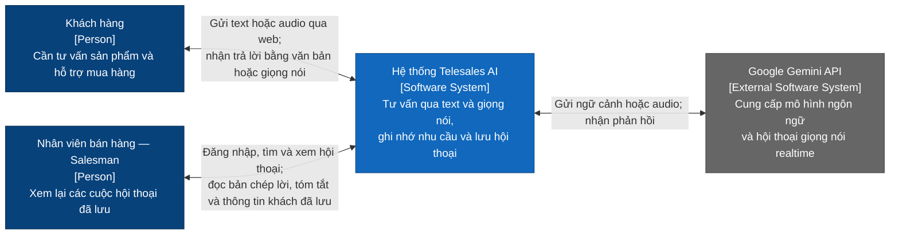
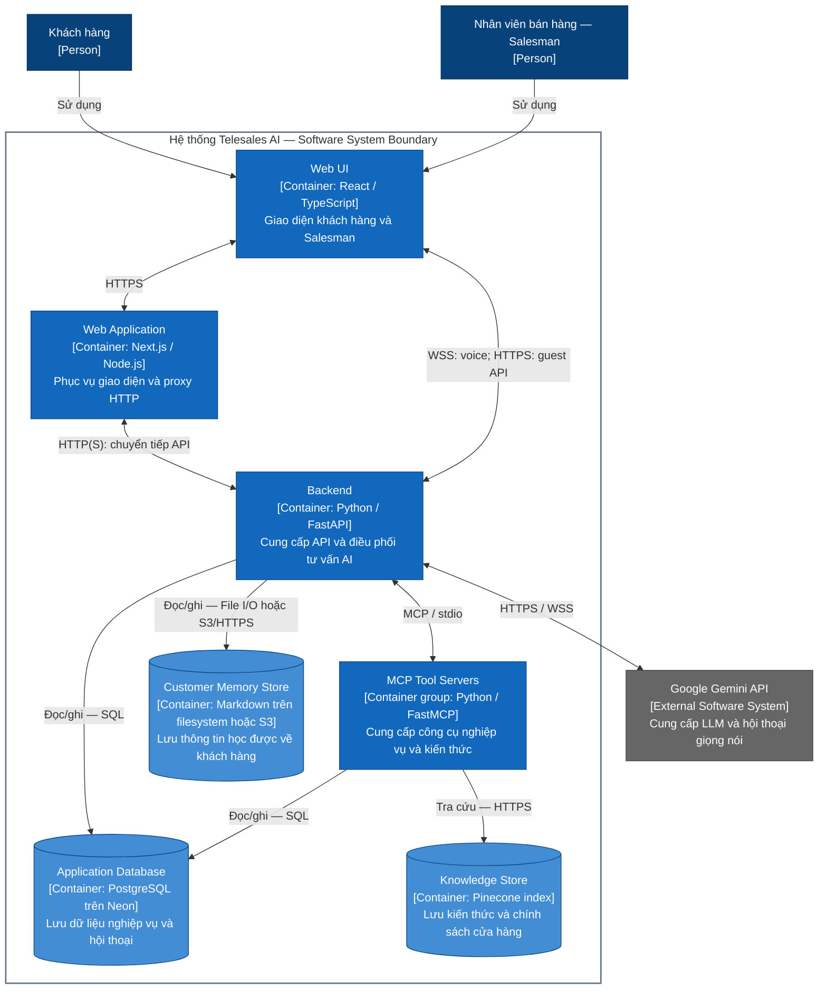
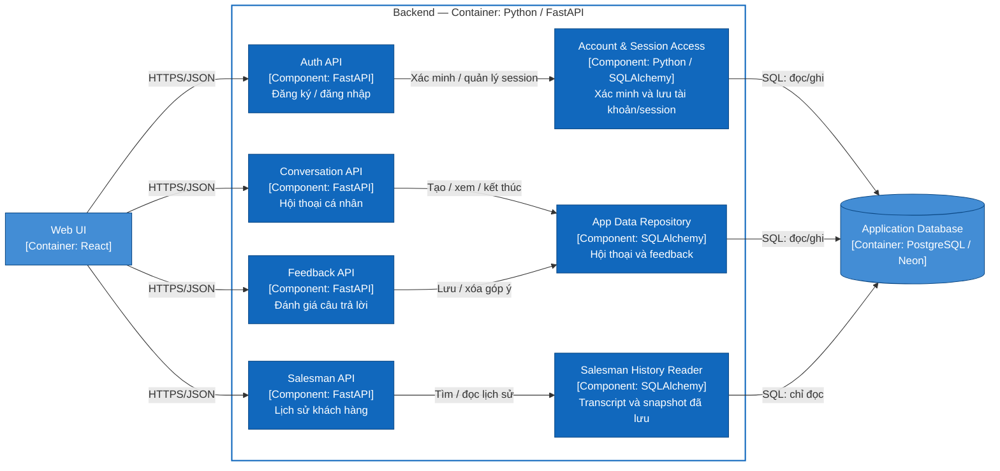
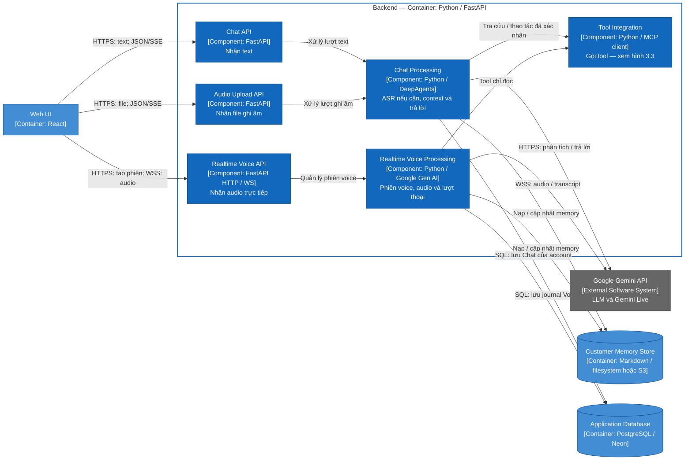
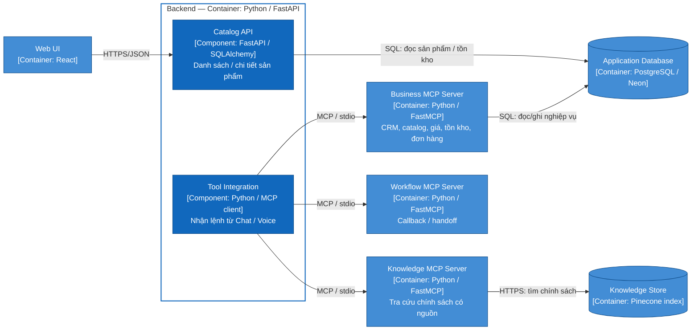

# Kiến trúc tổng quan hệ thống Telesales AI

## C4 — Level 1: System Context

Sơ đồ thể hiện người dùng tương tác với hệ thống và các dịch vụ bên ngoài hỗ trợ tư vấn bán hàng bằng tiếng Việt.

### Chức năng từng thành phần

| Thành phần | Chức năng |
| --- | --- |
| Khách hàng | Nhập thông tin nhận diện, hỏi đáp bằng text, gửi file ghi âm hoặc trò chuyện giọng nói realtime. |
| Nhân viên bán hàng — Salesman | Xem hội thoại Chat/Voice đã lưu, bản chép lời, tóm tắt và thông tin khách; chỉ có quyền xem. |
| Hệ thống Telesales AI | Nhận diện khách, tra cứu sản phẩm/giá/tồn kho/chính sách, tư vấn và ghi nhớ ngữ cảnh qua các lần tương tác. |
| Google Gemini API | Phân tích và sinh câu trả lời khi được cấu hình; Gemini Live nhận và trả audio cho hội thoại realtime. |

Database trên Neon, index trên Pinecone và kho customer memory do dự án quản lý thuộc phạm vi hệ thống. Chúng được mở rộng ở tầng Container bên dưới.

## C4 — Level 2: Container Diagram

Tầng này thể hiện các ứng dụng/process và kho dữ liệu của hệ thống: mỗi khối có công nghệ, trách nhiệm chính và giao thức kết nối. Cấu trúc được đối chiếu với code trong repository; cấu hình lưu trữ thực tế phụ thuộc môi trường deploy.

### Sơ đồ

### Chức năng từng container

| Container | Chức năng |
| --- | --- |
| Web UI | Chạy trong trình duyệt; cung cấp chat, nhập/phát audio và màn hình xem lịch sử cho Salesman. |
| Web Application | Chạy Next.js phía server; phục vụ trang/assets và chuyển tiếp HTTP API đến backend. |
| Backend | Xác thực, phân quyền, xử lý tư vấn text/voice và lưu kết quả hội thoại. |
| MCP Tool Servers | Cung cấp công cụ CRM, catalog, tồn kho, báo giá, đơn hàng, tra cứu chính sách, callback và handoff. |
| Application Database | Lưu catalog, CRM, đơn hàng, tài khoản, lịch sử Chat và journal Voice. |
| Knowledge Store | Lưu các đoạn kiến thức/chính sách để tìm kiếm phục vụ tư vấn. |
| Customer Memory Store | Lưu nhu cầu, sở thích và thông tin đã học qua nhiều cuộc hội thoại; dùng filesystem hoặc Neon Object Storage theo cấu hình. |

## C4 — Level 3: Component Diagram

Chia Backend thành **ba góc nhìn nhỏ**. Đọc từ **trái sang phải**: bên gọi → API → bộ phận xử lý → nơi lưu dữ liệu/dịch vụ được dùng. Mũi tên thể hiện quan hệ gọi/sử dụng; không phải toàn bộ thứ tự thực thi.

**API** nhận request; **Service** xử lý; **Repository/Adapter** đọc/ghi dữ liệu hoặc kết nối dịch vụ khác. Các hình chỉ giữ kết nối chính. Kiểm tra quyền dùng chung được ghi bằng chú thích để tránh đường nối chéo.

### 3.1. Tài khoản và lịch sử hội thoại

Đăng nhập đi qua bộ phận xác thực. Xem lịch sử, gửi feedback và màn hình Salesman đi qua repository để đọc/ghi database.

API lịch sử/feedback kiểm tra chủ tài khoản; Salesman API yêu cầu role `salesman`. Những kiểm tra này dùng chung dependency trong `auth.py`. Salesman chỉ đọc bản lưu, không chạy lại AI để tạo nội dung mới. HTTP của account được Next.js chuyển tiếp về backend.

### 3.2. Chat và Voice

Text và file ghi âm dùng chung pipeline Chat; file ghi âm được nhận dạng bằng ASR local. Voice realtime dùng bộ điều phối riêng, trao đổi audio với Gemini Live.

Chat Processing gom điều phối lượt, ASR, context, DeepAgent và adapter liên quan. Realtime Voice Processing gom SessionManager, Controller, Gemini Live adapter và các phần dùng chung. API kiểm tra session/role hoặc API key theo chế độ; Voice còn kiểm tra owner token/ticket. Voice không chạy DeepAgent cho từng audio chunk.

**Customer Memory Store** lưu thông tin học được để dùng lại qua nhiều cuộc gọi. **Application Database** lưu dữ liệu nghiệp vụ và transcript/checkpoint/journal để xem lại; cũng là database ở hình 3.1 và 3.3.

### 3.3. MCP tools và Catalog API

Tool Integration ở hình 3.2 gọi một trong ba MCP server. Catalog API phục vụ giao diện đọc sản phẩm trực tiếp từ PostgreSQL.

Ba MCP server là ba process con, nằm ngoài khung Backend FastAPI. Workflow hiện trả kết quả callback/handoff; chưa có hàng đợi bền vững hoặc gửi thông báo cho nhân viên. Tool đọc archive memory truy cập repository trực tiếp, không đi qua ba MCP server này.

Các component trong hình là nhóm trách nhiệm có thể bao gồm nhiều class/file; các hình giữ phụ thuộc chính thay vì toàn bộ lời gọi hàm. Các chức năng bên dưới được đối chiếu với code triển khai.

### 3.4. Danh sách component và chức năng

Các API là component tiếp nhận yêu cầu. Bảng này mô tả thêm các component xử lý, tích hợp và lưu dữ liệu phía sau API. Một số được gom trong Chat Processing hoặc Realtime Voice Processing trên sơ đồ để giữ hình dễ đọc.

| Component | Chức năng |
| --- | --- |
| Account & Session Access | Xác minh mật khẩu, tạo tài khoản, lưu/tra phiên đăng nhập và xử lý đăng xuất. |
| Authentication & Authorization | Kiểm tra session, role, Origin hoặc API key để xác định người gọi được phép làm gì; dùng chung giữa các API. |
| Chat Processing | Điều phối từng lượt text/file ghi âm: chuẩn bị ngữ cảnh, gọi agent, cập nhật memory và lưu kết quả của account. |
| Local ASR — trong Chat Processing | Chuyển file ghi âm tiếng Việt thành text tại backend bằng Zipformer/sherpa-onnx. |
| Customer & Turn Context — dùng chung Chat/Voice | Xác định khách, phân tích nhu cầu, nạp CRM/memory, tra cứu dữ liệu cần thiết và dựng bản tóm tắt ngữ cảnh CallBrief. |
| DeepAgent — trong Chat Processing | Dùng ngữ cảnh và các tool được cấp quyền để sinh câu trả lời tư vấn. |
| Realtime Voice Processing | Quản lý phiên microphone, trao đổi audio/transcript, xử lý ngắt lời, gọi tool chỉ đọc và hoàn tất lượt Voice. |
| LLM / Gemini Live Adapters | Kết nối mô hình AI: gửi nội dung để phân tích/sinh câu trả lời hoặc trao đổi audio realtime với Gemini Live. |
| Tool Integration | Khởi chạy/kết nối MCP, giữ danh sách tool, áp dụng quyền theo lượt/kênh và chuyển yêu cầu đến công cụ phù hợp. |
| Customer Memory Access & Persistence — dùng chung Chat/Voice | Đọc thông tin đã học của khách, phối hợp khóa ghi và commit cập nhật vào filesystem hoặc object storage. |
| App Data Repository | Đọc/ghi tài khoản, session, hội thoại, tin nhắn, checkpoint và feedback trong PostgreSQL theo chủ tài khoản. |
| Salesman History Reader | Tìm và đọc transcript, CallBrief, memory snapshot đã lưu; cung cấp dữ liệu cho màn hình Salesman. |
| Voice Journal Repository — trong luồng Voice | Lưu transcript từng lượt, trạng thái commit, batch memory chờ xử lý và snapshot để xem lại hoặc hỗ trợ phục hồi ghi memory. |
| CRM / Catalog Data Access | Tra hồ sơ khách, lịch sử đơn, sản phẩm, biến thể và tồn kho từ database nghiệp vụ. |

Account & Session Access và Authentication & Authorization là các nhóm trách nhiệm của module auth cùng repository, không phải hai service triển khai riêng. Customer Memory Access & Persistence là phần xử lý đọc/ghi; **Customer Memory Store** là nơi chứa dữ liệu. Tương tự, repository truy cập **Application Database**, không phải chính database.

#### Các MCP server hỗ trợ

Ba server dưới đây là process riêng bên ngoài Backend FastAPI; chức năng của chúng được tách rõ ở hình 3.3.

| Server | Chức năng |
| --- | --- |
| Business MCP Server | Cung cấp tool tra CRM, catalog, tồn kho, báo giá; tạo, theo dõi và cập nhật đơn hàng. |
| Knowledge MCP Server | Tìm chính sách liên quan, lọc tài liệu nội bộ/hết hạn và trả thông tin kèm nguồn. |
| Workflow MCP Server | Kiểm tra/điều chỉnh lịch gọi lại và tạo kết quả handoff; hiện chưa có hàng đợi hoặc gửi thông báo thực tế. |

Căn cứ: [`auth.py`](../src/telesale_agent/entrypoints/api/auth.py), [`deepagent/turn.py`](../src/telesale_agent/application/deepagent/turn.py), [`realtime/controller.py`](../src/telesale_agent/application/realtime/controller.py), [`customer_context.py`](../src/telesale_agent/application/customer_context.py), [`memory/coordinator.py`](../src/telesale_agent/application/memory/coordinator.py), [`adapters/db`](../src/telesale_agent/adapters/db), [`mcp_servers`](../src/mcp_servers).

### 3.5. Các component API và endpoint

Các component này nhận request, kiểm tra đầu vào và gọi các bộ phận xử lý tương ứng ở mục 3.4.

| Component | Endpoint hiện có | Chức năng |
| --- | --- | --- |
| Auth API | `POST /api/auth/register`, `POST /api/auth/login`, `GET /api/auth/me`, `POST /api/auth/logout` | Quản lý tài khoản và phiên đăng nhập. |
| Catalog API | `GET /api/catalog/products`, `GET /api/catalog/products/{sku}` | Đọc danh mục, biến thể và tồn kho từ PostgreSQL. |
| Chat API | `POST /api/chat` | Nhận text; trả JSON hoặc SSE theo request. |
| Audio Upload API | `POST /api/chat/audio` | Nhận file ghi âm và chuyển vào pipeline Chat có ASR local. |
| Realtime Voice API | `GET /api/voice/capabilities`; `POST /api/voice/sessions`; `GET`, `DELETE /api/voice/sessions/{session_id}`; `WS /api/voice/sessions/{session_id}/stream` | Kiểm tra khả năng Voice, quản lý phiên và trao đổi audio/events. |
| Conversation API | `POST`, `GET /api/conversations`; `GET /api/conversations/{conversation_id}`; `POST /api/conversations/{conversation_id}/end` | Quản lý hội thoại thuộc tài khoản đang đăng nhập. |
| Feedback API | `PUT`, `DELETE /api/messages/{message_id}/feedback` | Lưu hoặc xóa đánh giá/góp ý cho một câu trả lời. |
| Salesman API | `GET /api/salesman/conversations`, `GET /api/salesman/conversations/{source}/{conversation_id}` | Tìm và đọc bản lưu Chat/Voice, brief và memory snapshot. |
| System API | `GET /`, `GET /health`, `GET /api/health`; `DELETE /api/sessions/{conversation_id}` | Health check; xóa state phiên guest trong RAM. |

